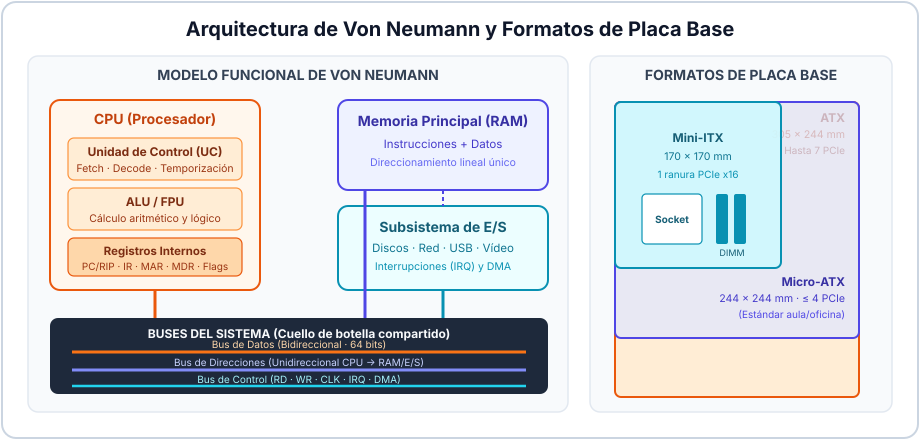
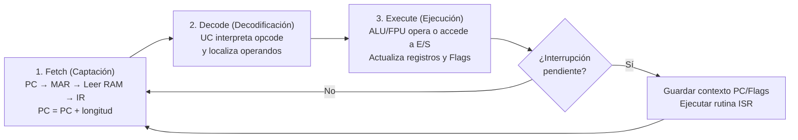

# Arquitectura de Von Neumann, Placa Base y CPU

> **Criterio de Evaluación cubierto:** `RA1.a` — *Se han reconocido los componentes físicos de un sistema informático y sus mecanismos de interconexión.*

---

## 1. Arquitectura de Von Neumann y Harvard Modificada

<!-- fuente: raw/procesados/ra1-hardware-cpu-placas.md -->

El modelo propuesto por **John von Neumann (1945)** establece la base de los ordenadores de propósito general actuales: tanto las **instrucciones del programa** como los **datos** que manipula residen en una misma **memoria principal** direccionable, sin necesidad de recablear la máquina para cambiar de tarea.



Sus cuatro bloques funcionales y sus mecanismos de interconexión son:

1. **Unidad Central de Proceso (CPU):** Interpreta y ejecuta las instrucciones.
2. **Memoria Principal (RAM):** Almacena temporalmente programas activos y datos.
3. **Subsistema de Entrada/Salida (E/S):** Conecta periféricos, almacenamiento secundario y redes.
4. **Buses del sistema:**
   - **Bus de Datos (bidireccional):** Transporta los bits de datos o instrucciones (64 bits por transferencia en CPUs modernas).
   - **Bus de Direcciones (unidireccional CPU → RAM/E/S):** Indica la posición exacta de memoria a leer o escribir. Su anchura $n$ determina el espacio teórico direccionable ($2^n$ posiciones).
   - **Bus de Control:** Transmite señales de sincronización y estado (`RD`, `WR`, reloj `CLK`, interrupciones `IRQ` y concesión de bus para `DMA`).

!!! warning "El cuello de botella de Von Neumann y la solución Harvard modificada"
    Como instrucciones y datos comparten un único bus principal hacia la RAM, la CPU pasa ciclos esperando transferencias. Para mitigarlo, los procesadores actuales aplican externamente el modelo **Von Neumann**, pero internamente usan una **arquitectura Harvard modificada** separando la caché de primer nivel en **L1i** (instrucciones) y **L1d** (datos), permitiendo leer código y operandos en paralelo.

---

## 2. La Placa Base (*Motherboard*) y sus Mecanismos de Interconexión

<!-- fuente: raw/procesados/ra1-hardware-cpu-placas.md -->

La placa base es el circuito impreso multicapa (PCB) que interconecta físicamente la CPU, la memoria, el almacenamiento y los buses de expansión.

### Formatos habituales

| Formato | Dimensiones | Ranuras PCIe típicas | Uso habitual |
| :--- | :---: | :---: | :--- |
| **ATX** | $305 \times 244\text{ mm}$ | Hasta 7 | Estaciones de trabajo, servidores torre, gaming |
| **Micro-ATX ($\mu$ATX)** | $244 \times 244\text{ mm}$ | Hasta 4 | Equipos de oficina y PCs de aula |
| **Mini-ITX** | $170 \times 170\text{ mm}$ | 1 (x16) | Mini-PCs, equipos compactos, laboratorios silenciosos |

### Componentes esenciales en la placa

- **Zócalo (*Socket*) de CPU:**
  - **LGA (*Land Grid Array*):** Pines en el zócalo de la placa y contactos planos en el procesador (Intel LGA 1700/1851, AMD AM5).
  - **PGA (*Pin Grid Array*):** Pines en la base de la CPU (AMD AM4).
  - **BGA (*Ball Grid Array*):** Procesador soldado directamente a la placa (portátiles y mini-PCs).
- **Chipset / PCH (*Platform Controller Hub*):** Circuito integrado que gestiona las comunicaciones secundarias (SATA, USB, audio, LAN, PCIe del chipset), conectado a la CPU mediante un enlace de alta velocidad (**DMI** o PCIe interno).
- **VRM (*Voltage Regulator Module*):** Conjunto de bobinas, condensadores y MOSFETs que transforman los $+12\text{ V}$ de la fuente en el voltaje preciso del procesador ($V_{\text{core}} \approx 0.8\text{–}1.4\text{ V}$).
- **Alimentación:** Conector principal **ATX de 24 pines** y conector auxiliar **EPS12V de 4 u 8 pines** dedicado a la CPU.

---

## 3. Estructura Interna del Procesador y Ciclo de Instrucción

<!-- fuente: raw/procesados/ra1-hardware-cpu-placas.md -->

### Bloques y registros internos de la CPU

- **Unidad de Control (UC):** Lee la instrucción de memoria, la decodifica y emite señales de control al resto del sistema siguiendo los pulsos del reloj.
- **ALU (*Arithmetic Logic Unit*) y FPU:** Ejecutan sumas/restas enteras, operaciones lógicas (`AND`, `OR`, `XOR`, desplazamientos) y cálculo en coma flotante / instrucciones vectoriales SIMD (`AVX2`, `NEON`).
- **Banco de registros (memoria ultrarrápida interna):**
  - **`PC` / `RIP` (*Program Counter* / *Instruction Pointer*):** Apunta a la dirección de memoria de la siguiente instrucción.
  - **`IR` (*Instruction Register*):** Almacena la instrucción actualmente en decodificación.
  - **`MAR` y `MDR`:** Conectan el procesador con los buses de direcciones y datos respectivamente.
  - **Registros de propósito general y `Flags`:** Almacenan operandos intermedios (`RAX`, `RBX`...) y banderas de resultado (cero `ZF`, acarreo `CF`, desbordamiento `OF`, interrupciones `IF`).

### Ciclo de instrucción (*Fetch–Decode–Execute*)



### Interrupciones y Acceso Directo a Memoria (DMA)

- **Interrupciones hardware (`IRQ` / `NMI`):** Permiten que un periférico (teclado, tarjeta de red, disco) avise a la CPU cuando tiene datos listos, evitando malgastar ciclos en espera activa (*polling*).
- **DMA (*Direct Memory Access*):** Controlador especializado que transfiere grandes bloques de datos directamente entre un dispositivo (NVMe, GPU, red) y la RAM sin que la CPU copie palabra a palabra.

### Conjuntos de instrucciones (ISA) y paralelismo

| Característica | Arquitectura CISC (`x86-64`) | Arquitectura RISC (`ARM64` / `RISC-V`) |
| :--- | :--- | :--- |
| **Longitud de instrucción** | Variable (1 a 15 bytes) | Fija (generalmente 32 bits) |
| **Acceso a memoria** | Algunas instrucciones operan directo sobre memoria | Modelo *load-store* (solo carga/almacén accede a RAM) |
| **Eficiencia y uso** | Alto rendimiento en PCs, servidores y aula MAX | Máxima eficiencia energética (móviles, portátiles ARM, IoT) |

- **Multinúcleo vs. SMT (*Hyper-Threading*):** Un procesador de 6 núcleos físicos puede exponer 12 hilos lógicos mediante *Simultaneous Multithreading*, duplicando los registros de contexto por núcleo para aprovechar unidades de ejecución ociosas.

---

## 4. Inspección Práctica en el Aula (MAX y VirtualBox)

<!-- fuente: raw/procesados/ra1-hardware-cpu-placas.md -->

En nuestro entorno de aula (**host MAX** + **VirtualBox**), podemos inspeccionar el hardware real y la virtualización asistida por hardware (`VT-x` / `AMD-V`) sin abrir el equipo:

=== "MAX / Ubuntu (Linux)"

    ```bash
    # Resumen completo de CPU, núcleos, cachés y soporte de virtualización
    lscpu

    # Fabricante, modelo y versión de la placa base (requiere privilegios)
    sudo dmidecode -t baseboard

    # Árbol hardware de procesador y placa
    sudo lshw -C cpu -C bus
    ```

    > **En VirtualBox sobre MAX:** Comprueba en `lscpu` que aparece `Virtualization: VT-x` (Intel) o `AMD-V` (AMD). Para las VMs del aula (equipos de 16 GB), asigna normalmente **2 vCPUs** sin superar los núcleos físicos reales del equipo anfitrión.

=== "Windows 10 / 11"

    ```powershell
    # Información de procesador y virtualización desde PowerShell
    Get-CimInstance Win32_Processor | Select-Object Name, NumberOfCores, NumberOfLogicalProcessors, MaxClockSpeed, VirtualizationFirmwareEnabled

    # Modelo de placa base y fabricante
    Get-CimInstance Win32_BaseBoard | Select-Object Manufacturer, Product, Version

    # Herramienta gráfica integrada de información del sistema
    msinfo32
    ```

    > **En una VM Windows de VirtualBox:** Verás el modelo del procesador físico heredado del host MAX, mientras que `Win32_BaseBoard` reportará placa base virtual `Oracle Corporation VirtualBox`.

---

## Laboratorio Interactivo: Placa Base Explorable

Para consolidar visualmente la ubicación real de los zócalos, ranuras PCIe, conectores ATX, chipset y puertos internos/externos antes de manipular un equipo en el taller, utiliza el recurso interactivo del módulo:

- [**Placa Base Explorable (`placa-base-explorable.mosqueteroweb.chatgpt.site`)**](https://placa-base-explorable.mosqueteroweb.chatgpt.site/): permite inspeccionar cada componente físico sobre la placa base, repasar sus buses asociados e identificar compatibilidades reales (factor de forma, zócalo de CPU, tipo de RAM y ranuras de expansión).

---

## Fases de Ejecución de una Instrucción Máquina y Registros Implicados

Aunque los ordenadores actuales ejecutan miles de millones de operaciones por segundo, todas se reducen a encadenar **instrucciones máquina** elementales almacenadas en la **Memoria Principal (`MP`)** siguiendo el esquema de registros de la **Unidad de Control (`UC`)** y la **Unidad Aritmético-Lógica (`UAL`)**:

1. **Búsqueda (*Fetch*):** La **UC** envía a la **MP** la dirección de la siguiente instrucción a ejecutar, contenida en el **Contador de Programa (`PC`)**, y activa las señales de control de lectura para que la **MP** entregue la instrucción por el bus de datos.
2. **Decodificación y búsqueda de operandos (*Decode*):** La **UC** recibe la instrucción y la almacena en el **Registro de Instrucción (`IR`)**, la interpreta y, si necesita datos de memoria, envía sus direcciones a través del **Registro de Direcciones de Memoria (`MAR`)** activando de nuevo las señales de control de lectura.
3. **Ejecución (*Execute*):** La **UAL**, bajo las órdenes de la **UC**, ejecuta la operación sobre los operandos y guarda el resultado en un registro interno o en la **MP**.
4. **Actualización del `PC`:** Finalizada la instrucción, el **Contador de Programa (`PC`)** se incrementa para apuntar automáticamente a la instrucción siguiente.

Este ciclo lineal forma un **programa**. Para romper la ejecución secuencial (bucles o condicionales `if/else`) existen instrucciones de **bifurcación** capaces de sobreescribir el contenido del `PC` con una nueva dirección de salto. Para que un programa de alto nivel (por ejemplo en Java) llegue a ejecutarse:

- Debe haberse traducido previamente a **lenguaje máquina** mediante un **compilador** (o bytecode + JIT/intérprete).
- El ejecutable y sus datos deben cargarse desde el almacenamiento secundario hacia la **Memoria Principal (`MP`)**, tarea que realiza el **Cargador del Sistema Operativo**.
- El **Contador de Programa (`PC`)** debe inicializarse con la dirección en **MP** de la **primera instrucción** del programa.

---

## Comparativa de Arquitecturas de 32 bits frente a 64 bits

La diferencia esencial entre una arquitectura de 32 bits y una de 64 bits radica en el **tamaño de la palabra** (la unidad de datos y ancho de registros/direcciones que el procesador maneja de forma nativa en cada ciclo):

| Característica | Arquitectura de 32 bits (`x86`) | Arquitectura de 64 bits (`x86_64` / `amd64`) |
| :--- | :--- | :--- |
| **Tamaño de palabra / registros** | 32 bits por registro general | 64 bits por registro general |
| **Memoria RAM direccionable** | Límite teórico de $2^{32}$ bytes = **4 GB** | Límite teórico de $2^{64}$ bytes (**16 exabytes**; limitado en SO/hardware actuales a TB) |
| **Precisión y rendimiento** | Menor ancho de bus interno; opera enteros de 64 bits en varios ciclos | Mayor rendimiento paralelo y precisión directa sobre enteros grandes |
| **Compatibilidad software** | Limitada a ejecutables de 32 bits (y 16 bits antiguos) | Mantiene compatibilidad hacia atrás con la mayoría del software de 32 bits |
| **Uso recomendado** | Sistemas embebidos ligeros o equipos heredados con poca RAM | Equipos de escritorio modernos, servidores, virtualización y desarrollo DAM |

---

## Recursos para profundizar

- **Documentación oficial y referencia técnica:**
  - [Página de manual oficial de `lscpu(1)` (man7.org)](https://man7.org/linux/man-pages/man1/lscpu.1.html)
  - [Microsoft Learn: Clase CIM `Win32_Processor`](https://learn.microsoft.com/en-us/windows/win32/cimwin32prov/win32-processor)
  - [Arquitectura de Von Neumann (Wikipedia en español)](https://es.wikipedia.org/wiki/Arquitectura_de_Von_Neumann)
- **Vídeos explicativos recomendados (YouTube):**
  - [Arquitectura de Von Neumann y funcionamiento del computador](https://www.youtube.com/watch?v=oEhTtQI9RN8)
  - [Cuello de botella de Von Neumann y arquitectura Harvard](https://www.youtube.com/watch?v=oH7vNuKyCPA)
- **Práctica relacionada en `wikiSI`:** [Ejercicio e01 · Auditoría de hardware, CPU y placa base](../ejercicios/e01-ra1-auditoria-hardware-cpu-placas.md)
