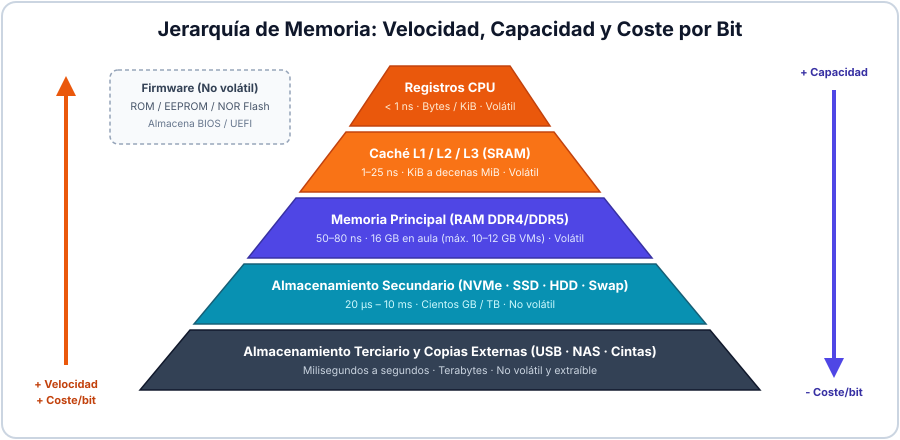

# Jerarquía de Memorias y Tipos de Memoria

> **Criterio de Evaluación cubierto:** `RA1.b` — *Se han clasificado los tipos de memorias, señalando sus características e identificando sus prestaciones y la función que desarrollan en el conjunto del sistema.*

---

## 1. El Dilema Velocidad–Capacidad–Coste y Principio de Localidad

<!-- fuente: raw/procesados/ra1-memorias-arranque-perifericos.md -->

Sería inviable fabricar un ordenador con 2 TB de memoria tan rápida como los registros de la CPU por su altísimo coste por bit, consumo energético y distancia física al silicio. La solución es organizar la memoria en una **jerarquía piramidal**, aprovechando el **principio de localidad**:

- **Localidad temporal:** Si un programa accede a una instrucción o variable, es muy probable que vuelva a usarla en breve (bucles, contadores).
- **Localidad espacial:** Si se accede a una dirección de memoria, es probable que las siguientes instrucciones lean direcciones contiguas (recorrido de arrays, flujo secuencial de código).



---

## 2. Memorias Volátiles (Requieren Alimentación Eléctrica)

<!-- fuente: raw/procesados/ra1-memorias-arranque-perifericos.md -->

### A. Registros y Caché SRAM (*Static RAM*)

- **Registros:** Integrados dentro de cada núcleo de la CPU. Latencia inferior a 1 ns (1 ciclo de reloj). Capacidad de pocos cientos de bytes o kilobytes.
- **Caché SRAM:** Fabricada con circuitos biestables (habitualmente 6 transistores por bit), **no necesita ciclos de refresco**. Actúa como puente ultrarrápido entre la CPU y la RAM:
  - **L1 (32–64 KiB/núcleo):** Dividida en `L1i` (instrucciones) y `L1d` (datos), ~1 ns.
  - **L2 (256 KiB–2 MiB/núcleo):** Unificada por núcleo, ~3–10 ns.
  - **L3 (8–96 MiB):** Compartida entre todos los núcleos del encapsulado, ~15–30 ns.


### B. Memoria Principal DRAM (*Dynamic RAM*)

Fabricada con un transistor y un diminuto condensador por bit: es muchísimo más densa y barata que la SRAM, pero los condensadores se descargan y requieren **refresco eléctrico continuo** cada pocos milisegundos. Almacena los programas y datos activos en ejecución.

| Generación | Tasa de transferencia típica | Voltaje | Notas técnicas clave |
| :--- | :---: | :---: | :--- |
| **DDR3** | 1066 – 2133 MT/s | 1.5 V / 1.35 V | Equipos antiguos |
| **DDR4** | 2133 – 3200 MT/s | 1.2 V | Muy extendida en aulas y estaciones actuales (288 pines DIMM) |
| **DDR5** | 4800 – 6400+ MT/s | 1.1 V | Doble subcanal de 32 bits por módulo y PMIC integrado en el módulo |

- **Formatos físicos:** **DIMM** (sobremesa/torre) frente a **SO-DIMM** (portátiles y mini-PCs compactos).
- **Canales (*Single* vs. *Dual Channel*):** Instalar dos módulos emparejados activa el acceso en **Dual Channel** (bus de 128 bits efectivos en lugar de 64 bits), duplicando el ancho de banda teórico:
  $$\text{Ancho de banda teórico} \approx \text{MT/s} \times 8\text{ bytes} \times \text{n.º canales}$$
  *Ejemplo:* 2 módulos DDR4-3200 en Dual Channel $\rightarrow 3200 \times 8 \times 2 = 51{,}2\text{ GB/s}$.
- **Latencia CAS (`CL`) y ECC:** El parámetro `CL` indica cuántos ciclos de reloj tarda en entregarse la primera palabra tras solicitar una columna. La memoria **ECC (*Error-Correcting Code*)** añade bits de paridad para detectar y corregir fallos de 1 bit en servidores críticos.

---

## 3. Memorias No Volátiles (Conservan los Datos sin Corriente)

<!-- fuente: raw/procesados/ra1-memorias-arranque-perifericos.md -->

| Tipo | Grabación y borrado | Uso principal en el sistema |
| :--- | :--- | :--- |
| **ROM** | Grabada de fábrica, solo lectura | Firmware inmutable en sistemas embebidos clásicos |
| **PROM / EPROM** | Programable una vez / borrable con luz ultravioleta | Sistemas industriales y microcontroladores antiguos |
| **EEPROM** | Borrable y regrabable eléctricamente por byte | Almacenamiento de pequeñas tablas de configuración y calibración |
| **Flash NOR** | Acceso aleatorio rápido de lectura, borrado por bloques | Chip SPI en placa base que contiene el firmware **BIOS / UEFI** |
| **Flash NAND** | Altísima densidad y menor coste/GB (SLC, MLC, TLC, QLC) | Discos **SSD**, **NVMe**, tarjetas microSD y pendrives USB |

---

## 4. Memoria Virtual, Paginación y Presupuesto de RAM en el Aula

<!-- fuente: raw/procesados/ra1-memorias-arranque-perifericos.md -->

El sistema operativo combina la RAM física con espacio en disco mediante **memoria virtual** (organizada en páginas de 4 KiB habitualmente) para proteger procesos entre sí y absorber picos de demanda:

- En **MAX / Ubuntu (Linux):** se utiliza una partición o archivo de intercambio (**Swap**).
- En **Windows 10 / 11:** se utiliza el archivo oculto **`C:\pagefile.sys`**.

!!! danger "Presupuesto obligatorio de RAM en las prácticas del aula (Equipos de 16 GB)"
    Cuando la RAM física se agota y el sistema comienza a mover páginas continuamente entre RAM y disco (*thrashing* o paginación excesiva), el rendimiento se desploma. En los ordenadores de **16 GB del aula**:
    
    - **Reserva obligatoria para el anfitrión MAX:** al menos **4–6 GB**.
    - **Presupuesto máximo simultáneo para VirtualBox:** **10–12 GB sumando todas las VMs encendidas**.

---

## 5. Comprobación de Memorias en el Sistema

=== "MAX / Ubuntu (Linux)"

    ```bash
    # Uso de RAM física, caché de páginas (buff/cache) y Swap
    free -h

    # Niveles de caché del procesador
    lscpu | grep -i cache

    # Detalle físico de módulos DIMM/SO-DIMM instalados (velocidad, fabricante, ranura)
    sudo dmidecode -t memory | grep -E "Size:|Type:|Speed:|Locator:"

    # Estado del intercambio (Swap)
    swapon --show
    ```

=== "Windows 10 / 11"

    ```powershell
    # Módulos físicos de RAM, capacidad en GB, velocidad en MHz/MT/s y factor de forma
    Get-CimInstance Win32_PhysicalMemory | Select-Object DeviceLocator, @{N='Capacidad_GB';E={$_.Capacity/1GB}}, ConfiguredClockSpeed, SMBIOSMemoryType

    # Archivo de paginación activo (pagefile.sys)
    Get-CimInstance Win32_PageFileUsage | Select-Object Name, AllocatedBaseSize, CurrentUsage
    ```

    También puedes consultar en el **Administrador de tareas** (`Ctrl + Shift + Esc`) $\rightarrow$ pestaña **Rendimiento** $\rightarrow$ **Memoria** las ranuras usadas, velocidad y caché de hardware.

---

## Representación Binaria, Coma Flotante IEEE 754 y Tipos de Datos Primitivos en Java

Comprender cómo reserva la memoria principal (**RAM**) cada byte en binario permite entender directamente por qué los lenguajes de programación tipados como **Java** (que utilizas en *Programación* de 1.º DAM) tienen rangos exactos y errores de redondeo en coma flotante:

| Tipo en Java | Tamaño (bits) | Rango de valores aproximado | Uso común y nota de representación |
| :--- | :---: | :--- | :--- |
| **`byte`** | 8 (1 B) | `-128` a `127` | Enteros muy pequeños (complemento a 2) |
| **`short`** | 16 (2 B) | `-32.768` a `32.767` | Enteros de tamaño medio |
| **`int`** | 32 (4 B) | `-2.147.483.648` a `2.147.483.647` | Entero estándar por defecto |
| **`long`** | 64 (8 B) | `-9.223.372.036.854.775.808` a `9.223.372.036.854.775.807` | Enteros muy grandes (marcas temporales, IDs) |
| **`float`** | 32 (4 B) | Aprox. $\pm 3{,}4028235 \times 10^{38}$ | Coma flotante IEEE 754 precisión simple: **1** bit signo + **8** bits exponente + **23** bits mantisa |
| **`double`** | 64 (8 B) | Aprox. $\pm 1{,}7976931348623157 \times 10^{308}$ | Coma flotante IEEE 754 precisión doble: **1** bit signo + **11** bits exponente + **52** bits mantisa |
| **`char`** | 16 (2 B) | `\u0000` a `\uffff` (0 a 65.535) | Carácter Unicode (UTF-16) |
| **`boolean`** | 1 bit lógico (alineado a 1 B) | `true` / `false` | Banderas lógicas y condiciones |

> [!TIP]
> **De los 64 bits a la cuantización de 1 bit en Inteligencia Artificial:** Mientras que en programación clásica reducimos el tamaño de las variables (`double` $\rightarrow$ `float`) para ahorrar RAM, en los grandes modelos de lenguaje actuales (LLMs como *BitNet* o modelos ternarios/binarios de 1 bit) la misma idea de **cuantización extrema** reduce pesos de 16/32 bits a valores de 1,58 bits o 1 bit para que quepan en menor VRAM y consuman menos energía en memoria. Puedes ver esta conexión explicada en el vídeo de clase: [Modelos de IA de 1 bit y fundamentos binarios (YouTube)](https://youtu.be/Ne5K7V0U77M).

---

## Recursos para profundizar

- **Documentación oficial y referencia técnica:**
  - [Linux Kernel Memory Management Documentation](https://docs.kernel.org/admin-guide/mm/index.html)
  - [Página de manual oficial de `free(1)` (man7.org)](https://man7.org/linux/man-pages/man1/free.1.html)
  - [Microsoft Learn: Clase CIM `Win32_PhysicalMemory`](https://learn.microsoft.com/en-us/windows/win32/cimwin32prov/win32-physicalmemory)
- **Vídeos explicativos recomendados (YouTube):**
  - [Jerarquía de memoria: registros, caché SRAM, RAM y almacenamiento](https://www.youtube.com/watch?v=adCVlwpIoTs)
- **Práctica relacionada en `wikiSI`:** [Ejercicio e02 · Análisis de la jerarquía de memorias en MAX y VirtualBox](../ejercicios/e02-ra1-analisis-jerarquia-memorias.md)
