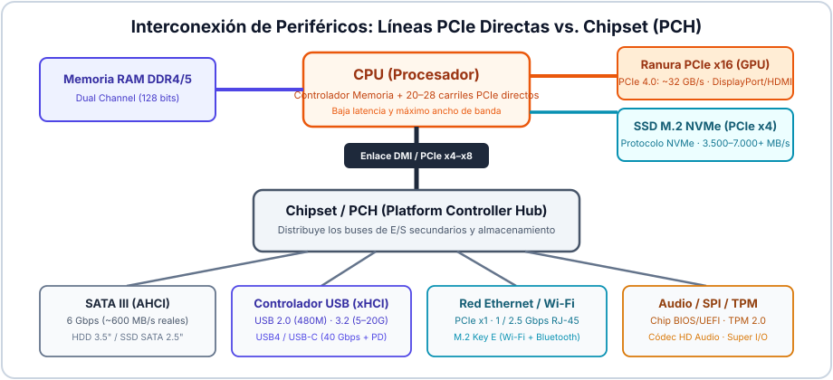
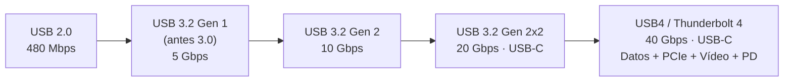

# Periféricos, Interfaces de Entrada/Salida y Buses

> **Criterios de Evaluación cubiertos:** `RA1.a` y `RA1.d` — *Se han clasificado, instalado y configurado diferentes tipos de dispositivos periféricos.*

---

## 1. Clasificación Funcional de Periféricos

<!-- fuente: raw/procesados/ra1-memorias-arranque-perifericos.md -->

Los periféricos permiten intercambiar información entre el usuario o el exterior y el núcleo del sistema (CPU + RAM) a través de **controladores** y **buses de E/S**:

| Categoría | Función | Ejemplos habituales en el aula DAM |
| :--- | :--- | :--- |
| **Entrada (E)** | Introducen datos al sistema | Teclado, ratón, escáner, lector de códigos, micrófono, webcam |
| **Salida (S)** | Muestran resultados al usuario | Monitor (HDMI/DisplayPort), impresora, altavoces |
| **Entrada/Salida (E/S)** | Almacenamiento o comunicación bidireccional | SSD NVMe/SATA, pendrive USB, tarjeta de red Ethernet/Wi-Fi, pantalla táctil |

---

## 2. Buses Internos y Almacenamiento: PCIe, SATA III y M.2 NVMe

<!-- fuente: raw/procesados/ra1-memorias-arranque-perifericos.md -->

Es fundamental no confundir el **formato físico del conector** (por ejemplo, M.2 o USB-C) con el **bus y protocolo lógico** que circula por su interior (PCIe/NVMe frente a SATA/AHCI).



### A. PCI Express (PCIe)

Bus serie punto a punto con enlaces bidireccionales simultáneos (*full-duplex*) agrupados en **carriles (*lanes*)**: `x1`, `x4`, `x8` y `x16`. La CPU gestiona directamente las líneas críticas (tarjeta gráfica `x16` y ranura M.2 principal `x4`), mientras el **Chipset (PCH)** distribuye carriles adicionales para red, audio o ranuras secundarias.

| Versión PCIe | Ancho de banda por 1 carril (`x1`) | Enlace SSD típico (`x4`) | Ranura gráfica (`x16`) |
| :--- | :---: | :---: | :---: |
| **PCIe 3.0** | ~1 GB/s | ~4 GB/s | ~16 GB/s |
| **PCIe 4.0** | ~2 GB/s | ~8 GB/s | ~32 GB/s |
| **PCIe 5.0** | ~4 GB/s | ~16 GB/s | ~64 GB/s |

### B. SATA III vs. M.2 NVMe

- **SATA III (6 Gbps):** Utiliza el protocolo **AHCI** (heredado de discos mecánicos con 1 cola de 32 comandos). Su techo real ronda los **550–600 MB/s**, lo que limita a los SSD modernos de 2,5 pulgadas.
- **NVMe (*Non-Volatile Memory Express*):** Protocolo diseñado específicamente para memoria flash conectado directamente al bus **PCIe** (habitualmente mediante formato compacto **M.2** con clave `M`). Admite hasta **64.000 colas con 64.000 comandos cada una**, alcanzando **3.500–7.000+ MB/s** y latencias mucho menores.

---

## 3. Puertos Externos: Evolución USB y Conectores de Vídeo

<!-- fuente: raw/procesados/ra1-memorias-arranque-perifericos.md -->

### Estándares USB (*Universal Serial Bus*)



- **Conector vs. protocolo:** El conector reversible **USB-C** puede transportar solo USB 2.0 o llegar hasta **USB4 / Thunderbolt 4 (40 Gbps)**, además de entregar carga eléctrica (**USB Power Delivery** hasta 100–240 W) y señal de vídeo (**DisplayPort Alt Mode**).
- **Vídeo:** **DisplayPort (1.4/2.1)** destaca en monitores profesionales y soporta encadenamiento de varios monitores (*MST*); **HDMI (2.0/2.1)** domina en pantallas, televisores y proyectores de aula transportando vídeo y audio digital.

---

## 4. Controladores (*Drivers*), Instalación y VirtualBox

<!-- fuente: raw/procesados/ra1-memorias-arranque-perifericos.md -->

Un **controlador (*driver*)** es el software del núcleo que traduce las órdenes genéricas del sistema operativo al lenguaje específico del dispositivo hardware.

=== "MAX / Ubuntu (Linux)"

    - La gran mayoría de controladores vienen integrados como **módulos del kernel Linux** (`lsmod`), y el subsistema **`udev`** crea automáticamente los archivos de dispositivo bajo `/dev/`.
    - Las impresoras de red o USB se gestionan mediante el servidor de impresión **CUPS** (`http://localhost:631`).

    ```bash
    # Ver topología en árbol de buses PCIe y drivers cargados (-nnk)
    lspci -tv
    lspci -nnk

    # Ver árbol de controladores y dispositivos USB conectados
    lsusb -tv

    # Listar discos e interfaz de transporte (sata, nvme, usb)
    lsblk -o NAME,SIZE,TYPE,TRAN,MODEL

    # Últimos eventos del kernel al conectar un periférico USB
    sudo dmesg | tail -n 20
    ```

=== "Windows 10 / 11"

    - Los controladores se administran desde **`devmgmt.msc`** (*Administrador de dispositivos*) o por línea de comandos con **`pnputil`** y Windows Update.
    - Windows 10/11 exige **controladores firmados digitalmente** para evitar malware en modo kernel.

    ```powershell
    # Listar dispositivos conectados por clase y estado
    Get-PnpDevice -PresentOnly | Select-Object Class, FriendlyName, Status

    # Inspeccionar paquetes de drivers de terceros instalados en el almacén
    pnputil /enum-drivers
    ```

### Conexión de periféricos en Oracle VirtualBox (Aula MAX)

1. **Passthrough USB:** Para pasar un pendrive conectado al host MAX directamente a una VM, entra en *Configuración de la VM → USB*, activa el controlador **USB 3.0 (xHCI)** (requiere *Extension Pack* en el host) y añade un filtro para tu dispositivo. Además, tu usuario en MAX debe pertenecer al grupo `vboxusers`.
2. **Guest Additions:** Instalar las *Guest Additions* dentro del SO invitado habilita controladores paravirtualizados para redimensionar pantalla, portapapeles bidireccional y **carpetas compartidas** entre MAX y la VM.

---

## Recursos para profundizar

- **Documentación oficial y referencia técnica:**
  - [Linux Kernel USB Documentation](https://docs.kernel.org/usb/index.html)
  - [Página de manual oficial de `lspci(8)` (man7.org)](https://man7.org/linux/man-pages/man8/lspci.8.html)
  - [Microsoft Learn — Herramienta de drivers `pnputil`](https://learn.microsoft.com/en-us/windows-hardware/drivers/devtest/pnputil)
- **Vídeos explicativos recomendados (YouTube):**
  - [Conectores, buses y protocolos de E/S: USB, SATA, PCIe y NVMe](https://www.youtube.com/watch?v=0BeqIqB8Z9g)
  - [Por qué NVMe sobre PCIe supera a SATA: explicado paso a paso](https://www.youtube.com/watch?v=x7QOiNsajyA)
- **Práctica relacionada en `wikiSI`:** [Ejercicio e04 · Inventario de buses PCIe/USB y periféricos en VirtualBox](../ejercicios/e04-ra1-inventario-perifericos-buses-usb.md)
