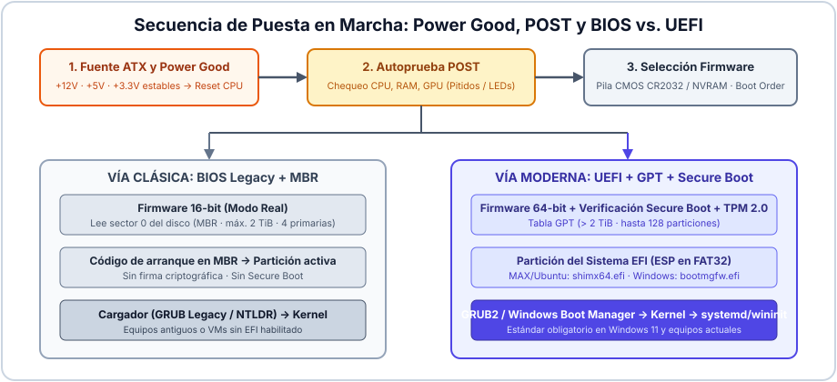
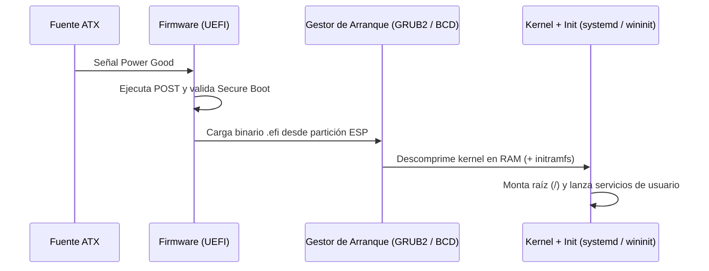

# Puesta en Marcha del Equipo: POST, BIOS Legacy y UEFI

> **Criterio de Evaluación cubierto:** `RA1.c` — *Se ha verificado el proceso de puesta en marcha de un equipo.*

---

## 1. De la Pulsación del Botón al POST

<!-- fuente: raw/procesados/ra1-memorias-arranque-perifericos.md -->

Cuando pulsas el botón de encendido de la caja, el equipo no carga inmediatamente el sistema operativo; primero ejecuta una secuencia hardware y de firmware estrictamente ordenada:



1. **Estabilización eléctrica y señal *Power Good*:** La fuente ATX recibe la señal `PS_ON#` de la placa base y suministra las tensiones de trabajo (+12 V, +5 V, +3,3 V). Cuando las salidas son estables (en unos ~100–500 ms), envía la señal **Power Good** (`PWR_OK`), liberando el pin *Reset* de la CPU para que ejecute su primera instrucción desde el chip Flash SPI de la placa.
2. **Autoprueba de encendido (POST — *Power-On Self-Test*):** El firmware comprueba que la CPU, los registros, el controlador de memoria RAM, la tarjeta gráfica y los controladores básicos responden correctamente.
   - Si aparece un fallo grave antes de poder inicializar la pantalla, la placa informa mediante **códigos de pitidos (*beep codes*)** en el altavoz interno o **LEDs de diagnóstico** (`CPU`, `DRAM`, `VGA`, `BOOT`).
   - *Ejemplo orientativo (varía según fabricante AMI/Award/Phoenix):* 1 pitido corto suele indicar POST correcto; pitidos largos repetidos o código continuo suelen indicar ausencia o mal contacto de memoria RAM o tarjeta gráfica.
3. **Configuración CMOS / NVRAM y pila CR2032:** Una pila botón de litio de 3 V (**CR2032**) mantiene alimentado el reloj en tiempo real (RTC) y los parámetros básicos en la memoria CMOS/NVRAM cuando el equipo se desconecta de la red eléctrica. Si se agota la pila, el reloj se atrasa a la fecha de fábrica y pueden perderse ajustes del orden de arranque.

---

## 2. BIOS Legacy vs. UEFI

<!-- fuente: raw/procesados/ra1-memorias-arranque-perifericos.md -->

| Característica | BIOS Legacy (Clásica) | UEFI (*Unified Extensible Firmware Interface*) |
| :--- | :--- | :--- |
| **Modo de ejecución** | 16 bits (modo real, máx. 1 MiB inicial) | 32 o 64 bits (arquitectura modular con drivers propios) |
| **Tabla de particiones estándar** | **MBR** (*Master Boot Record*) | **GPT** (*GUID Partition Table*) |
| **Límite de tamaño de disco** | Hasta **2 TiB** | Más de **2 TiB** (hasta 9,4 ZiB teóricos) |
| **Número de particiones** | Máximo 4 primarias (o 3 + 1 extendida) | Hasta **128 particiones** estándar (sin extendidas/lógicas) |
| **Partición de arranque** | Sector 0 (primeros 446 bytes + código VBR) | **Partición del Sistema EFI (ESP)** en FAT32 (`/boot/efi`) |
| **Seguridad en arranque** | Sin validación criptográfica | **Secure Boot** (verifica firmas digitales) + soporte **TPM 2.0** |
| **Interfaz** | Solo texto y teclado | Gráfica, ratón, acceso a red (PXE/HTTPS) |

!!! tip "Windows 11 en VirtualBox"
    A diferencia de Windows 10 o Ubuntu (que pueden funcionar tanto en BIOS Legacy como en UEFI), **Windows 11 exige oficialmente modo UEFI, Secure Boot y chip TPM 2.0**. En VirtualBox se activan desde *Configuración → Sistema → Placa base → Habilitar EFI (solo SO especiales)* y seleccionando *TPM 2.0* y *Habilitar arranque seguro*.

---

## 3. Cadena de Arranque del Sistema Operativo

<!-- fuente: raw/procesados/ra1-memorias-arranque-perifericos.md -->



=== "MAX / Ubuntu (Linux)"

    1. El firmware UEFI lee la NVRAM y lanza `/EFI/ubuntu/shimx64.efi` (firmado para *Secure Boot*), que a su vez carga **`grubx64.efi`** (**GRUB 2**).
    2. GRUB 2 muestra el menú de selección de sistema y carga en RAM el núcleo de Linux (`vmlinuz`) junto al sistema de archivos inicial en memoria (`initramfs`).
    3. El kernel detecta el hardware, monta el sistema de archivos raíz real (`/`) y ejecuta el proceso inicial **`systemd` (PID 1)**, que levanta la red y el entorno gráfico de MAX.

    **Verificación desde terminal en MAX / Ubuntu:**
    ```bash
    # Confirmar si el equipo arrancó en modo UEFI o BIOS Legacy
    [ -d /sys/firmware/efi ] && echo "Modo: UEFI" || echo "Modo: BIOS Legacy"

    # Consultar entradas de arranque almacenadas en la NVRAM UEFI
    efibootmgr -v

    # Medir el tiempo de arranque (firmware, cargador, kernel y espacio de usuario)
    systemd-analyze
    ```

=== "Windows 10 / 11"

    1. El firmware UEFI ejecuta `\EFI\Microsoft\Boot\bootmgfw.efi` (**Windows Boot Manager**).
    2. El gestor lee la base de datos de configuración de arranque (**BCD**) y lanza `winload.efi`.
    3. Se carga el núcleo de Windows (**`ntoskrnl.exe`**), la capa de abstracción de hardware (`hal.dll`) y el subsistema de sesión (`smss.exe` → `wininit.exe`), iniciando los servicios y el escritorio.

    **Verificación desde PowerShell (Administrador) en Windows 10/11:**
    ```powershell
    # Comprobar si Secure Boot está activo (solo existe en modo UEFI)
    Confirm-SecureBootUEFI

    # Listar entradas de arranque UEFI en el almacén BCD
    bcdedit /enum firmware
    ```

---

## Recursos para profundizar

- **Documentación oficial y referencia técnica:**
  - [UEFI Forum — Especificaciones oficiales UEFI](https://uefi.org/specifications)
  - [Arch Wiki — Proceso de arranque en Linux (BIOS y UEFI)](https://wiki.archlinux.org/title/Arch_boot_process)
  - [Microsoft Learn — Configuración del almacén BCD para UEFI](https://learn.microsoft.com/en-us/windows-hardware/manufacture/desktop/bcd-system-store-settings-for-uefi)
- **Vídeos explicativos recomendados (YouTube):**
  - [Qué pasa al encender el ordenador: POST, BIOS, UEFI y Bootloader](https://www.youtube.com/watch?v=lTooitSRwUY)
  - [Diferencias entre BIOS Legacy y UEFI explicadas paso a paso](https://www.youtube.com/watch?v=Kz6rnn-FFYk)
- **Práctica relacionada en `wikiSI`:** [Ejercicio e03 · Verificación del arranque UEFI/BIOS y análisis de tiempos](../ejercicios/e03-ra1-verificacion-arranque-uefi-bios.md)
