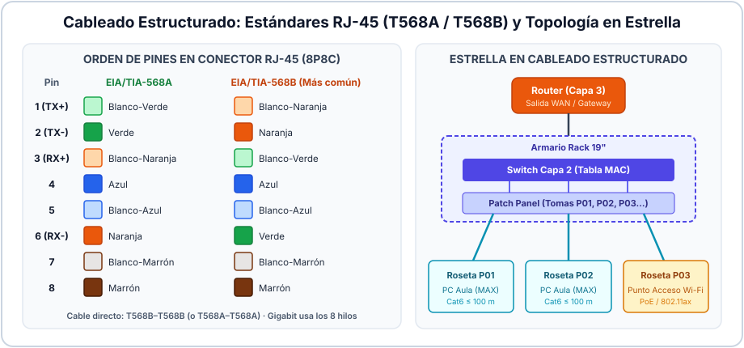
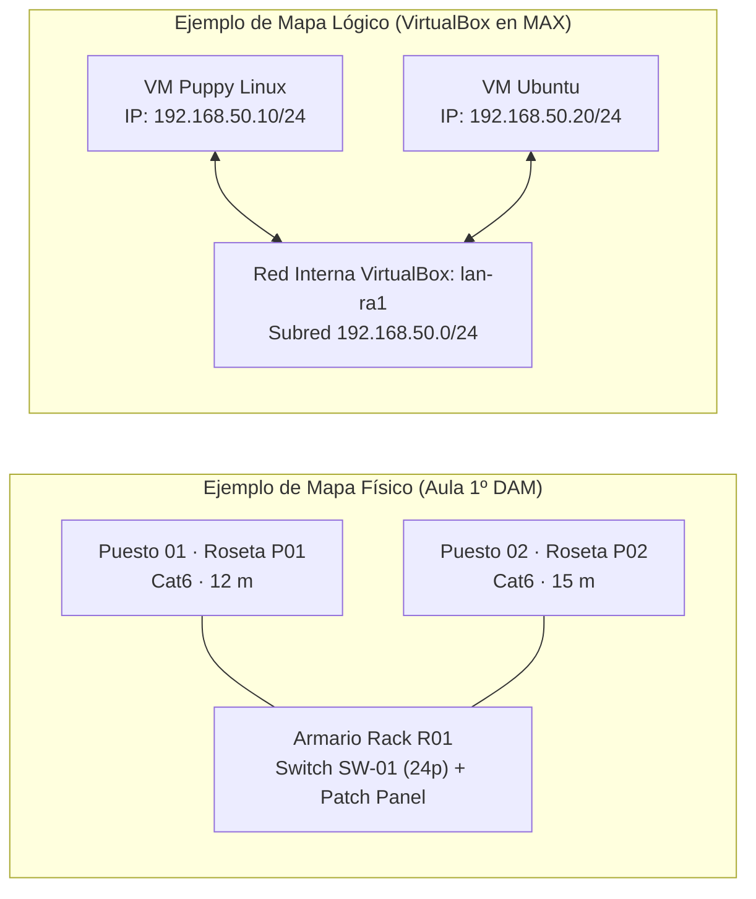

# Redes, Componentes, Cableado y Mapas Físico y Lógico

> **Criterios de Evaluación cubiertos:** `RA1.e`, `RA1.f` y `RA1.g` — *Tipos de redes y sistemas de comunicación, componentes de una red informática e interpretación de mapas físicos y lógicos.*

---

## 1. Tipos de Redes y Sistemas de Comunicación (`RA1.e`)

<!-- fuente: raw/procesados/ra1-redes-fisica-topologias-prl.md -->

### Clasificación por alcance geográfico

| Tipo | Alcance típico | Ejemplo real |
| :--- | :--- | :--- |
| **PAN** (*Personal Area Network*) | < 10 m | Auriculares Bluetooth, teclado inalámbrico, móvil por USB |
| **LAN** (*Local Area Network*) | Aula, edificio o vivienda | Red cableada Ethernet y Wi-Fi del instituto |
| **MAN** (*Metropolitan Area Network*) | Ciudad o campus extenso | Red de fibra interconectando sedes educativas o municipales |
| **WAN** (*Wide Area Network*) | País o escala global | Internet y enlaces privados entre delegaciones |

### Ventajas e inconvenientes y modos de transmisión

- **Cableadas (Ethernet / Fibra):** Máxima estabilidad, baja latencia y seguridad física; menor movilidad y coste inicial de instalación.
- **Inalámbricas (Wi-Fi IEEE 802.11):** Movilidad inmediata y menor obra física; más sensibles a interferencias, atenuación por muros y medio compartido.
- **Dirección del canal:** *Símplex* (un sentido), *Semidúplex* (ambos sentidos alternos, ej. Wi-Fi tradicional o antiguo *Hub*) y *Dúplex completo* (*full-duplex*, envío y recepción simultáneos en *Switch* moderno).

---

## 2. Componentes de Red, Medios y Cableado Estructurado (`RA1.f`)

<!-- fuente: raw/procesados/ra1-redes-fisica-topologias-prl.md -->

### Dispositivos de interconexión según su nivel

| Dispositivo | Capa OSI | Identificador clave | Función principal |
| :--- | :---: | :--- | :--- |
| **Tarjeta de red (NIC)** | Capas 1–2 | Dirección **MAC** (48 bits) | Conecta un equipo al medio físico; los 24 primeros bits identifican al fabricante (OUI) |
| **Hub / Repetidor** | Capa 1 (Física) | Ninguno (señal eléctrica) | Reenvía por todos los puertos. Un solo **dominio de colisión** (obsoleto) |
| **Switch (Conmutador)** | Capa 2 (Enlace) | Tabla **MAC (CAM)** | Envía la trama solo al puerto destino. Cada puerto aísla su dominio de colisión |
| **Punto de Acceso (AP)** | Capa 2 (Enlace) | BSSID / MAC Wi-Fi | Une clientes inalámbricos Wi-Fi a la LAN cableada |
| **Router (Enrutador)** | Capa 3 (Red) | Dirección **IP** y rutas | Interconecta redes distintas, separa dominios de difusión (*broadcast*) y da salida WAN |

### Par trenzado, fibra óptica y estándares de crimpado



| Categoría cobre | Frecuencia | Velocidad y distancia máxima | Blindaje habitual |
| :--- | :---: | :--- | :--- |
| **Cat5e** | 100 MHz | 1 Gbps hasta 100 m | UTP (sin apantallar) |
| **Cat6** | 250 MHz | 1 Gbps a 100 m · 10 Gbps hasta 55 m | UTP / FTP |
| **Cat6A** | 500 MHz | 10 Gbps completos hasta 100 m | FTP / SFTP (ideal contra EMI) |

- **Normas RJ-45 (8P8C):** **EIA/TIA-568B** (Blanco-Naranja, Naranja, Blanco-Verde, Azul, Blanco-Azul, Verde, Blanco-Marrón, Marrón) es la más extendida; **EIA/TIA-568A** intercambia los pares naranja y verde. Un **cable directo** usa la misma norma en ambos extremos; un **cable cruzado** combina 568A y 568B (aunque las tarjetas Gigabit modernas soportan *Auto-MDIX*).
- **Fibra óptica:** **Multimodo (OM3/OM4)** para enlaces cortos dentro de edificios/CPD; **Monomodo (OS2)** para kilómetros sin interferencias electromagnéticas (conectores **LC** o **SC**).
- **Cableado estructurado:** Armario **Rack 19"**, **Patch Panel** (terminación ordenada del cableado fijo), latiguillos (*patch cords*) hacia el *Switch* y **rosetas** murales etiquetadas.

---

## 3. Topologías e Interpretación de Mapas Físicos y Lógicos (`RA1.g`)

<!-- fuente: raw/procesados/ra1-redes-fisica-topologias-prl.md -->

### Topologías principales

- **Estrella / Estrella extendida (Árbol):** Todos los nodos convergen en un *Switch* central. Si falla un cable individual, solo cae ese puesto; el fallo del nodo central afecta a su segmento.
- **Bus (obsoleta en Ethernet moderno):** Cable troncal compartido con terminadores; un corte detiene toda la red.
- **Anillo:** Tramas circulando nodo a nodo (usado hoy en variantes redundantes de fibra en operadores/campus).
- **Malla (parcial o total):** Múltiples caminos alternativos; máxima tolerancia a fallos en núcleos de red y WAN.

### Mapa Físico vs. Mapa Lógico

| Criterio | Mapa Físico | Mapa Lógico |
| :--- | :--- | :--- |
| **Qué muestra** | Ubicación real de PCs, armarios Rack, *Switches*, rosetas, canaletas y tipos/longitudes de cable | Direcciones IP, máscaras de subred, puerta de enlace (*gateway*), DNS, VLANs y flujo de datos |
| **Para qué sirve** | Localizar averías de cableado, ampliar puestos o identificar un puerto en el *Patch Panel* | Diagnosticar conectividad IP, diseñar subredes o configurar reglas y servicios |



### Modos de Red en Oracle VirtualBox (Comparativa de Aula)

| Modo VirtualBox | Comunicación entre VMs | Acceso al Host MAX | Acceso a Internet | Uso recomendado en DAM |
| :--- | :---: | :---: | :---: | :--- |
| **NAT** | No | Limitado | Sí (vía host) | Navegar o instalar paquetes en una VM aislada |
| **Red NAT** | Sí (misma red NAT) | Limitado | Sí (vía router NAT) | Varias VMs compartiendo salida a Internet |
| **Adaptador Puente** | Sí | Sí | Sí | La VM actúa como un equipo más en la LAN real del aula |
| **Red Interna** | Sí (switch privado) | No | No | Laboratorios aislados de redes y servidores sin tocar la red del centro |
| **Solo Anfitrión** | Sí | Sí | No | Pruebas directas entre MAX y tus VMs sin Internet |

=== "MAX / Ubuntu (Linux)"

    ```bash
    # Ver interfaces de red, estado físico (UP/DOWN) y dirección MAC
    ip -br link

    # Ver direcciones IPv4/IPv6 asignadas
    ip -br addr

    # Consultar velocidad negociada (1000Mb/s Full) y enlace físico de una tarjeta cableada
    sudo ethtool enp0s3
    ```

=== "Windows 10 / 11"

    ```powershell
    # Listar adaptadores, estado, velocidad de enlace y dirección MAC
    Get-NetAdapter | Select-Object Name, InterfaceDescription, Status, LinkSpeed, MacAddress

    # Consultar configuración IP lógica actual
    ipconfig /all
    ```

---

## Recursos para profundizar

- **Documentación oficial y referencia técnica:**
  - [Oracle VirtualBox Manual — Chapter 6: Virtual Networking](https://www.virtualbox.org/manual/ch06.html)
  - [Página de manual oficial de `ip(8)` (man7.org)](https://man7.org/linux/man-pages/man8/ip.8.html)
- **Vídeos explicativos recomendados (YouTube):**
  - [Topologías y representaciones de red (mapas físicos y lógicos)](https://www.youtube.com/watch?v=DxXouJlWx64)
  - [Topologías físicas y lógicas en redes de computadores](https://www.youtube.com/watch?v=kZn-Ls4jTCc)
- **Práctica relacionada en `wikiSI`:** [Ejercicio e05 · Mapa físico/lógico en VirtualBox y checklist PRL](../ejercicios/e05-ra1-interpretacion-mapa-red-prl.md)
