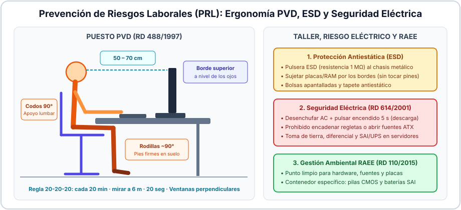
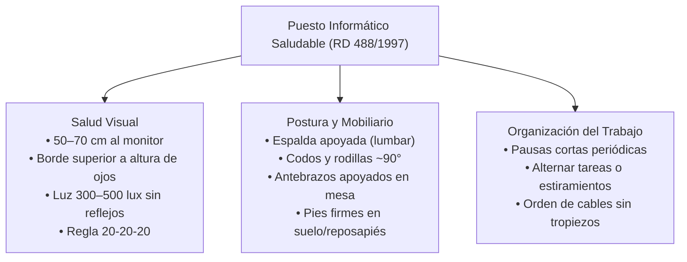

# Normas de Seguridad y Prevención de Riesgos Laborales (PRL)

> **Criterio de Evaluación cubierto:** `RA1.h` — *Se han reconocido las normas de seguridad y prevención de riesgos laborales en el uso de los sistemas informáticos.*

---

## 1. Marco Normativo en Entornos Informáticos

<!-- fuente: raw/procesados/ra1-redes-fisica-topologias-prl.md -->

El trabajo habitual de técnicos y desarrolladores DAM combina dos escenarios con riesgos específicos: la **operación continuada frente a pantallas** y la **manipulación física de equipos hardware y cableado**.

- **Ley 31/1995** de Prevención de Riesgos Laborales (marco general de derechos y obligaciones).
- **Real Decreto 488/1997:** Disposiciones mínimas de seguridad y salud relativas al trabajo con equipos que incluyen **Pantallas de Visualización de Datos (PVD)**.
- **Real Decreto 614/2001:** Disposiciones mínimas para la protección de la salud y seguridad frente al **riesgo eléctrico**.
- **Real Decreto 110/2015:** Gestión ambiental de **Residuos de Aparatos Eléctricos y Electrónicos (RAEE)**.

---

## 2. Seguridad Eléctrica y Protección ESD en el Taller

<!-- fuente: raw/procesados/ra1-redes-fisica-topologias-prl.md -->

### Riesgo eléctrico (protección de las personas)

1. **Desconexión previa obligatoria:** Antes de abrir una torre o manipular componentes internos, apaga el equipo, **desenchufa el cable de corriente de la toma AC** y pulsa el botón de encendido durante 5 segundos para descargar los condensadores.
2. **Prohibido abrir fuentes de alimentación ATX:** Contienen condensadores de alta tensión capaces de almacenar carga peligrosa incluso desconectados.
3. **Instalación segura:** No encadenar regletas en cascada (*daisy-chain*), verificar tomas con puesta a tierra, interruptores diferenciales y revisar que no existan cables pelados o pisados por sillas.
4. **Sistemas de Alimentación Ininterrumpida (SAI / UPS):** Protegen servidores y estaciones frente a apagones y sobretensiones (tipos *Offline*, *Line-Interactive* y *Online* de doble conversión).

### Descarga electrostática — ESD (protección del hardware)

Una persona solo percibe una descarga estática a partir de ~3.000 V, pero un circuito integrado moderno (RAM, CPU, chipset) puede dañarse de forma latente o irreversible con tan solo **30–100 V**:

- Utilizar **pulsera antiestática** (con resistencia limitadora interna de seguridad de **$1\text{ M}\Omega$**) conectada al chasis metálico sin pintar o a toma de tierra ESD.
- Trabajar sobre **alfombrilla antiestática**, evitar suelos enmoquetados o ropa de fibra altamente estática.
- Sujetar siempre módulos RAM, tarjetas PCIe y placas base por los **bordes**, sin tocar contactos dorados ni patillas.
- Almacenar piezas sueltas en **bolsas antiestáticas metalizadas** (nunca sobre plástico común o espuma convencional).

---

## 3. Ergonomía en Puestos con Pantallas (PVD)

<!-- fuente: raw/procesados/ra1-redes-fisica-topologias-prl.md -->

| Factor ergonómico | Recomendación técnica | Riesgo prevenido |
| :--- | :--- | :--- |
| **Distancia y altura del monitor** | Entre **50 y 70 cm**; borde superior a la altura de los ojos o ligeramente por debajo | Cervicalgia y tensión ocular |
| **Iluminación y reflejos** | Ventanas **perpendiculares** a la pantalla (300–500 lux), uso de persianas/filtros | Deslumbramientos y fatiga visual |
| **Descanso visual (20-20-20)** | Cada **20 min**, enfocar a **6 metros (20 pies)** durante **20 segundos** | Sequedad ocular y fatiga de acomodación |
| **Silla y teclado** | Silla regulable con 5 ruedas, respaldo lumbar, muñecas neutras sin doblar hacia arriba | Lumbalgia y síndrome del túnel carpiano |

---

## 4. Sostenibilidad y Reciclaje Tecnológico (RAEE)

<!-- fuente: raw/procesados/ra1-redes-fisica-topologias-prl.md -->

Los equipos informáticos contienen metales pesados (plomo en soldaduras antiguas, cadmio, mercurio en pantallas LCD antiguas) y materiales recuperables (cobre, oro, aluminio, tierras raras):

- Todo hardware obsoleto o averiado debe entregarse en un **punto limpio o gestor autorizado RAEE** (RD 110/2015), nunca en la basura orgánica o envases.
- Las **baterías de SAI/portátil** y las **pilas botón CR2032** de placa base requieren contenedores específicos de pilas/acumuladores.

---

## Recursos para profundizar

- **Documentación oficial y normativa:**
  - [INSST — Guía Técnica sobre Pantallas de Visualización de Datos (PVD)](https://www.insst.es/normativa/pantallas-de-visualizacion-de-datos)
  - [BOE — Real Decreto 488/1997 (Pantallas de Visualización de Datos)](https://www.boe.es/buscar/act.php?id=BOE-A-1997-8669)
  - [BOE — Real Decreto 614/2001 (Riesgo Eléctrico)](https://www.boe.es/buscar/act.php?id=BOE-A-2001-11881)
- **Vídeos explicativos recomendados (YouTube):**
  - [Prevención de riesgos laborales y ergonomía en oficinas (PVD)](https://www.youtube.com/watch?v=0MrqAB7eo7o)
  - [Trabajo con pantallas de visualización de datos y buenas prácticas](https://www.youtube.com/watch?v=iappFgOpI5w)
- **Práctica relacionada en `wikiSI`:** [Ejercicio e05 · Mapa físico/lógico en VirtualBox y checklist PRL](../ejercicios/e05-ra1-interpretacion-mapa-red-prl.md)
