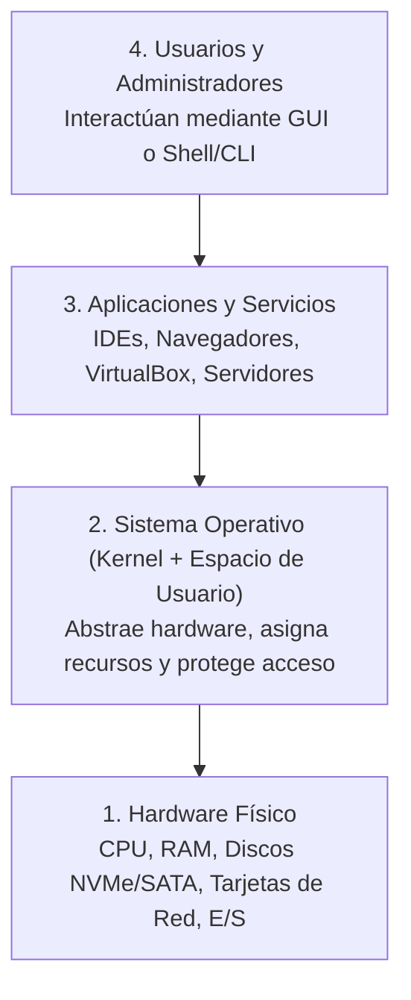
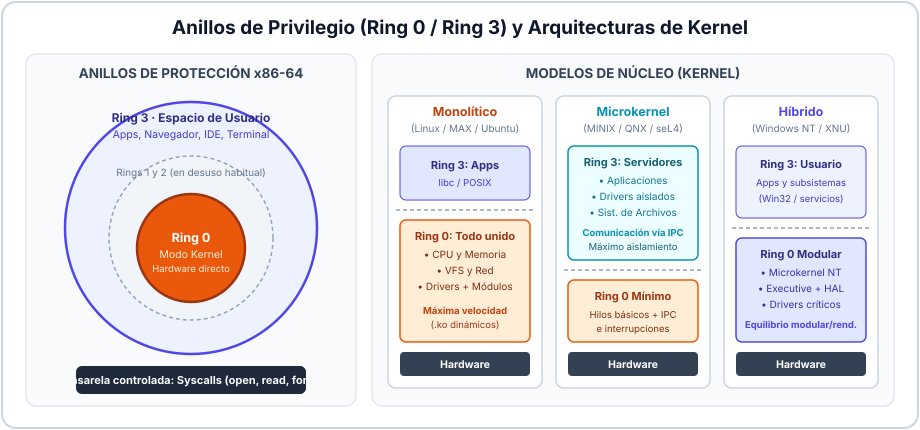

# Arquitectura y Funciones de un Sistema Operativo

> **Criterios de Evaluación cubiertos:** `RA2.a` y `RA2.b` — *Elementos funcionales de un sistema informático y análisis de las características, funciones y arquitectura de un sistema operativo.*

---

## 1. Elementos Funcionales de un Sistema Informático (`RA2.a`)

<!-- fuente: raw/procesados/ra2-arquitectura-so-licencias.md -->

Todo sistema informático operativo se apoya en cuatro elementos funcionales organizados en capas:



Sin el **Sistema Operativo**, cada programa tendría que conocer los registros exactos de cada modelo de placa base, tarjeta gráfica o disco duro, y competir sin árbitro por la CPU y la memoria RAM.

---

## 2. Evolución Histórica y Clasificación de los Sistemas Operativos

<!-- fuente: raw/procesados/ra2-arquitectura-so-licencias.md -->

- **Evolución:** De los sistemas **por lotes (*batch*)** sin interacción, a la **multiprogramación** (varios trabajos en RAM), el **tiempo compartido (*time-sharing*)** con acceso interactivo concurrente, los **sistemas de escritorio y servidor en red**, los **sistemas de tiempo real (RTOS)** y la actual **computación virtualizada y en la nube**.
- **Criterios de clasificación:**
  - **Por número de usuarios:** *Monousuario* (un único contexto de sesión) frente a *Multiusuario* (aislamiento de cuentas, permisos y cuotas simultáneas como Linux/MAX y Windows moderno).
  - **Por gestión de tareas:** *Monotarea* frente a *Multitarea apropiativa (preemptive)*, donde el planificador del kernel interrumpe los procesos mediante el reloj del sistema para repartir tiempo de CPU.
  - **Por ámbito de aplicación:** Escritorio (MAX, Ubuntu Desktop, Linux Mint, Windows 10/11), Servidor (Ubuntu Server, Windows Server), Ligero/Rescate (**Puppy Linux**), Móvil (Android/iOS) y Tiempo Real (RTOS industriales/automoción).

---

## 3. Funciones Esenciales, Anillos de Privilegio y Kernel (`RA2.b`)

<!-- fuente: raw/procesados/ra2-arquitectura-so-licencias.md -->

### Funciones principales del núcleo (*Kernel*)

1. **Gestión de procesos e hilos:** Planificación de CPU (*scheduling*), creación/terminación y cambios de contexto.
2. **Gestión de memoria:** Asignación de RAM, memoria virtual, paginación y aislamiento entre procesos.
3. **Gestión de almacenamiento y sistemas de archivos:** Capa VFS (Linux) / controladores NTFS (`ext4`, `NTFS`, `FAT32`, `Btrfs`).
4. **Control de dispositivos (E/S) y red:** Carga y coordinación de *drivers*, buffers y pila TCP/IP.
5. **Seguridad y control de acceso:** Aislamiento de usuarios, permisos y auditoría.

### Anillos de protección (`Ring 0` vs. `Ring 3`) y arquitecturas de núcleo



Para impedir que una aplicación con errores sobrescriba memoria ajena o bloquee el hardware, los procesadores `x86-64` separan la ejecución en niveles de privilegio:

- **Ring 0 (Modo Kernel):** Acceso total e irrestricto al hardware.
- **Ring 3 (Espacio de Usuario):** Modo restringido donde corren nuestras aplicaciones. Cuando un programa necesita abrir un archivo o enviar datos por red, invoca una **llamada al sistema (*syscall*)** para que el kernel ejecute la operación de forma segura.

| Arquitectura de Kernel | Organización interna | Ventajas principales | Inconvenientes | Ejemplos reales |
| :--- | :--- | :--- | :--- | :--- |
| **Monolítico Modular** | Planificador, memoria, VFS, red y drivers en Ring 0 con carga dinámica de módulos (`.ko`) | Máximo rendimiento sin saltos continuos entre anillos | Un fallo grave en un driver de Ring 0 puede provocar *Kernel Panic* | **Linux** (MAX, Ubuntu, Mint, Puppy) |
| **Microkernel** | Ring 0 mínimo (hilos, IPC básico, interrupciones); drivers y FS en Ring 3 | Alta tolerancia a fallos y mínima superficie de ataque | Mayor latencia por intercambio continuo de mensajes (IPC) | MINIX, QNX, seL4 |
| **Híbrido** | Estructura modular (Executive, HAL, microkernel) con subsistemas críticos y drivers en Ring 0 | Equilibrio entre diseño modular y rendimiento | Mayor complejidad arquitectónica | **Windows NT** (Windows 10/11), macOS (XNU) |

---

## 4. Inspección de Arquitectura del SO en el Aula

=== "MAX / Ubuntu (Linux)"

    ```bash
    # Versión exacta del kernel Linux y arquitectura
    uname -a

    # Datos de distribución, kernel y virtualización si corre en VirtualBox
    hostnamectl

    # Módulos cargados dinámicamente en el kernel monolítico Linux
    lsmod | head -n 15

    # Observar las llamadas al sistema (syscalls) reales de un comando
    strace -c ls /tmp
    ```

=== "Windows 10 / 11"

    ```powershell
    # Versión exacta del kernel Windows NT y compilación
    winver

    # Resumen de SO, arquitectura, fecha de instalación y hardware base
    systeminfo | Select-String -Pattern "Nombre del SO|Versión del sistema|Tipo de sistema|Virtualización"

    # Listar controladores cargados en modo kernel/sistema
    driverquery /FO TABLE | Select-Object -First 15
    ```

---

## Recursos para profundizar

- **Documentación oficial y referencia técnica:**
  - [The Linux Kernel Documentation (kernel.org)](https://docs.kernel.org/)
  - [Página de manual oficial de `syscalls(2)` (man7.org)](https://man7.org/linux/man-pages/man2/syscalls.2.html)
  - [Microsoft Learn — Kernel-Mode and User-Mode Architecture](https://learn.microsoft.com/en-us/windows-hardware/drivers/gettingstarted/user-mode-and-kernel-mode)
- **Vídeos explicativos recomendados (YouTube):**
  - [Arquitectura de Sistemas Operativos: Ring 0, Ring 3 y Kernel](https://www.youtube.com/watch?v=5Dm39eWxNRo)
  - [Kernel Monolítico vs. Microkernel vs. Híbrido explicado](https://www.youtube.com/watch?v=phBR7ZpW3B0)
- **Práctica relacionada en `wikiSI`:** [Ejercicio e06 · Verificación de ISOs y creación de VMs en VirtualBox](../ejercicios/e06-ra2-verificacion-isos-creacion-vm-virtualbox.md)
