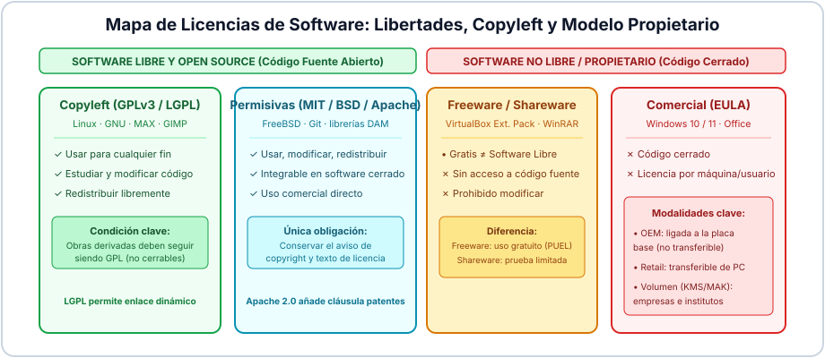

# Comparativa de Sistemas Operativos y Licencias de Uso

> **Criterio de Evaluación cubierto:** `RA2.c` — *Se han comparado sistemas operativos en base a sus requisitos, características, campos de aplicación y licencias de uso.*

---

## 1. Tipos de Licencias de Software y Sistemas Operativos

<!-- fuente: raw/procesados/ra2-arquitectura-so-licencias.md -->

Una **licencia de software** es el marco legal que determina qué puede hacer el usuario o desarrollador con el programa y con su código fuente.



### Software Libre y Código Abierto (*Open Source*)

Según la *Free Software Foundation* (FSF), un programa es **Software Libre** si garantiza las **4 libertades esenciales**: (0) ejecutarlo con cualquier propósito, (1) estudiar cómo funciona y modificar su código fuente, (2) redistribuir copias y (3) distribuir versiones modificadas.

- **Licencias *Copyleft* fuerte (`GPLv2` / `GPLv3`):** Obligan a que toda obra derivada que se distribuya mantenga la misma licencia libre y comparta su código fuente (ejemplo: el kernel Linux).
- **Licencias *Copyleft* débil (`LGPL`):** Permiten enlazar dinámicamente una librería libre dentro de aplicaciones propietarias.
- **Licencias Permisivas (`MIT`, `BSD`, `Apache 2.0`):** Autorizan usar, modificar e incluso integrar el código en software comercial cerrado conservando el aviso de copyright original (`Apache 2.0` añade protección expresa sobre patentes).

### Software No Libre y Propietario

- **Freeware:** Gratuito en precio, pero de código cerrado y sin derecho de modificación (ej. *VirtualBox Extension Pack* bajo licencia PUEL para uso personal/educativo).
- **Shareware / Evaluación:** Gratuito temporalmente o con funciones limitadas.
- **Propietario Comercial (EULA):** El usuario adquiere únicamente un derecho de uso sujeto a restricciones estrictas:
  - **OEM (*Original Equipment Manufacturer*):** Preinstalada de fábrica y vinculada a la placa base del equipo; **no transferible** a otro ordenador.
  - **Retail (FPP):** Comprada por separado; **transferible** a otro equipo si se desactiva en el anterior.
  - **Volumen (`KMS` / `MAK`):** Activación centralizada para centros educativos, universidades y empresas.

---

## 2. Comparativa Técnica de Sistemas Operativos de Aula y Empresa

<!-- fuente: raw/procesados/ra2-arquitectura-so-licencias.md -->

En los equipos de **16 GB RAM del aula con MAX**, elegimos el sistema operativo invitado según el objetivo didáctico y el presupuesto disponible (**máximo 10–12 GB totales en VirtualBox**):

| Sistema Operativo | Familia y Licencia | RAM mínima oficial | RAM recomendada en VirtualBox (Aula) | Disco VDI sugerido | Firmware / Requisitos clave | Campo de aplicación principal |
| :--- | :--- | :---: | :---: | :---: | :--- | :--- |
| **MAX (Host)** | Linux (Ubuntu/Debian) · Libre | 2 GB | *(Anfitrión: reservar 4–6 GB libres)* | SSD físico | BIOS o UEFI | Estación educativa oficial de la Comunidad de Madrid |
| **Ubuntu Desktop** | Linux · Libre (GPL/MIT/etc.) | 4 GB | **2048 – 4096 MB** | 25 GB | BIOS o UEFI | Desarrollo DAM, contenedores, servidores y escritorio |
| **Ubuntu Server** | Linux · Libre | 1 GB | **1024 – 2048 MB** | 15–20 GB | BIOS o UEFI (sin GUI) | Servicios de red, SSH, bases de datos y cloud |
| **Linux Mint** | Linux · Libre | 2 GB | **2048 MB** | 20–25 GB | BIOS o UEFI | Escritorio ligero (Cinnamon/Xfce), transición desde Windows |
| **Puppy Linux** | Linux · Libre | 512 MB | **512 – 1024 MB** | 4–8 GB | BIOS o UEFI | Equipos antiguos, rescate Live USB y **labs multi-VM** |
| **Windows 10** | Propietario (EULA) | 2 GB (64-bit) | **4096 MB** | 40–50 GB | BIOS o UEFI | Estación corporativa, .NET, soporte legacy |
| **Windows 11** | Propietario (EULA) | 4 GB | **4096 MB** | 50–64 GB | **UEFI + Secure Boot + TPM 2.0 obligatorios** | Estación cliente moderna y entornos empresariales actuales |

---

## 3. Verificación de Edición y Licencia desde Consola

=== "MAX / Ubuntu (Linux)"

    ```bash
    # Identificar distribución, versión LTS y nombre en clave
    cat /etc/os-release
    lsb_release -a

    # Consultar la licencia exacta de un paquete instalado desde Debian/Ubuntu
    head -n 25 /usr/share/doc/bash/copyright
    ```

=== "Windows 10 / 11"

    ```powershell
    # Ver edición exacta, canal de licencia (OEM, Retail, Volume) y estado de activación
    slmgr /dlv

    # Consultar versión y compilación desde PowerShell
    Get-ComputerInfo | Select-Object WindowsProductName, WindowsVersion, OsHardwareAbstractionLayer
    ```

---

## Recursos para profundizar

- **Documentación oficial y referencia técnica:**
  - [Proyecto GNU — Licencias y categorías de software libre (gnu.org)](https://www.gnu.org/licenses/licenses.es.html)
  - [Open Source Initiative — Licencias aprobadas (MIT, Apache 2.0, BSD)](https://opensource.org/licenses)
  - [Microsoft Learn — Requisitos mínimos del sistema de Windows 11](https://learn.microsoft.com/es-es/windows/whats-new/windows-11-requirements)
- **Vídeos explicativos recomendados (YouTube):**
  - [Tipos de licencias de software: Propietario, Software Libre, GPL y MIT](https://www.youtube.com/watch?v=p4pSjP0FqQQ)
  - [Diferencias entre licencias permisivas (MIT) y copyleft (GPL)](https://www.youtube.com/watch?v=6etRzaESeuk)
- **Práctica relacionada en `wikiSI`:** [Ejercicio e06 · Verificación de ISOs y creación de VMs en VirtualBox](../ejercicios/e06-ra2-verificacion-isos-creacion-vm-virtualbox.md)
