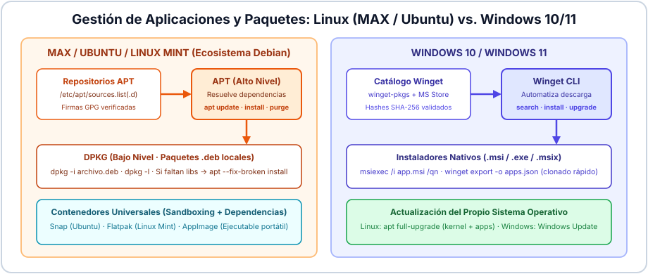
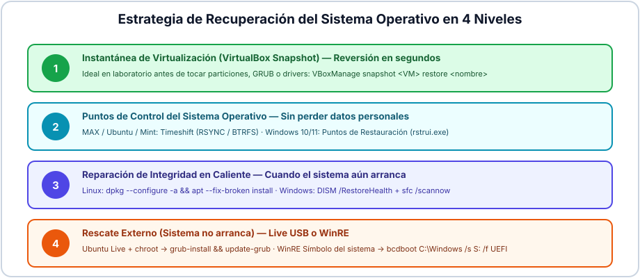

# Gestión de Aplicaciones, Actualización y Recuperación del Sistema

<!-- fuente: raw/procesados/ra2-arranque-aplicaciones-recuperacion-doc.md -->

> **Criterios de evaluación cubiertos:** `RA2.f` (actualización y recuperación del sistema), `RA2.h` (instalación, desinstalación y actualización de aplicaciones) y `RA2.i` (documentación técnica de procesos realizados).

Un sistema operativo recién instalado carece de valor productivo sin su capa de software y sin mecanismos fiables para mantenerse actualizado y recuperarse ante un fallo de configuración, corrupción de archivos o error humano.

---

## 1. Ecosistema de Gestión de Paquetes y Aplicaciones (`RA2.h`)

<!-- fuente: raw/procesados/ra2-arranque-aplicaciones-recuperacion-doc.md -->



En sistemas profesionales, instalar aplicaciones desde instaladores descargados manualmente en el navegador conlleva riesgos de seguridad y dificultad de mantenimiento. Se priorizan los **gestores de paquetes oficiales** con repositorios firmados criptográficamente y resolución automática de dependencias.

### Comparativa de capas y formatos de empaquetado

| Dimensión | GNU/Linux (MAX / Ubuntu / Mint) | Windows 10 / 11 |
| :--- | :--- | :--- |
| **Nivel bajo (sin repositorios)** | **`dpkg`** sobre ficheros **`.deb`** (o `rpm` en Red Hat/Fedora) | Instaladores **`.msi`** (`msiexec`), **`.exe`**, MSIX |
| **Gestor con repositorios** | **`apt`** (*Advanced Package Tool*) conectado a `/etc/apt/sources.list(.d)` | **`winget`** (*Windows Package Manager*), Microsoft Store o Chocolatey |
| **Paquetes universales / Aislados** | **Snap** (`snap`, Ubuntu) y **Flatpak** (`flatpak`, Linux Mint / Flathub) | **MSIX** / AppX con ejecución aislada (*sandbox*) |
| **Actualización integral** | `sudo apt update && sudo apt upgrade` + `snap refresh` | Windows Update + `winget upgrade --all` |

### Diferencia crítica entre `apt remove` y `apt purge`

- **`sudo apt remove <paquete>`**: desinstala los binarios de la aplicación, pero **conserva los archivos de configuración** del sistema (por ejemplo en `/etc/`). Útil si se planea reinstalar manteniendo los ajustes.
- **`sudo apt purge <paquete>`**: elimina binarios **y archivos de configuración** globales asociados al paquete. Tras desinstalar paquetes que quedaron sin padres necesarios, conviene ejecutar `sudo apt autoremove`.

---

## 2. Operaciones Cotidianas con Aplicaciones en Consola (`RA2.h`)

<!-- fuente: raw/procesados/ra2-arranque-aplicaciones-recuperacion-doc.md -->

=== "MAX / Ubuntu (Linux)"
    ```bash
    # 1. Actualizar el índice local de repositorios y aplicar actualizaciones
    sudo apt update && sudo apt upgrade -y

    # 2. Buscar e inspeccionar un paquete antes de instalarlo
    apt search htop
    apt show htop

    # 3. Instalar desde repositorio oficial
    sudo apt install -y htop tree curl

    # 4. Instalar un paquete .deb descargado manualmente y resolver dependencias faltantes
    sudo dpkg -i paquete_local.deb
    sudo apt install -f

    # 5. Desinstalación completa + limpieza de dependencias huérfanas
    sudo apt purge -y nombre_paquete && sudo apt autoremove -y

    # 6. Gestión de paquetes aislados Snap / Flatpak
    snap list
    flatpak list
    ```

=== "Windows 10 / 11"
    ```powershell
    # 1. Buscar una aplicación en el repositorio oficial de winget
    winget search "Visual Studio Code"

    # 2. Instalar aplicación aceptando licencias de forma desatendida
    winget install --id Microsoft.VisualStudioCode -e --accept-source-agreements --accept-package-agreements

    # 3. Listar software instalado y detectar actualizaciones disponibles
    winget list
    winget upgrade

    # 4. Actualizar todas las aplicaciones compatibles de una sola vez
    winget upgrade --all

    # 5. Desinstalar limpiamente mediante identificador exacto
    winget uninstall --id Microsoft.VisualStudioCode -e
    ```

!!! tip "Evitar el *dependency hell* al usar `.deb` manuales"
    `dpkg -i archivo.deb` **no descarga dependencias** desde Internet. Si falla indicando dependencias no satisfechas, puedes usar directamente `sudo apt install ./archivo.deb` (desde directorio local `./`), ya que `apt` moderno sabe leer un `.deb` local y descargar automáticamente todo lo que falte desde los repositorios.

---

## 3. Estrategias de Actualización del Sistema Operativo (`RA2.f`)

<!-- fuente: raw/procesados/ra2-arranque-aplicaciones-recuperacion-doc.md -->

Mantener el sistema parcheado cierra vulnerabilidades críticas (*CVEs*), pero actualizar sin criterio en producción puede romper servicios:

1. **Parches de seguridad y mantenimiento:**
   - **Ubuntu/MAX:** `apt upgrade` instala versiones nuevas dentro de la misma rama LTS sin eliminar paquetes; `apt full-upgrade` (antes `dist-upgrade`) permite añadir o sustituir kernels y dependencias complejas; **`unattended-upgrades`** automatiza parches de seguridad críticos.
   - **Windows 10/11:** *Windows Update* clasifica las actualizaciones en **Acumulativas mensuales** (seguridad y calidad), **De características** (cambio de compilación `23H2` → `24H2`) y **Actualizaciones de controladores**. En entornos corporativos se gestionan mediante *Windows Update for Business* o WSUS diferiendo 7–30 días las de características para probar compatibilidad previa.
2. **Cambio de versión mayor (*Release Upgrade*):**
   - En Ubuntu LTS se utiliza `sudo do-release-upgrade` siempre previo snapshot o respaldo completo.

---

## 4. Técnicas de Recuperación y Tolerancia a Fallos (`RA2.f`)

<!-- fuente: raw/procesados/ra2-arranque-aplicaciones-recuperacion-doc.md -->



Ante un fallo tras una actualización, eliminación accidental de archivos de sistema o corrupción del arranque, aplicamos la técnica adecuada según el nivel del incidente:

### Escala progresiva de recuperación

| Nivel | Herramienta en VirtualBox / Hardware | Sistema(s) | Qué recupera y cuándo usarla |
| :---: | :--- | :---: | :--- |
| **1. Instantánea Hipervisor** | **Snapshots de VirtualBox** (`VBoxManage snapshot`) | Todos | Congela disco y estado VM completo en segundos antes de cambios arriesgados. Ideal en laboratorio. |
| **2. Instantánea de Sistema** | **Timeshift** (`rsync` / `Btrfs`) / **Restaurar Sistema** | Linux / Windows | Revierte ficheros del sistema operativo y registro tras una actualización fallida **sin borrar documentos de `/home`** o `C:\Users`. |
| **3. Reparación de Imagen** | `dpkg --configure -a`, `apt --fix-broken install` / **`sfc` + `DISM`** | Linux / Windows | Repara paquetes interrumpidos o almacén de componentes corruptos en Windows (`WinSxS`). |
| **4. Entorno Live / Rescate** | **Live-USB Linux (Ubuntu/Puppy)** / **WinRE** | Todos | Cuando el sistema ni siquiera arranca: permite montar discos, rescatar archivos de usuario y reparar GRUB o BCD vía `chroot` / `bcdboot`. |

### Comandos de diagnóstico y reparación de emergencia

=== "MAX / Ubuntu (Linux)"
    ```bash
    # 1. Reparar instalación de paquetes interrumpida por un corte eléctrico o cierre forzado
    sudo dpkg --configure -a
    sudo apt install -f

    # 2. Verificar integridad del sistema de archivos (sobre partición desmontada, ej. desde Live-USB)
    sudo fsck -f /dev/sda5

    # 3. Crear y listar instantáneas del sistema operativo con Timeshift (CLI)
    sudo timeshift --create --comments "Antes de actualizar kernel y paquetes"
    sudo timeshift --list
    ```

=== "Windows 10 / 11"
    ```powershell
    # 1. Analizar y reparar archivos protegidos del sistema Windows (desde PowerShell Admin)
    sfc /scannow

    # 2. Si SFC indica que no pudo reparar todos los archivos, reparar la imagen base con DISM:
    DISM /Online /Cleanup-Image /CheckHealth
    DISM /Online /Cleanup-Image /ScanHealth
    DISM /Online /Cleanup-Image /RestoreHealth

    # 3. Reintentar después verificación de archivos de sistema
    sfc /scannow
    ```

!!! danger "No confundir Instantánea (*Snapshot*) con Copia de Seguridad (*Backup*)"
    Un **Snapshot de VirtualBox** o **Timeshift local** reside en el mismo disco que la máquina: **si falla el SSD físico o se borra la VM completa, se pierden las instantáneas**. Una verdadera copia de seguridad exige almacenar los datos críticos o exportar la VM en `.ova` en un medio externo separado (regla **3-2-1**).

---

## 5. Cierre Documental del Mantenimiento (`RA2.i`)

<!-- fuente: raw/procesados/ra2-arranque-aplicaciones-recuperacion-doc.md -->

Cualquier intervención de actualización o rescate en aula o empresa queda incompleta si no se deja trazabilidad:

- **Registro de inventario de software instalado:** exportar lista reproducible de paquetes (`dpkg --get-selections > paquetes_ubuntu.txt` o `winget export -o apps_windows.json`).
- **Bitácora de incidencias (*changelog*):** qué falló, mensaje exacto de error, comando aplicado (`DISM`, `apt -f`, `timeshift --restore`) y verificación tras reiniciar.

---

## Recursos para profundizar

- **Documentación oficial:** [APT Package Management (Ubuntu Docs)](https://ubuntu.com/server/docs/package-management) y [Reparar una imagen de Windows con DISM y SFC (Microsoft Support)](https://support.microsoft.com/es-es/topic/use-la-herramienta-comprobador-de-archivos-de-sistema-para-reparar-los-archivos-de-sistema-que-faltan-o-est%C3%A1n-da%C3%B1ados-79aa86cb-ca52-166a-92a3-966e85d4094e).
- **Vídeos recomendados:** [Cómo funciona APT y dpkg en Linux](https://www.youtube.com/watch?v=5bvUMyLKZ5A) y [Domina Winget para instalar y actualizar apps en Windows](https://www.youtube.com/watch?v=W94vBHoX4T8).
- **Practica lo aprendido:** [e09 · Gestión de paquetes con `apt`, `dpkg` y `winget`](../ejercicios/e09-ra2-gestion-paquetes-apt-dpkg-winget.md) y [e10 · Recuperación con Snapshots, Timeshift y DISM/SFC](../ejercicios/e10-ra2-recuperacion-snapshots-timeshift-dism.md).
