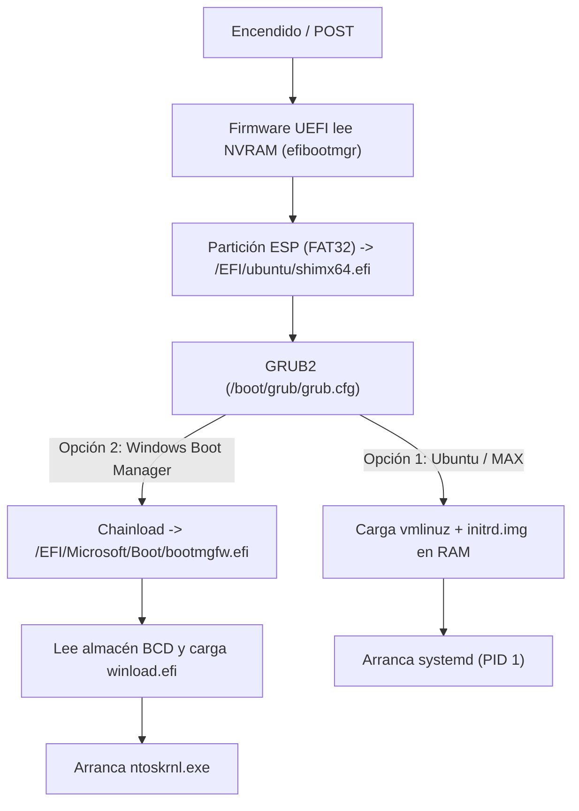

# Gestores de Arranque: GRUB2, Windows BCD y Reparación

<!-- fuente: raw/procesados/ra2-arranque-aplicaciones-recuperacion-doc.md -->

> **Criterios de evaluación cubiertos:** `RA2.e` (instalación y configuración del arranque en entornos multi-sistema) y `RA2.f` (técnicas de actualización y recuperación del sistema).

Cuando se enciende un ordenador con múltiples sistemas operativos instalados, el firmware (**UEFI** o **BIOS**) no carga directamente el núcleo del sistema operativo: transfiere el control a un **gestor de arranque** (*bootloader*), encargado de mostrar el menú de selección, localizar la partición destino y cargar el kernel en memoria.

---

## 1. Flujo de Arranque en UEFI Dual-Boot

<!-- fuente: raw/procesados/ra2-arranque-aplicaciones-recuperacion-doc.md -->

En sistemas **UEFI + GPT**, el orden de arranque se almacena en la memoria no volátil (**NVRAM**) de la placa base y los binarios residen dentro de la partición **ESP** (`/boot/efi` en Linux):



!!! info "¿Por qué aparece `shimx64.efi` antes de `grubx64.efi`?"
    Cuando **Secure Boot** está habilitado en UEFI, el firmware solo ejecuta binarios firmados por claves de Microsoft o de la placa. Canonical/Debian distribuyen **`shimx64.efi`**, un pequeño cargador firmado con clave de Microsoft cuya única función es validar criptográficamente a **`grubx64.efi`** y al kernel Linux mediante las claves MOK (*Machine Owner Key*).

---

## 2. GRUB2 en GNU/Linux (MAX, Ubuntu y Linux Mint)

<!-- fuente: raw/procesados/ra2-arranque-aplicaciones-recuperacion-doc.md -->

**GRUB2 (*GRand Unified Bootloader v2*)** es el gestor estándar en distribuciones Ubuntu, MAX y Debian.

### Archivos clave de configuración

| Ruta del archivo | Rol en el sistema |
| :--- | :--- |
| **`/etc/default/grub`** | Fichero principal editable por el administrador (tiempo de espera, entrada por defecto, parámetros del kernel). |
| **`/etc/grub.d/`** | Scripts numerados (`00_header`, `10_linux`, `30_os-prober`, `40_custom`) que generan las entradas del menú. |
| **`/boot/grub/grub.cfg`** | Fichero final leído al arrancar. **NUNCA editar manualmente**: se regenera automáticamente. |

### Parámetros habituales en `/etc/default/grub`

```ini
# Seleccionar la primera entrada (0) o la entrada guardada previamente
GRUB_DEFAULT=0
# Mostrar menú visible durante 5 segundos (útil en Dual-Boot)
GRUB_TIMEOUT_STYLE=menu
GRUB_TIMEOUT=5
# Argumentos pasados al núcleo Linux (ej. quitar 'quiet splash' para depurar fallos)
GRUB_CMDLINE_LINUX_DEFAULT="quiet splash"
# Detectar otros sistemas operativos instalados (requiere paquete os-prober)
GRUB_DISABLE_OS_PROBER=false
```

!!! warning "Cambio importante en Ubuntu 22.04 / 24.04 con `os-prober`"
    Por seguridad, Ubuntu moderno desactiva **`os-prober`** por defecto (`GRUB_DISABLE_OS_PROBER=true`). Si instalas Ubuntu junto a Windows y no aparece Windows en el menú de GRUB, debes editar `/etc/default/grub`, añadir `GRUB_DISABLE_OS_PROBER=false` y ejecutar `sudo update-grub`.

---

## 3. Windows Boot Manager y el Almacén BCD

<!-- fuente: raw/procesados/ra2-arranque-aplicaciones-recuperacion-doc.md -->

Windows abandona el antiguo `boot.ini` de texto plano desde Windows Vista y utiliza el almacén binario **BCD (*Boot Configuration Data*)**:

- **Archivo principal:** `\EFI\Microsoft\Boot\BCD` (en sistemas UEFI) o `\Boot\BCD` (en sistemas BIOS Legacy).
- **Herramientas de administración:**
  - **`bcdedit`** (CMD/PowerShell con privilegios de Administrador): inspecciona, modifica entradas, tiempos de espera y opciones de depuración.
  - **`bcdboot`** (especialmente desde entorno de recuperación **WinRE** o USB de Windows): reconstruye desde cero los ficheros de arranque EFI y la entrada BCD leyendo `C:\Windows`.
  - **`bootrec`** (Legacy/MBR): comandos clásicos `/fixmbr`, `/fixboot`, `/rebuildbcd`.

---

## 4. Comandos Esenciales y Escenarios de Reparación (`RA2.f`)

<!-- fuente: raw/procesados/ra2-arranque-aplicaciones-recuperacion-doc.md -->

En las prácticas de clase (`p02` y `e08`) es frecuente simular una avería típica del mundo real: **una actualización mayor de Windows sobreescribe el orden de arranque UEFI** y desaparece el menú de GRUB, arrancando Windows directamente.

=== "MAX / Ubuntu (Linux)"
    ```bash
    # 1. Consultar entradas UEFI actuales y orden de arranque (BootOrder)
    efibootmgr -v

    # 2. Aplicar cambios tras editar /etc/default/grub
    sudo update-grub

    # 3. Reparar GRUB arrancando desde un Live-USB de Ubuntu/MAX (si el sistema no inicia)
    # Suponiendo raíz Linux en /dev/sda5 y partición EFI en /dev/sda1:
    sudo mount /dev/sda5 /mnt
    sudo mount /dev/sda1 /mnt/boot/efi
    for dir in /dev /dev/pts /proc /sys /sys/firmware/efi/efivars; do
        sudo mount --bind "$dir" "/mnt$dir"
    done

    # Entrar en el sistema instalado mediante chroot y reinstalar GRUB2
    sudo chroot /mnt
    grub-install --target=x86_64-efi --efi-directory=/boot/efi --bootloader-id=ubuntu
    update-grub
    exit
    ```

=== "Windows 10 / 11"
    ```powershell
    # 1. Ver el almacén BCD actual (PowerShell / CMD Administrador)
    bcdedit /enum all

    # 2. Cambiar el tiempo de espera del menú Windows a 5 segundos
    bcdedit /timeout 5

    # 3. Indicar al firmware UEFI desde Windows que vuelva a usar GRUB (si desapareció)
    bcdedit /set "{bootmgr}" path \EFI\ubuntu\shimx64.efi

    # 4. Reconstruir el arranque de Windows desde WinRE (USB reparación):
    # Asignando temporalmente la letra S: a la partición EFI con diskpart:
    bcdboot C:\Windows /s S: /f UEFI
    ```

!!! tip "Diagnóstico rápido desde la consola mínima `grub>`"
    Si al reiniciar tras mover particiones aparece el prompt `grub>` o `grub rescue>`, no cunda el pánico: puedes listar particiones con `ls`, localizar dónde está `/boot/grub` (`ls (hd0,gpt5)/boot/grub`) y cargar manualmente el kernel (`linux ...`, `initrd ...`, `boot`) para iniciar Ubuntu y ejecutar `sudo update-grub && sudo grub-install`.

---

## Recursos para profundizar

- **Documentación oficial:** [Manual oficial de GNU GRUB 2](https://www.gnu.org/software/grub/manual/grub/grub.html) y [BCDBoot Command-Line Options (Microsoft Learn)](https://learn.microsoft.com/es-es/windows-hardware/manufacture/desktop/bcdboot-command-line-options-techref-di).
- **Vídeo recomendado:** [Cómo reparar GRUB en Dual Boot UEFI paso a paso](https://www.youtube.com/watch?v=jLvSESujTJM).
- **Siguiente tema:** [Gestión de Aplicaciones, Actualización y Recuperación del Sistema](ra2-gestion-aplicaciones-actualizacion-recuperacion.md).
