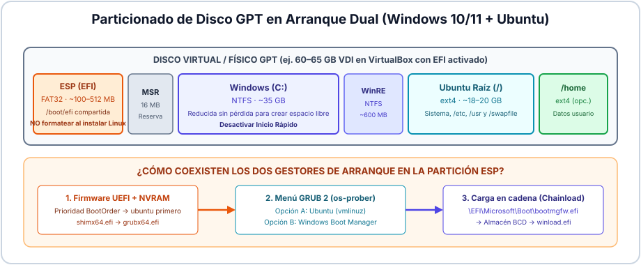

# Planificación, Particionado GPT/UEFI e Instalación Dual-Boot

<!-- fuente: raw/procesados/ra2-virtualizacion-planificacion-instalacion.md -->

> **Criterios de evaluación cubiertos:** `RA2.d` (planificación de la instalación), `RA2.e` (instalación y actualización de sistemas operativos libres y propietarios) y `RA2.i` (documentación de los procesos realizados).

Instalar un sistema operativo no consiste simplemente en pulsar *Siguiente*; exige una **planificación previa** de hardware, compatibilidad de firmware, esquema de particiones, red, seguridad y estrategia de arranque dual (*dual-boot*) para evitar pérdida de datos o despliegues inestables.

---

## 1. Fases de Planificación Previa a la Instalación (`RA2.d`)

<!-- fuente: raw/procesados/ra2-virtualizacion-planificacion-instalacion.md -->

Antes de introducir el medio de instalación (USB bootable o imagen ISO en VirtualBox), el técnico debe elaborar una **hoja de ruta de despliegue**:

1. **Inventario y verificación de requisitos:**
   - Comprobar arquitectura de CPU (`x86_64`, `ARM64`), soporte de virtualización (`VT-x` / `AMD-V`), **TPM 2.0** y **Secure Boot** (obligatorios por defecto en Windows 11).
   - Evaluar memoria RAM disponible y espacio libre en SSD/NVMe (en nuestras aulas **MAX con 16 GB de RAM**, asignar al menos 60 GB virtuales dinámicos en dual-boot para albergar Windows + Linux cómodamente).
2. **Validación de compatibilidad y controladores (*drivers*):**
   - Consultar las *Hardware Compatibility Lists* (HCL) de Ubuntu/Debian o Microsoft.
   - Descargar previamente controladores críticos sin conexión (red Ethernet/Wi-Fi o controladores de almacenamiento NVMe/RAID).
3. **Verificación de integridad de la imagen ISO:**
   - Jamás instalar desde una imagen descargada sin comprobar su huella **SHA-256** frente al resumen oficial publicado por Canonical, Microsoft o Linux Mint.
   - Una ISO corrupta provoca errores aleatorios de lectura/copia (`squashfs errors`, pantallazos azules durante la fase OOBE).
4. **Copia de seguridad (*backup*) y plan de contingencia:**
   - En máquinas físicas o VMs existentes, realizar copia de datos de usuario y crear un **Snapshot en VirtualBox** antes de alterar la tabla de particiones.
5. **Diseño de red, identidad y posinstalación:**
   - Definir nombre de host (*hostname*), usuario administrador inicial, configuración IP (DHCP o estática) y política de actualizaciones.

!!! tip "Regla de oro en instalaciones Dual-Boot"
    **Instala siempre Windows primero y GNU/Linux (Ubuntu/MAX) en segundo lugar.** El instalador de Windows sobreescribe el gestor de arranque sin preguntar por otros sistemas previos; en cambio, el instalador de Ubuntu (`Ubiquity` / `Subiquity`) detecta la partición EFI existente y configura GRUB automáticamente para ofrecer el menú de selección al iniciar.

---

## 2. Tablas de Particiones: MBR vs. GPT y Estructura UEFI

<!-- fuente: raw/procesados/ra2-virtualizacion-planificacion-instalacion.md -->

Elegir el firmware (**BIOS Legacy** vs **UEFI**) condiciona el esquema de particionado del disco:

| Característica | MBR (*Master Boot Record*) | GPT (*GUID Partition Table*) |
| :--- | :--- | :--- |
| **Firmware asociado** | BIOS Legacy (o UEFI en modo CSM) | **UEFI** nativo (estándar actual) |
| **Límite de tamaño por disco** | Máximo **2 TiB** | Hasta **9,4 ZiB** (prácticamente ilimitado) |
| **Número máximo de particiones** | 4 primarias (o 3 primarias + 1 extendida con lógicas) | Hasta **128 particiones primarias** por defecto |
| **Redundancia de tabla** | Única copia al inicio (sector 0) | Cabecera primaria al principio + **copia de respaldo al final del disco** |
| **Verificación de integridad** | Sin suma de comprobación | **CRC32** en cabecera y tabla de particiones |
| **Requisito Windows 11** | No soportado oficialmente | **Obligatorio** (UEFI + GPT + TPM 2.0 + Secure Boot) |

### Esquema visual de particionado Dual-Boot en UEFI/GPT



En un disco con arranque dual **Windows 10/11 + Ubuntu/MAX** sobre GPT, todas las particiones conviven compartiendo una única **ESP (*EFI System Partition*)**:

1. **ESP (`EFI System Partition`):** Formato **FAT32** (100–512 MiB). Almacena los cargadores `.efi` de Windows (`\EFI\Microsoft\Boot\bootmgfw.efi`) y Ubuntu (`\EFI\ubuntu\grubx64.efi`). **No se debe formatear al instalar Linux** si Windows ya existe.
2. **MSR (*Microsoft Reserved Partition*):** 16 MiB sin letra asignada, utilizada internamente por Windows.
3. **Partición de Sistema Windows (`C:`):** Formato **NTFS**. Aloja `C:\Windows`, aplicaciones y perfiles. Conviene desactivar *Inicio Rápido* (*Fast Startup*) en Windows para evitar que NTFS quede en estado de hibernación bloqueado (*dirty bit*) al acceder desde Linux.
4. **WinRE (*Windows Recovery Environment*):** Partición de recuperación oculta (500 MiB – 1 GiB, NTFS).
5. **Raíz de GNU/Linux (`/`):** Formato **ext4** (o Btrfs/XFS). Contiene el núcleo, `/etc`, `/usr`, `/var` y los directorios del sistema.
6. **Área de intercambio (`swap`):** Puede ser una partición dedicada (`linux-swap`) o un archivo `/swapfile` en sistemas modernos (Ubuntu 22.04/24.04 usa `/swapfile` por defecto).
7. **Partición `/home` separada (recomendada en producción):** Formato **ext4**. Aísla los archivos personales y configuraciones de usuario, permitiendo reinstalar `/` sin perder datos.

---

## 3. Verificación de ISOs y Medios de Instalación (`RA2.d`)

<!-- fuente: raw/procesados/ra2-virtualizacion-planificacion-instalacion.md -->

Antes de crear un USB de arranque o adjuntar una ISO a VirtualBox, verificamos su hash SHA-256 desde la terminal del equipo anfitrión o estación de trabajo:

=== "MAX / Ubuntu (Linux)"
    ```bash
    # 1. Calcular el resumen SHA-256 de la ISO descargada
    sha256sum ubuntu-24.04.1-desktop-amd64.iso

    # 2. Comparar automáticamente frente al fichero oficial SHA256SUMS
    sha256sum -c --ignore-missing SHA256SUMS

    # Salida esperada:
    # ubuntu-24.04.1-desktop-amd64.iso: La suma coincide
    ```

    Para volcar una imagen híbrida a una memoria USB desde terminal (verificando previamente el dispositivo exacto con `lsblk` para no destruir el disco del sistema):

    ```bash
    # Identificar el pendrive (ej. /dev/sdb)
    lsblk -o NAME,SIZE,MODEL,TRAN

    # Grabar bloque a bloque sincronizando caché al finalizar
    sudo dd if=ubuntu-24.04.1-desktop-amd64.iso of=/dev/sdb bs=4M status=progress oflag=sync
    ```

=== "Windows 10 / 11"
    ```powershell
    # 1. Calcular SHA-256 en PowerShell
    Get-FileHash -Path ".\Win11_24H2_Spanish_x64.iso" -Algorithm SHA256 | Format-List

    # Alternativa clásica con certutil en CMD:
    certutil -hashfile Win11_24H2_Spanish_x64.iso SHA256
    ```

    Para crear USB bootable en Windows con esquema **GPT/UEFI**, la herramienta estándar recomendada en el aula es **Rufus** (seleccionando esquema de partición `GPT` y sistema destino `UEFI (no CSM)`), o bien la utilidad oficial **Media Creation Tool** de Microsoft.

---

## 4. Proceso de Instalación de Sistemas Operativos (`RA2.e`)

<!-- fuente: raw/procesados/ra2-virtualizacion-planificacion-instalacion.md -->

### Comparativa del flujo de instalación

| Fase | Windows 10 / 11 | Ubuntu Desktop / MAX / Mint | Ubuntu Server / Despliegue desatendido |
| :--- | :--- | :--- | :--- |
| **Instalador** | Windows Setup (`WinPE`) | **Ubiquity** / instalador Flutter (24.04) | **Subiquity** (`curtin` + TUI ncurses) |
| **Selección de disco** | *Instalación personalizada (avanzada)* para gestionar NTFS/ESP | *Instalar junto a Windows* o **Más opciones** (particionado manual) | LVM guiado o particionado personalizado |
| **Configuración inicial** | **OOBE** (región, teclado, cuenta local/Microsoft, privacidad) | Zona horaria, distribución teclado, usuario (`sudo` admin) | Red netplan, proxy, servidor **OpenSSH**, perfiles mínimos |
| **Automatización (`RA2.e`)** | Archivos de respuesta XML **`autounattend.xml`** (Windows ADK) | Preseed (legacy) o **Autoinstall YAML** (`user-data`) | **Cloud-init / Autoinstall** (`nocloud` / PXE) |

!!! warning "Cuidado al reducir particiones Windows desde Linux"
    Si Windows ya ocupa todo el disco, es más seguro **reducir la partición `C:` desde la propia herramienta *Administración de discos* de Windows** (`diskmgmt.msc` → *Reducir volumen*) dejando espacio **Sin asignar**, antes de arrancar el instalador de Ubuntu. Así se evitan incoherencias en los metadatos NTFS o archivos inamovibles de paginación.

---

## 5. Documentación Técnica de Procesos de Instalación (`RA2.i`)

<!-- fuente: raw/procesados/ra2-arranque-aplicaciones-recuperacion-doc.md -->

Todo despliegue profesional en entornos de sistemas exige redactar una **ficha técnica o acta de instalación** verificable. Un informe técnico completo debe registrar:

- **Identificación del equipo/VM:** Nombre de host, CPU asignada, RAM (cumpliendo en VirtualBox el margen de $\le 10\text{–}12\text{ GB}$ simultáneos sobre anfitriones MAX de 16 GB), tipo de firmware (`UEFI` + `GPT`) y red.
- **Origen de medios:** Versión exacta de ISO y hash **SHA-256** verificado.
- **Tabla de particiones final:** Salida textual de `lsblk -f` / `parted -l` o `diskpart` (`list partition`) con puntos de montaje y tamaños.
- **Credenciales no sensibles y servicios activos:** Usuario administrativo creado (sin escribir contraseñas en texto plano en documentos públicos), IP asignada y estado de SSH/RDP.
- **Incidencias resueltas y estado inicial:** Registro de errores encontrados (p. ej., desactivación de *Fast Startup* o activación de TPM virtual) y confirmación de snapshot base creado.

=== "MAX / Ubuntu (Linux)"
    ```bash
    # Recopilación rápida de evidencias tras instalar (para adjuntar al informe)
    hostnamectl
    lsblk -f
    efibootmgr -v
    ip -brief address
    ```

=== "Windows 10 / 11"
    ```powershell
    # Recopilación de evidencias posinstalación en PowerShell
    Get-ComputerInfo | Select-Object CsName, OsName, OsVersion, BiosFirmwareType
    Get-Partition | Select-Object DiskNumber, PartitionNumber, DriveLetter, Type, @{N="SizeGB";E={[math]::Round($_.Size/1GB,2)}}
    Get-NetIPAddress -AddressFamily IPv4 | Format-Table InterfaceAlias, IPAddress, PrefixLength
    ```

---

## Recursos para profundizar

- **Documentación oficial:** [Ubuntu Desktop Installation Guide (Canonical)](https://ubuntu.com/tutorials/install-ubuntu-desktop) y [Particiones GPT/UEFI en Windows (Microsoft Learn)](https://learn.microsoft.com/es-es/windows-hardware/manufacture/desktop/configure-uefigpt-based-hard-drive-partitions).
- **Vídeo recomendado (Dual Boot y particiones):** [Cómo hacer Dual Boot Windows + Linux paso a paso sin perder datos](https://www.youtube.com/watch?v=jLvSESujTJM) y [Esquema de particiones Linux recomendado (`/`, `/home`, `swap`, `EFI`)](https://www.youtube.com/watch?v=H9SMgVe0bcU).
- **Siguiente tema:** [Gestores de Arranque: GRUB2, Windows Boot Manager (BCD) y Resolución de Fallos](ra2-gestores-arranque-grub-bcd.md).
