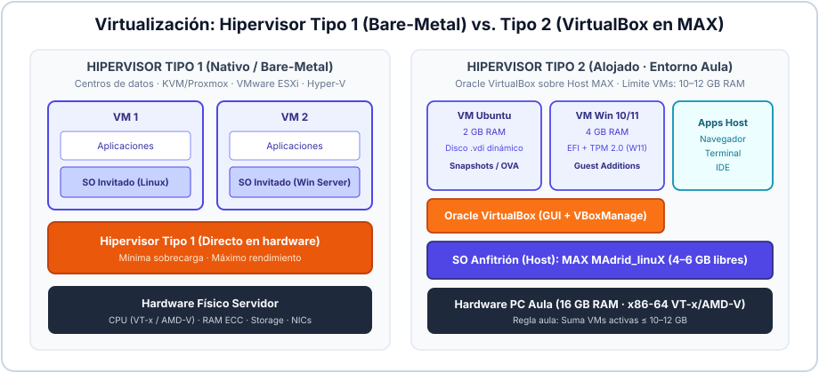
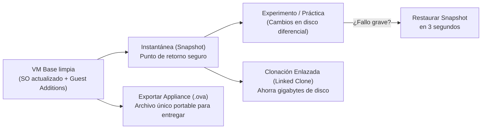

# Tecnologías de Virtualización con VirtualBox sobre MAX

> **Criterios de Evaluación cubiertos:** `RA2.g` y `RA2.d` — *Uso de tecnologías de virtualización para instalar, probar y gestionar sistemas operativos.*

---

## 1. Hipervisores Tipo 1 vs. Tipo 2 y Contenedores

<!-- fuente: raw/procesados/ra2-virtualizacion-planificacion-instalacion.md -->

Un **hipervisor** (*Virtual Machine Monitor*, VMM) es el software encargado de crear, aislar y asignar recursos hardware virtuales (vCPU, RAM, discos, NICs) a una o varias **Máquinas Virtuales (VMs)**.



| Tecnología | Cómo opera | Ejemplos | Uso principal |
| :--- | :--- | :--- | :--- |
| **Hipervisor Tipo 1 (*Bare-metal*)** | Corre directamente sobre el hardware físico sin SO base | Proxmox VE (KVM), VMware ESXi, Microsoft Hyper-V | Servidores de producción, centros de datos y cloud |
| **Hipervisor Tipo 2 (*Hosted*)** | Corre como aplicación dentro de un SO anfitrión | **Oracle VirtualBox (en MAX)**, VMware Workstation | **Aulas DAM**, desarrollo local y pruebas multi-SO |
| **Contenedores** | Aíslan procesos en espacio de usuario compartiendo el mismo kernel Linux del host | Docker, Podman, LXC | Despliegue ligero de microservicios y apps (no ejecutan kernel Windows en host Linux) |

---

## 2. Almacenamiento Virtual, Instantáneas, Clones y `OVA`

<!-- fuente: raw/procesados/ra2-virtualizacion-planificacion-instalacion.md -->

### Formatos y modos de disco virtual

- **`VDI` (*Virtual Disk Image*):** Formato nativo de VirtualBox.
- **`VMDK`:** Formato estándar de VMware, muy usado al importar/exportar *appliances*.
- **`VHD` / `VHDX`:** Formatos nativos de Microsoft Hyper-V.
- **`QCOW2`:** Formato avanzado de QEMU/KVM/Proxmox con compresión y *snapshots* nativos.
- **Reservado dinámicamente (*Dynamic*):** Recomendado en los equipos del aula porque solo ocupa en el SSD real de MAX los gigabytes realmente escritos por la VM.
- **Tamaño fijo (*Fixed*):** Asigna todo el espacio desde el minuto cero; ofrece menor fragmentación en servidores dedicados.

### Herramientas imprescindibles para prácticas en VirtualBox



- **Instantáneas (*Snapshots*):** Crean un disco diferencial hijo congelando el estado anterior. Toma siempre una instantánea antes de editar particiones, gestores de arranque o registros críticos.
- **Clon completo vs. Clon enlazado (*Linked Clone*):** El clon completo copia todo el archivo VDI (independiente pero pesado); el clon enlazado comparte la imagen base de solo lectura de una instantánea y solo guarda las diferencias de la nueva VM.
- **Exportación `OVA` (*Open Virtualization Archive*):** Empaqueta en un único archivo `.ova` la definición hardware (`.ovf`) y los discos comprimidos para mover VMs entre el aula y casa.

---

## 3. Gestión de VirtualBox por GUI y por Consola (`VBoxManage`)

<!-- fuente: raw/procesados/ra2-virtualizacion-planificacion-instalacion.md -->

Además de la interfaz gráfica en MAX, VirtualBox incorpora la herramienta CLI **`VBoxManage`**, ideal para automatizar laboratorios respetando el límite de **10–12 GB de RAM**:

=== "MAX / Ubuntu (Host con `VBoxManage`)"

    ```bash
    # Listar todas las VMs registradas y las que están encendidas actualmente
    VBoxManage list vms
    VBoxManage list runningvms

    # Crear una instantánea antes de realizar cambios arriesgados
    VBoxManage snapshot "DAM-Ubuntu" take "pre-practica-grub" --description "Estado limpio"

    # Restaurar instantánea (con la VM apagada)
    VBoxManage snapshot "DAM-Ubuntu" restore "pre-practica-grub"

    # Ajustar RAM y vCPUs de una VM apagada cumpliendo el presupuesto del aula
    VBoxManage modifyvm "DAM-Ubuntu" --memory 2048 --cpus 2 --firmware efi
    ```

=== "Windows (Host con `VBoxManage.exe`)"

    ```powershell
    # En anfitriones Windows (por ejemplo en casa), VBoxManage.exe reside en Archivos de programa
    & "C:\Program Files\Oracle\VirtualBox\VBoxManage.exe" list vms
    & "C:\Program Files\Oracle\VirtualBox\VBoxManage.exe" snapshot "DAM-Ubuntu" take "estado-limpio"
    ```

---

## Recursos para profundizar

- **Documentación oficial y referencia técnica:**
  - [Oracle VirtualBox User Manual — Chapter 1: First Steps](https://www.virtualbox.org/manual/ch01.html)
  - [Oracle VirtualBox User Manual — Chapter 5: Virtual Storage (VDI, VMDK, Differencing Images)](https://www.virtualbox.org/manual/ch05.html)
  - [Oracle VirtualBox User Manual — Chapter 8: VBoxManage Reference](https://www.virtualbox.org/manual/ch08.html)
- **Vídeos explicativos recomendados (YouTube):**
  - [Virtualización: Hipervisores Tipo 1 vs. Tipo 2 explicados](https://www.youtube.com/watch?v=gekm9zlVXsc)
  - [Diferencias entre Hipervisor Tipo 1 y Tipo 2 con esquemas](https://www.youtube.com/watch?v=qLD_I7MzxgY)
- **Práctica relacionada en `wikiSI`:** [Ejercicio e06 · Verificación de ISOs y creación de VMs en VirtualBox](../ejercicios/e06-ra2-verificacion-isos-creacion-vm-virtualbox.md)
