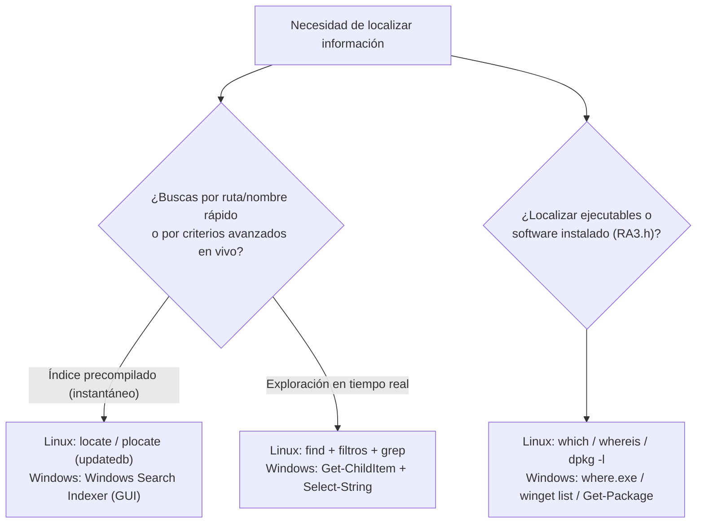

# Búsqueda, Localización de Información e Inventario de Software

<!-- fuente: raw/procesados/ra3-sistemas-archivos-directorios-busqueda.md -->

> **Criterios de evaluación cubiertos:** `RA3.d` (localización de información en entorno gráfico y comandos) y `RA3.h` (identificación y evaluación de utilidades relacionadas con la gestión de información y software instalado).

Localizar archivos de configuración olvidados, detectar ficheros gigantes que están llenando una partición `/var`, buscar cadenas dentro de cientos de logs o auditar el software instalado en un equipo son operaciones diarias en administración de sistemas.

---

## 1. Estrategias de Búsqueda: Tiempo Real vs. Índice Precompilado (`RA3.d`)

<!-- fuente: raw/procesados/ra3-sistemas-archivos-directorios-busqueda.md -->



| Herramienta | Tipo de motor | Cuándo usarla | Ventaja / Limitación |
| :--- | :--- | :--- | :--- |
| **`find` (Linux)** | Recorrido en tiempo real | Filtrar por tamaño (`+100M`), antigüedad (`-mtime -2`), permisos o dueño | 100 % actualizada y exacta; puede ser lenta sobre millones de ficheros |
| **`locate` / `plocate`** | Base de datos indexada (`updatedb`) | Encontrar un archivo conocido en milisegundos por todo `/` | Ultrarrápida; si creaste un archivo hace un segundo, requiere `sudo updatedb` |
| **`grep` / `ripgrep`** | Búsqueda de contenido interno | Encontrar una IP, puerto o palabra clave dentro de ficheros de configuración o logs | Admite expresiones regulares (`-E`) y recursividad (`-rn`) |
| **`Get-ChildItem` + `Select-String`** | Motor PowerShell orientado a objetos | Automatizar búsquedas y auditorías en Windows filtrando por propiedades reales | Permite encadenar tuberías (`Sort-Object Length -Descending`) |

---

## 2. Búsqueda Avanzada de Archivos y Contenidos (`RA3.d`)

<!-- fuente: raw/procesados/ra3-sistemas-archivos-directorios-busqueda.md -->

=== "MAX / Ubuntu (Linux)"
    ```bash
    # 1. Buscar ficheros .log modificados en las últimas 24 horas mayores de 10 MiB en /var
    sudo find /var -type f -name "*.log" -mtime -1 -size +10M 2>/dev/null

    # 2. Localizar ficheros por índice en milisegundos (actualizar índice si falta plocate)
    locate sshd_config

    # 3. Buscar contenido textual recursivamente dentro de /etc mostrando línea exacta
    sudo grep -rn "PasswordAuthentication" /etc/ssh/

    # 4. Localizar dónde está instalado un comando y sus páginas man
    which python3
    whereis systemctl

    # 5. Identificar qué directorios ocupan más disco (auditoría de capacidad)
    sudo du -sh /var/* | sort -rh | head -n 10
    ```

=== "Windows 10 / 11"
    ```powershell
    # 1. Buscar archivos mayores de 50 MB dentro del perfil de usuario ordenados por tamaño
    Get-ChildItem -Path $env:USERPROFILE -Recurse -File -ErrorAction SilentlyContinue |
      Where-Object { $_.Length -gt 50MB } |
      Sort-Object Length -Descending |
      Select-Object FullName, @{N="MB";E={[math]::Round($_.Length/1MB,2)}} -First 10

    # 2. Buscar texto dentro de ficheros de configuración o logs (equivalente a grep -rn)
    Select-String -Path "C:\Windows\System32\drivers\etc\hosts" -Pattern "localhost"

    # 3. Localizar dónde reside un binario en $env:PATH (similar a which)
    where.exe notepad
    Get-Command powershell | Select-Object Source

    # 4. Operadores útiles en el buscador gráfico del Explorador de Windows:
    # ext:pdf fecha de modificación:esta semana tamaño:>10MB
    ```

---

## 3. Identificación del Software Instalado en Entorno Gráfico y Consola (`RA3.h`)

<!-- fuente: raw/procesados/ra3-sistemas-archivos-directorios-busqueda.md -->

El currículo de RA3 exige saber inventariar qué utilidades y aplicaciones están presentes en el equipo tanto por interfaz gráfica (*Software de Ubuntu / Centro de Aplicaciones* o *Configuración → Aplicaciones instaladas* en Windows) como mediante consola reproducible:

=== "MAX / Ubuntu (Linux)"
    ```bash
    # Listar todos los paquetes Debian instalados con estado y versión
    dpkg -l | grep -E "virtualbox|timeshift|openssh"

    # Listar paquetes instalados explícitamente (apt) y paquetes aislados (Snap/Flatpak)
    apt list --installed 2>/dev/null | head -n 20
    snap list

    # Averiguar a qué paquete pertenece un binario o fichero concreto del sistema
    dpkg -S /usr/bin/find
    ```

=== "Windows 10 / 11"
    ```powershell
    # Inventario unificado moderno mediante winget
    winget list

    # Consultar paquetes UWP / Microsoft Store y proveedores MSI/Programas en PowerShell
    Get-Package | Select-Object Name, Version, ProviderName -First 20
    Get-AppxPackage | Select-Object Name, Version | Sort-Object Name -First 15
    ```

!!! tip "Filtrado de errores de permiso en `find`"
    Al ejecutar `find /` como usuario normal sin `sudo`, aparecerán decenas de mensajes `Permission denied` por pantalla. Añadiendo **`2>/dev/null`** al final redirigimos el flujo de error (`stderr`) al sumidero nulo para ver únicamente los resultados encontrados.

---

## Recursos para profundizar

- **Documentación oficial:** `man 1 find`, `man 1 grep`, `man 1 locate` y [Microsoft Learn: PowerShell `Get-ChildItem`](https://learn.microsoft.com/en-us/powershell/module/microsoft.powershell.management/get-childitem).
- **Vídeo recomendado:** [Dominar find, grep y utilidades de búsqueda en Linux](https://www.youtube.com/watch?v=YYyc9XGurE4).
- **Practica lo aprendido:** [e11 · Exploración FHS, Inodos, Enlaces y Búsqueda](../ejercicios/e11-ra3-exploracion-fhs-inodos-enlaces-busqueda.md).
