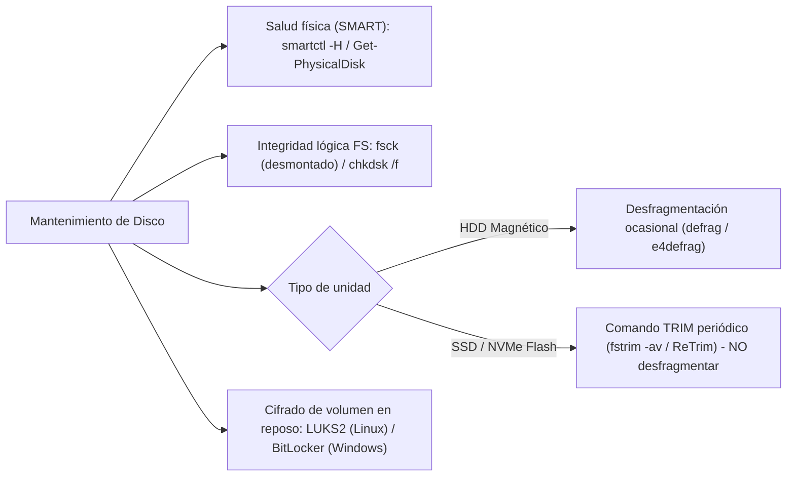

# Diagnóstico, Chequeo, TRIM vs. Desfragmentación y Cifrado de Discos

<!-- fuente: raw/procesados/ra3-particiones-volumenes-lvm-raid-cifrado.md -->

> **Criterios de evaluación cubiertos:** `RA3.e` (mantenimiento, chequeo y cifrado de particiones) y `RA3.h` (utilidades de diagnóstico, optimización y protección de datos).

El mantenimiento preventivo del almacenamiento evita pérdidas silenciosas de información, detecta discos próximos a fallar antes de que colapsen y protege los datos confidenciales frente a robos físicos mediante cifrado de disco completo.

---

## 1. Diagnóstico Físico (SMART) y Reparación Lógica (`fsck` / `chkdsk`)

<!-- fuente: raw/procesados/ra3-particiones-volumenes-lvm-raid-cifrado.md -->



### Regla crítica antes de ejecutar `fsck`
En GNU/Linux, **jamás ejecutes `fsck` sobre una partición montada en lectura/escritura**, ya que modificarías estructuras mientras el kernel escribe en caché provocando corrupción grave. Desmóntala primero (o arranca desde un **Live-USB / Puppy Linux** si es `/`).

=== "MAX / Ubuntu (Linux)"
    ```bash
    # 1. Salud física SMART de discos reales (requiere smartmontools)
    sudo apt install -y smartmontools
    sudo smartctl -H /dev/sda
    sudo smartctl -A /dev/sda | grep -E "Reallocated|Pending|Wear|Temperature"

    # 2. Chequeo y reparación lógica de una partición desmontada
    sudo umount /mnt/datos
    sudo fsck -f -y /dev/sdb1

    # 3. Optimización SSD (TRIM) en lugar de desfragmentación mecánica
    sudo fstrim -av
    systemctl status fstrim.timer
    ```

=== "Windows 10 / 11"
    ```powershell
    # 1. Consultar estado de salud física de las unidades desde PowerShell
    Get-PhysicalDisk | Select-Object FriendlyName, MediaType, HealthStatus, OperationalStatus

    # 2. Comprobar y reparar el sistema de archivos NTFS (e: datos o c: al reiniciar)
    chkdsk E: /f
    # Usar /r añade escaneo físico completo de sectores defectuosos (muy lento en HDD grandes)

    # 3. Enviar TRIM manualmente a un SSD o comprobar tipo de optimización
    Optimize-Volume -DriveLetter C -ReTrim -Verbose
    ```

!!! danger "¿Por qué NO se debe desfragmentar un SSD?"
    En un disco duro mecánico (**HDD**), juntar los fragmentos contiguos acelera la lectura al mover menos el cabezal. En una unidad **SSD / NVMe**, no hay partes móviles (latencia uniforme) y **desfragmentar genera miles de borrados/escrituras innecesarias que acortan la vida útil de las celdas Flash NAND**. En SSD se aplica **TRIM** para informar al controlador qué bloques han quedado libres.

---

## 2. Cifrado de Discos y Volúmenes (`LUKS2` vs. `BitLocker`) (`RA3.e`, `RA3.h`)

<!-- fuente: raw/procesados/ra3-particiones-volumenes-lvm-raid-cifrado.md -->

Si un portátil corporativo o disco USB externo se pierde o es sustraído, el atacante puede arrancar desde un Live-USB y leer todos los archivos sin conocer la contraseña de usuario del sistema operativo **a menos que el volumen esté cifrado en reposo**.

| Aspecto | LUKS2 (`cryptsetup` · GNU/Linux) | BitLocker (`manage-bde` · Windows Pro/Edu/Ent) |
| :--- | :--- | :--- |
| **Estándar / Cifrado** | AES-XTS 256/512 bits sobre `dm-crypt` | AES-XTS 128/256 bits integrado en NTFS/ReFS |
| **Almacenamiento de clave** | Cabecera con hasta 32 *keyslots* (contraseñas, archivos clave o chip TPM2 vía `systemd-cryptenroll`) | Chip **TPM 2.0** automático + PIN opcional + **Clave de recuperación de 48 dígitos** |
| **Ámbito** | Partición completa, volumen LVM o disco USB | Volumen completo `C:` o unidades extraíbles (*BitLocker To Go*) |

=== "MAX / Ubuntu (`cryptsetup` / LUKS)"
    ```bash
    # ¡ATENCIÓN! luksFormat destruye todo el contenido previo del dispositivo destino
    sudo apt install -y cryptsetup

    # 1. Cifrar la partición /dev/sdb1 con LUKS2
    sudo cryptsetup luksFormat /dev/sdb1

    # 2. Desbloquear el contenedor cifrado bajo el nombre lógico 'caja_fuerte'
    sudo cryptsetup open /dev/sdb1 caja_fuerte

    # 3. Formatear y montar el dispositivo descifrado mapeado en /dev/mapper/
    sudo mkfs.ext4 -L CajaFuerte /dev/mapper/caja_fuerte
    sudo mkdir -p /mnt/seguro && sudo mount /dev/mapper/caja_fuerte /mnt/seguro

    # 4. Al terminar: desmontar y volver a cerrar el contenedor
    sudo umount /mnt/seguro && sudo cryptsetup close caja_fuerte
    ```

=== "Windows 10 / 11 (`BitLocker`)"
    ```powershell
    # Comprobar el estado de protección BitLocker en las unidades actuales
    manage-bde -status
    Get-BitLockerVolume

    # Activar BitLocker en la unidad de datos E: con protector por contraseña (PowerShell Admin)
    Enable-BitLocker -MountPoint "E:" -EncryptionMethod XtsAes256 -PasswordProtector

    # Exportar obligatoriamente la clave de recuperación numérica de 48 dígitos
    (Get-BitLockerVolume -MountPoint "E:").KeyProtector | Format-List KeyProtectorType, RecoveryPassword
    ```

!!! tip "Alternativa multiplataforma portable para aulas y USBs"
    Si necesitas contenedores cifrados portables idénticos en MAX (Linux), Windows y macOS sin depender de TPM, **VeraCrypt** (software libre) permite crear volúmenes o ficheros-contenedor multiplataforma verificables en cualquier máquina.

---

## Recursos para profundizar

- **Documentación oficial:** [ArchWiki: dm-crypt / LUKS Disk Encryption](https://wiki.archlinux.org/title/Dm-crypt/Encrypting_an_entire_system) y [BitLocker Drive Encryption Overview (Microsoft Learn)](https://learn.microsoft.com/en-us/windows/security/operating-system-security/data-protection/bitlocker/).
- **Vídeo recomendado:** [Sistemas de archivos, SSD TRIM, diagnóstico y seguridad en discos](https://www.youtube.com/watch?v=nktxla7gtKc).
- **Practica lo aprendido:** [e14 · Chequeo SMART, `fsck`/`chkdsk` y Cifrado LUKS/BitLocker](../ejercicios/e14-ra3-chequeo-smart-cifrado-luks-bitlocker.md).
