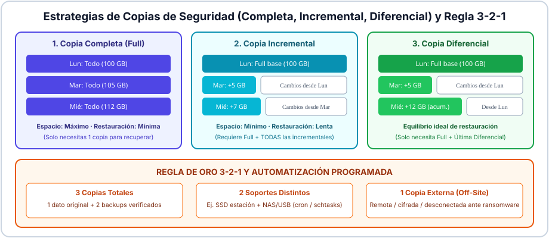

# Copias de Seguridad, Clonación y Automatización de Tareas

<!-- fuente: raw/procesados/ra3-copias-seguridad-automatizacion-tareas.md -->

> **Criterios de evaluación cubiertos:** `RA3.f` (realización y restauración de copias de seguridad), `RA3.g` (planificación y automatización de tareas) y `RA3.h` (utilidades especializadas de respaldo y clonación).

Un sistema de almacenamiento bien particionado fracasa en su misión si no dispone de copias automáticas verificadas que permitan recuperar la información dentro de los plazos comprometidos tras un borrado accidental, fallo hardware o ataque de cifrado malicioso (*ransomware*).

---

## 1. Tipos de Copias de Seguridad y Regla 3-2-1 (`RA3.f`)

<!-- fuente: raw/procesados/ra3-copias-seguridad-automatizacion-tareas.md -->



Al diseñar un plan de respaldos definimos el **RPO** (*cuántos datos/horas de trabajo máximo aceptamos perder entre copias*) y el **RTO** (*cuánto tiempo máximo podemos tardar en restaurar el servicio*).

| Tipo de Copia | Qué copia exactamente | Tamaño y rapidez al crear | Cadena necesaria al **restaurar** |
| :--- | :--- | :--- | :--- |
| **Completa (*Full*)** | Todos los archivos íntegros del directorio origen | Máximo tamaño / más lenta | **1 archivo:** solo la última completa |
| **Incremental** | Solo archivos creados/cambiados desde la **última copia (Full o Incremental)** | Mínimo tamaño / muy rápida | Completa + **todas las incrementales** posteriores en orden |
| **Diferencial** | Todo lo cambiado acumulado desde la **última copia Completa** | Tamaño creciente cada día | Completa + **última diferencial** únicamente |

### Regla 3-2-1 obligatoria
Conservar al menos **3 copias** en total, almacenadas en **2 soportes o medios distintos** (ej. SSD del servidor + NAS/disco externo USB), manteniendo **1 copia fuera del recinto** (*off-site* o aislada sin escritura continua) para sobrevivir a incendios o secuestro de red.

---

## 2. Herramientas de Respaldo, Sincronización y Clonación (`RA3.f`, `RA3.h`)

<!-- fuente: raw/procesados/ra3-copias-seguridad-automatizacion-tareas.md -->

=== "MAX / Ubuntu (Linux)"
    ```bash
    # 1. Empaquetado y compresión con tar (.tar.gz) conservando permisos
    tar -czvf ~/backup_etc_$(date +%F).tar.gz /etc/netplan /etc/fstab

    # 2. Copias incrementales reales con tar usando fichero de estado (.snar)
    tar --listed-incremental=/tmp/estado.snar -czvf /tmp/full.tar.gz ~/proyectos/

    # 3. Sincronización inteligente con rsync (simular primero con --dry-run / -n)
    rsync -avhn --delete ~/proyectos/ /mnt/backup/proyectos/
    rsync -avh --delete ~/proyectos/ /mnt/backup/proyectos/

    # 4. Restaurar un fichero concreto desde tar o sincronizar inverso con rsync
    tar -xzvf ~/backup_etc_2026-11-15.tar.gz -C /tmp/restaurado/
    ```

    Para clonación íntegra de discos físicos/VDI entre aulas sin depender del sistema instalado se utiliza **Clonezilla Live** (permite guardar imágenes comprimidas excluyendo sectores vacíos mediante `partclone`). En escritorio también destaca **Déjà Dup**.

=== "Windows 10 / 11"
    ```powershell
    # 1. Sincronización espejo robusta con Robocopy (/MIR refleja origen en destino)
    # ¡Cuidado! /MIR elimina en destino lo que se borró en origen. Probar antes con /L (solo listar):
    robocopy "C:\Proyectos" "D:\Backups\Proyectos" /MIR /L /R:2 /W:5

    # Ejecución real registrando log completo:
    robocopy "C:\Proyectos" "D:\Backups\Proyectos" /MIR /R:2 /W:5 /LOG:"D:\Backups\log_copia.txt"

    # 2. Copia de seguridad de imagen de sistema Windows desde CLI Administrador:
    # wbadmin start backup -backupTarget:E: -include:C: -allCritical -quiet
    ```

    En interfaz gráfica Windows ofrece el **Historial de archivos** (para carpetas de usuario en unidad externa/red) y **Copias de seguridad y restauración**.

---

## 3. Planificación y Automatización de Tareas (`RA3.g`)

<!-- fuente: raw/procesados/ra3-copias-seguridad-automatizacion-tareas.md -->

Una copia que depende de la memoria humana termina olvidándose. Los sistemas operativos ofrecen planificadores robustos para ejecutar scripts de respaldo o mantenimiento sin intervención:

=== "MAX / Ubuntu (`cron` y `systemd timers`)"
    La sintaxis de **`crontab -e`** consta de cinco campos de tiempo seguidos del comando (usando siempre rutas absolutas):

    ```text
    ┌───────────── minuto (0 - 59)
    │ ┌─────────── hora (0 - 23)
    │ │ ┌───────── día del mes (1 - 31)
    │ │ │ ┌─────── mes (1 - 12)
    │ │ │ │ ┌───── día de la semana (0 - 7, domingo = 0 ó 7)
    │ │ │ │ │
    * * * * *  /ruta/absoluta/script_backup.sh
    ```

    ```bash
    # Editar tareas programadas del usuario actual
    crontab -e
    # Ejemplo dentro de crontab: copiar cada día de Lunes a Viernes a las 22:30
    30 22 * * 1-5 /usr/bin/rsync -az /home/alumdam/proyectos/ /mnt/backups/proyectos/

    # Listar tareas programadas del usuario y temporizadores modernos systemd
    crontab -l
    systemctl list-timers --all

    # Programar una tarea única puntual con 'at'
    echo "/usr/local/bin/mi_alerta.sh" | at 23:45
    ```

=== "Windows 10 / 11 (`schtasks` / Programador de tareas)"
    En entorno gráfico se abre con **`taskschd.msc`** (*Programador de tareas*). Desde consola/PowerShell podemos automatizar su alta reproducible:

    ```powershell
    # 1. Crear tarea diaria con schtasks a las 22:30 ejecutando robocopy
    schtasks /create /tn "BackupProyectosDAM" `
      /tr "robocopy C:\Proyectos D:\Backups\Proyectos /MIR" `
      /sc DAILY /st 22:30

    # 2. Equivalente moderno en PowerShell (Register-ScheduledTask)
    $accion = New-ScheduledTaskAction -Execute "robocopy.exe" -Argument "C:\Proyectos D:\Backups\Proyectos /MIR"
    $disparador = New-ScheduledTaskTrigger -Daily -At "22:30"
    Register-ScheduledTask -TaskName "BackupProyectosPS" -Action $accion -Trigger $disparador -Description "Copia diaria RA3"

    # 3. Consultar y forzar ejecución de prueba inmediata
    Get-ScheduledTask -TaskName "BackupProyectos*"
    schtasks /run /tn "BackupProyectosDAM"
    ```

!!! tip "Prueba siempre tus restauraciones"
    Un backup no verificado mediante un simulacro de restauración es solo un acto de fe. Verifica periódicamente el contenido restaurado y los códigos de retorno en el log (`EXIT 0` o `< 8` en `robocopy`).

---

## Clonación Masiva (Clonezilla), Sincronización (`rclone`) y Plantilla de Política 3-2-1

Para llevar la teoría de copias e imágenes al entorno real de aula o empresa conviene distinguir tres herramientas complementarias:

- **Clonación de equipos con [Clonezilla](https://clonezilla.org/):**
  - Permite generar una **imagen completa** de disco o particiones y restaurarla bit a bit en otro equipo (`unicast`), o bien desplegar simultáneamente una misma imagen sobre toda un aula en red local usando **Clonezilla Server / Multicast** sin saturar el ancho de banda con envíos repetidos.
- **Sincronización entre carpetas locales y nube:**
  - En Linux / multiplataforma destaca **`rclone`** para sincronizar carpetas **local ↔ local** y **local ↔ nube** (Google Drive, OneDrive, S3/Nextcloud), junto con **`Syncthing`** (P2P cifrado), **`FreeFileSync`** en Windows y **`Cyberduck`** como cliente gráfico multi-protocolo (`SFTP`, WebDAV, nube).
- **Diseño de una Política de Copias de Seguridad (`Checklist` profesional):**
  1. **¿Qué datos?** Separar políticas por criticidad (*Sistema operativo*, *Documentos y proyectos de código*, *Otros archivos*).
  2. **¿Cómo?** Combinación de copia **completa**, **diferencial** e **incremental**.
  3. **¿Cuándo?** Periodicidad y política de retención/sustitución.
  4. **¿Dónde?** Regla **3-2-1** (en empresas con grandes volúmenes archivísticos siguen usándose cintas **LTO** por su aislamiento físico *air-gapped*).
  5. **Seguridad y software:** cifrado en reposo/tránsito, etiquetado, lista de acceso, herramientas como *Cobian Backup*, *Areca* o `borg`/`restic`, y referencia oficial de la [Guía de Copias de Seguridad de INCIBE](https://www.incibe.es/sites/default/files/contenidos/guias/guia-copias-de-seguridad.pdf).

---

## Recursos para profundizar

- **Documentación oficial:** [Manual oficial de Rsync](https://download.samba.org/pub/rsync/rsync.1), `man 5 crontab` y [Microsoft Learn: Robocopy & Task Scheduler](https://learn.microsoft.com/en-us/windows-server/administration/windows-commands/robocopy).
- **Vídeo recomendado:** [Backups automáticos en Linux con rsync y crontab desde cero](https://www.youtube.com/watch?v=MPqCAhVKlBs).
- **Practica lo aprendido:** [e15 · Copias de Seguridad con `rsync`/`tar`/`robocopy` y Tareas Programadas](../ejercicios/e15-ra3-backups-rsync-tar-cron-schtasks.md).
