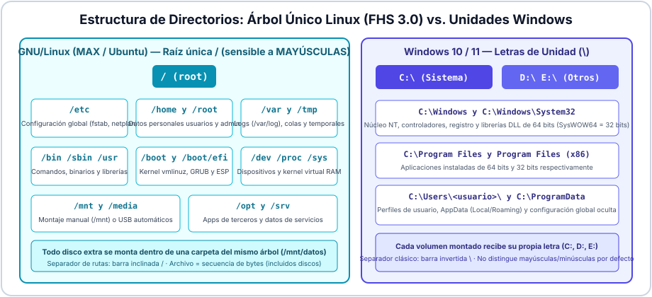

# Estructura y Función de los Directorios del Sistema Operativo

<!-- fuente: raw/procesados/ra3-sistemas-archivos-directorios-busqueda.md -->

> **Criterios de evaluación cubiertos:** `RA3.b` y `RA3.c` (*en el currículo oficial del módulo 0483, la identificación de la estructura y función de los directorios del sistema operativo se divide entre los apartados `b)` y `c)`*).

Cada sistema operativo sigue una filosofía propia para organizar el código del núcleo, los ejecutables, la configuración y los archivos de usuario. Comprender qué contiene cada directorio permite administrar, diagnosticar fallos y planificar copias de seguridad con precisión.

---

## 1. Filosofía: Árbol Único POSIX vs. Unidades Independientes

<!-- fuente: raw/procesados/ra3-sistemas-archivos-directorios-busqueda.md -->



| Característica estructural | GNU/Linux (`FHS 3.0`) | Windows 10 / 11 |
| :--- | :--- | :--- |
| **Raíz del sistema** | Única raíz global **`/`** (todos los discos se montan como subcarpetas dentro de `/`) | Múltiples raíces independientes por letra de unidad (`C:\`, `D:\`, `E:\`) |
| **Separador de rutas** | Barra inclinada **`/`** (ej. `/etc/netplan/01.yaml`) | Barra invertida **`\`** (ej. `C:\Windows\System32`) |
| **Sensibilidad a mayúsculas** | **Sensible** (`Archivo.txt` ≠ `archivo.txt`) | **Insensible por defecto** en NTFS/Explorer (preserva mayúsculas, no las distingue al abrir) |
| **Caracteres y extensiones** | El tipo de archivo lo definen los permisos `+x` y su cabecera (*magic bytes*) | La asociación de apertura depende de la extensión (`.exe`, `.msi`, `.txt`) |

---

## 2. El Estándar FHS en GNU/Linux (MAX y Ubuntu) (`RA3.b`, `RA3.c`)

<!-- fuente: raw/procesados/ra3-sistemas-archivos-directorios-busqueda.md -->

El **Filesystem Hierarchy Standard (FHS)** garantiza que scripts y administradores encuentren siempre cada archivo en la misma ruta estándar:

| Directorio | Función exacta en el sistema | Contenido habitual en MAX / Ubuntu |
| :---: | :--- | :--- |
| **`/`** | Raíz absoluta de todo el árbol de ficheros | Contiene el resto de directorios y puntos de montaje |
| **`/bin`** y **`/usr/bin`** | Comandos y aplicaciones ejecutables de usuario | `ls`, `cp`, `bash`, `nano`, `python3` (`/bin` suele enlazar a `/usr/bin`) |
| **`/sbin`** y **`/usr/sbin`** | Binarios administrativos reservados habitualmente a `root` | `fdisk`, `mkfs`, `iptables`, `systemctl` |
| **`/etc`** | Archivos de configuración global del sistema (solo texto) | `fstab`, `hosts`, `passwd`, `group`, `/etc/netplan/`, `/etc/apt/` |
| **`/home`** | Directorios personales de cada usuario estándar | `/home/alumdam/Documentos`, configuraciones ocultas `.bashrc` |
| **`/root`** | Directorio personal exclusivo del superusuario `root` | Separado de `/home` para poder acceder aunque `/home` falle |
| **`/var`** | Datos variables generados durante la operación | Registros en `/var/log/`, caché de paquetes `/var/cache/apt/`, spool |
| **`/tmp`** | Almacenamiento temporal volátil accesible a todos (con *Sticky Bit*) | Archivos de sesión limpiados automáticamente al reiniciar |
| **`/boot`** | Ficheros necesarios para arrancar el sistema operativo | Kernel `vmlinuz`, `initrd.img`, `/boot/grub/` y ESP en `/boot/efi` |
| **`/dev`**, **`/proc`**, **`/sys`** | Sistemas virtuales en memoria (kernel y dispositivos) | Discos `/dev/sda`, procesos `/proc/<PID>/`, info `/proc/meminfo` |
| **`/mnt`** y **`/media`** | Puntos de montaje temporales (manual vs automático) | Discos extra montados en `/mnt/disco2` o USB en `/media/$USER` |
| **`/opt`** y **`/srv`** | Software de terceros empaquetado aparte y datos de servicios | IDEs descargados en `/opt/`, carpetas web o Samba en `/srv/` |

---

## 3. Jerarquía de Directorios en Windows (`RA3.b`, `RA3.c`)

<!-- fuente: raw/procesados/ra3-sistemas-archivos-directorios-busqueda.md -->

- **`C:\Windows`**: Núcleo (`ntoskrnl.exe`), controladores (`System32\drivers`), fuentes y utilidades administrativas (`System32`). Por razones históricas de compatibilidad en arquitecturas x64, `System32` guarda binarios de **64 bits** y `SysWOW64` los de **32 bits**.
- **`C:\Program Files`** y **`C:\Program Files (x86)`**: Carpeta estándar para software nativo de 64 bits y de 32 bits respectivamente.
- **`C:\ProgramData`**: Carpeta oculta para configuración global de aplicaciones compartida entre todos los usuarios locales.
- **`C:\Users\<usuario>`**: Perfil individual de usuario (`Desktop`, `Documents`, `Downloads`) más **`AppData\Local`** (cachés específicas de ese PC) y **`AppData\Roaming`** (preferencias portables en entorno de dominio).

---

## 4. Rutas Absolutas vs. Relativas y Enlaces (`Hard` vs. `Symbolic`)

<!-- fuente: raw/procesados/ra3-sistemas-archivos-directorios-busqueda.md -->

- **Ruta absoluta:** Parte siempre desde la raíz (`/etc/apt/sources.list` o `C:\Windows\System32\drivers\etc\hosts`). Funciona sin importar el directorio actual.
- **Ruta relativa:** Parte de la ubicación actual (`.` = directorio actual, `..` = directorio padre, `~` = `/home/$USER`).

### Comparativa práctica en terminal

=== "MAX / Ubuntu (Linux)"
    ```bash
    # Inspeccionar el árbol FHS de primer nivel y enlaces simbólicos base (/bin -> /usr/bin)
    ls -l /

    # Crear un enlace duro (hard link): comparte el mismo número de inodo en el mismo disco
    echo "Configuracion base" > ~/original.txt
    ln ~/original.txt ~/enlace_duro.txt

    # Crear un enlace simbólico (soft link): apunta por ruta, permite enlazar carpetas o cruzar particiones
    ln -s ~/original.txt ~/acceso_simbolico.txt

    # Verificar los inodos: original.txt y enlace_duro.txt comparten idéntico inodo; el simbólico tiene uno propio
    ls -li ~/original.txt ~/enlace_duro.txt ~/acceso_simbolico.txt
    ```

=== "Windows 10 / 11"
    ```powershell
    # Ver variables del sistema que apuntan a carpetas clave de Windows
    $env:SystemRoot      # C:\Windows
    $env:ProgramFiles    # C:\Program Files
    $env:APPDATA         # C:\Users\<usuario>\AppData\Roaming

    # Crear enlace simbólico (Symbolic Link) desde PowerShell o CMD Administrador
    New-Item -ItemType SymbolicLink -Path "$env:USERPROFILE\Desktop\hosts_link.txt" -Target "C:\Windows\System32\drivers\etc\hosts"
    # Equivalente en CMD: mklink enlace.txt destino.txt  |  mklink /H duro.txt destino.txt
    ```

!!! tip "¿Qué ocurre si borras el archivo original?"
    Si borras `original.txt`, el **enlace simbólico** queda roto (*dangling symlink*), mientras que el **enlace duro** conserva el contenido intacto porque el archivo físico solo se libera cuando el contador de enlaces de su inodo llega a `0`.

---

## Recursos para profundizar

- **Documentación oficial:** [Filesystem Hierarchy Standard (FHS 3.0 · Linux Foundation)](https://refspecs.linuxfoundation.org/FHS_3.0/fhs/index.html) y `man 7 hier` en terminal MAX/Ubuntu.
- **Vídeo recomendado:** [Estructura de directorios en Linux (FHS) explicada paso a paso](https://www.youtube.com/watch?v=YYyc9XGurE4).
- **Practica lo aprendido:** [e11 · Exploración FHS, Inodos, Enlaces y Búsqueda](../ejercicios/e11-ra3-exploracion-fhs-inodos-enlaces-busqueda.md).
