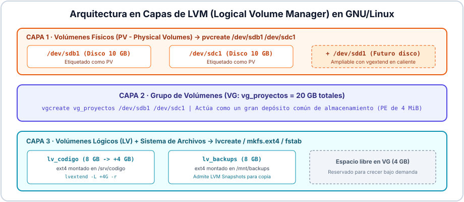
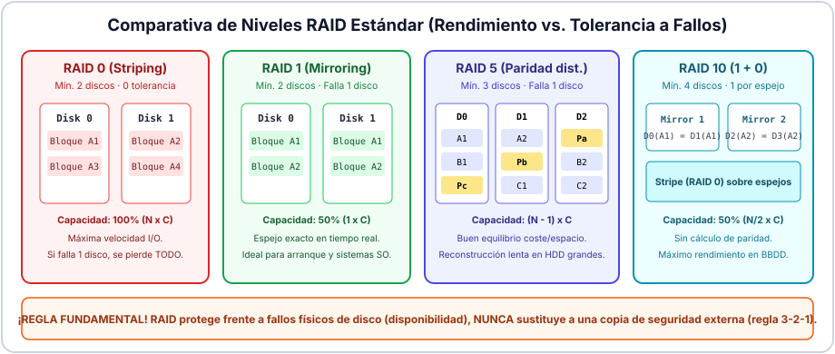

# Administración de Discos, Particiones, LVM y Matrices RAID

<!-- fuente: raw/procesados/ra3-particiones-volumenes-lvm-raid-cifrado.md -->

> **Criterios de evaluación cubiertos:** `RA3.e` (creación de particiones, unidades y volúmenes lógicos) y `RA3.h` (instalación y evaluación de utilidades de gestión de almacenamiento).

A medida que crecen los servidores y las necesidades de las aplicaciones, particionar discos con tamaños rígidos se vuelve insuficiente. Tanto GNU/Linux como Windows incorporan herramientas gráficas y de consola para administrar particiones clásicas, volúmenes flexibles (**LVM** / *Storage Spaces*) y arreglos tolerantes a fallos (**RAID**).

---

## 1. Particionado Clásico y Montaje Persistente (`fstab` vs. Letras) (`RA3.e`)

<!-- fuente: raw/procesados/ra3-particiones-volumenes-lvm-raid-cifrado.md -->

En Linux un disco nuevo (`/dev/sdb` o `/dev/nvme1n1`) requiere crear tabla de particiones (**GPT** preferida frente a MBR), definir particiones, crear el sistema de archivos (`mkfs`) y **montarlo** en un directorio vacío del árbol único.

!!! warning "Montar por UUID en `/etc/fstab` — Nunca por `/dev/sdX`"
    Si conectas un nuevo disco o cambias el puerto SATA, `/dev/sdb1` puede pasar a llamarse `/dev/sdc1`. Por ello **`/etc/fstab`** debe identificar cada volumen por su **UUID único** (`blkid`), probando siempre los cambios antes de reiniciar con `sudo mount -a`.

=== "MAX / Ubuntu (Linux)"
    ```bash
    # 1. Identificar discos, particiones y UUIDs actuales
    lsblk -f
    sudo blkid

    # 2. Inicializar tabla GPT y crear una partición primaria ocupando el 100% con parted
    sudo parted /dev/sdb --script mklabel gpt mkpart primary ext4 1MiB 100%

    # 3. Formatear con etiqueta 'Proyectos' en ext4
    sudo mkfs.ext4 -L Proyectos /dev/sdb1

    # 4. Crear punto de montaje y añadir entrada persistente por UUID a /etc/fstab
    sudo mkdir -p /mnt/proyectos
    UUID_SDB1=$(sudo blkid -s UUID -o value /dev/sdb1)
    echo "UUID=$UUID_SDB1 /mnt/proyectos ext4 defaults,noatime 0 2" | sudo tee -a /etc/fstab

    # 5. Validar fstab sin reiniciar (si devuelve error, corregir antes de apagar)
    sudo mount -a && df -h /mnt/proyectos
    ```

=== "Windows 10 / 11"
    ```powershell
    # En entorno gráfico: diskmgmt.msc (Administración de discos) o 'Espacios de almacenamiento'
    # En PowerShell (Administrador) para inicializar disco 1 en GPT, crear partición y formatear NTFS:
    Get-Disk | Where-Object PartitionStyle -eq 'RAW' |
      Initialize-Disk -PartitionStyle GPT -PassThru |
      New-Partition -AssignDriveLetter -UseMaximumSize |
      Format-Volume -FileSystem NTFS -NewFileSystemLabel "Proyectos" -Confirm:$false

    # Equivalente clásico interactivo con DiskPart:
    # diskpart -> list disk -> select disk 1 -> convert gpt -> create partition primary
    # -> format fs=ntfs quick label="Proyectos" -> assign letter=E -> exit
    ```

---

## 2. Volúmenes Lógicos (`LVM`) y Discos Dinámicos (`RA3.e`, `RA3.h`)

<!-- fuente: raw/procesados/ra3-particiones-volumenes-lvm-raid-cifrado.md -->



Con **LVM (*Logical Volume Manager*)**, el almacenamiento deja de estar atado a los límites de una partición física gracias a tres capas:

1. **Volumen Físico (`PV`):** Discos o particiones marcados para LVM (`pvcreate`).
2. **Grupo de Volúmenes (`VG`):** Piscina unificada de almacenamiento que suma la capacidad de uno o varios PV (`vgcreate`).
3. **Volumen Lógico (`LV`):** Las unidades finales que se formatean (`ext4`/`xfs`) y montan (`lvcreate`). Su gran ventaja es **crecer o reducirse dinámicamente** incluso agregando nuevos discos VDI sin interrumpir el servicio (`vgextend` + `lvextend -r`).

```bash
# Flujo completo de creación y ampliación en caliente con LVM (en Ubuntu/MAX):
sudo pvcreate /dev/sdb1 /dev/sdc1
sudo vgcreate vg_datos /dev/sdb1 /dev/sdc1
sudo lvcreate -L 8G -n lv_apps vg_datos
sudo mkfs.ext4 /dev/vg_datos/lv_apps

# Más adelante, si se llena lv_apps y sobra espacio en el VG (ampliación sin desmontar):
sudo lvextend -L +4G -r /dev/vg_datos/lv_apps
```

En **Windows**, el equivalente clásico son los *Discos Dinámicos* (volúmenes distribuidos/seccionados) y la evolución moderna son los **Espacios de Almacenamiento (*Storage Spaces*)**, que permiten crear *Storage Pools* combinando múltiples unidades físicas o virtuales con paridad o reflejo.

---

## 3. Matrices RAID: Niveles, Capacidad y `mdadm` (`RA3.e`, `RA3.h`)

<!-- fuente: raw/procesados/ra3-particiones-volumenes-lvm-raid-cifrado.md -->



| Nivel RAID | Discos mínimos | Capacidad útil | Discos que puede perder | Balance rendimiento / seguridad |
| :---: | :---: | :---: | :---: | :--- |
| **RAID 0** (*Striping*) | 2 | $N \times C$ (100 %) | **Ninguno (0)** | Máxima lectura/escritura; pérdida total si cae 1 disco |
| **RAID 1** (*Mirroring*) | 2 | $1 \times C$ (50 %) | 1 (de 2) | Alta fiabilidad y lectura rápida; ideal para SO y arranque |
| **RAID 5** (*Paridad*) | 3 | $(N-1) \times C$ | 1 | Buen aprovechamiento del espacio; reconstrucción exigente |
| **RAID 10** (*1 + 0*) | 4 (par) | $(N/2) \times C$ (50 %) | 1 por cada espejo | Alto rendimiento en escritura + alta tolerancia sin calcular paridad |

=== "MAX / Ubuntu (`mdadm`)"
    ```bash
    # Crear un RAID 1 por software sobre dos particiones/discos de igual tamaño
    sudo apt install -y mdadm
    sudo mdadm --create --verbose /dev/md0 --level=1 --raid-devices=2 /dev/sdb1 /dev/sdc1

    # Consultar el estado de sincronización en tiempo real y detalles de la matriz
    cat /proc/mdstat
    sudo mdadm --detail /dev/md0
    ```

=== "Windows 10 / 11 (Storage Spaces)"
    ```powershell
    # Crear un Storage Pool y un Virtual Disk con resistencia Mirror (equivalente a RAID 1)
    $discos = Get-PhysicalDisk -CanPool $true
    New-StoragePool -FriendlyName "PoolAula" -StorageSubSystemFriendlyName "Windows Storage*" -PhysicalDisks $discos
    New-VirtualDisk -StoragePoolFriendlyName "PoolAula" -FriendlyName "DiscoEspejo" -ResiliencySettingName Mirror -UseMaximumSize
    ```

!!! danger "El mito más peligroso del RAID"
    Un **RAID 1 o RAID 5 NO es una copia de seguridad**: protege contra la avería eléctrica o mecánica de un disco duro, pero **si borras un fichero o sufres ransomware, el daño se replica al instante en todos los discos del espejo**.

---

## Equivalencias RAID en Windows (*Espacios de Almacenamiento*) frente a Linux (`mdadm`)

En la práctica profesional resulta útil saber traducir los niveles RAID clásicos a la terminología gráfica de **Espacios de almacenamiento** (*Storage Spaces*) en Windows 10/11:

| Nivel RAID clásico | Discos mínimos | Tolerancia a fallos | Equivalente en Windows (*Storage Spaces*) | Herramienta estándar en Linux |
| :--- | :---: | :---: | :--- | :--- |
| **RAID 0 (*Striping*)** | 2 | 0 discos (si falla uno se pierde todo) | **Espacio simple** (`Simple`) | `mdadm --level=0` |
| **RAID 1 (*Mirroring*)** | 2 | 1 disco por pareja | **Espacio de reflejo** (`Mirror`) | `mdadm --level=1` |
| **RAID 5 (*Paridad*)** | 3 | 1 disco de todo el conjunto | **Espacio de paridad** (`Parity`) | `mdadm --level=5` |

> **Lectura de particiones Linux desde Windows:** De forma nativa Windows no monta particiones `ext4`. Para consultar o rescatar archivos puntuales en solo lectura desde Windows pueden emplearse utilidades como *DiskInternals Linux Reader* o acceso mediante WSL2 (`wsl --mount`).

---

## Recursos para profundizar

- **Documentación oficial:** [Ubuntu Server Guide: LVM y Software RAID](https://ubuntu.com/server/docs/logical-volume-manager-lvm) y [Microsoft Learn: Storage Spaces](https://learn.microsoft.com/en-us/windows-server/storage/storage-spaces/overview).
- **Vídeo recomendado:** [Implementación práctica de RAID y LVM en Linux desde cero](https://www.youtube.com/watch?v=mvpI9KcdyV0).
- **Practica lo aprendido:** [e12 · Particionado y `fstab`](../ejercicios/e12-ra3-particionado-montaje-fstab-diskpart.md) y [e13 · Volúmenes Lógicos LVM y RAID con `mdadm`](../ejercicios/e13-ra3-volumenes-logicos-lvm-raid-mdadm.md).
