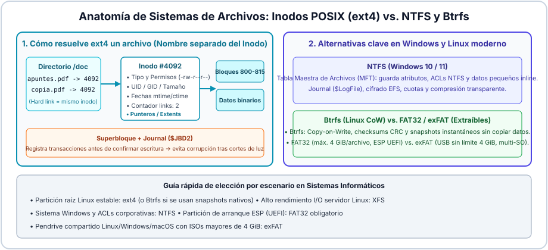

# Sistemas de Archivos: Anatomía y Comparativa Técnica

<!-- fuente: raw/procesados/ra3-sistemas-archivos-directorios-busqueda.md -->

> **Criterio de evaluación cubierto:** `RA3.a` (comparación técnica de sistemas de archivos en sistemas libres y propietarios).

Un disco duro o unidad SSD recién conectado es un bloque lineal de sectores sin significado propio. Para organizar carpetas, nombres, permisos y contenido es imprescindible dar formato con un **sistema de archivos (*filesystem*)**, cuya arquitectura interna determina la fiabilidad, velocidad y seguridad del almacenamiento.

---

## 1. Estructuras Internas Fundamentales (`RA3.a`)

<!-- fuente: raw/procesados/ra3-sistemas-archivos-directorios-busqueda.md -->



### En UNIX / GNU/Linux (`ext4`, `XFS`, `Btrfs`)
- **Superbloque (*Superblock*):** Cabecera crítica que guarda los parámetros del volumen (tamaño total, tamaño de bloque de 4 KiB por defecto, número total/libre de inodos, tipo de FS y **UUID**). Se replica en varios sectores de respaldo por si falla el bloque inicial.
- **Inodos (*Index Nodes*):** Cada fichero o directorio posee un número de inodo único (`ls -li` / `stat`) donde residen sus metadatos (**tipo, permisos `rwx`, propietario UID/GID, tamaño exacto, fechas `atime/mtime/ctime`, contador de enlaces duros y punteros/extents a bloques de datos**). El inodo **no contiene el nombre del fichero**; ese mapeo vive dentro del directorio contenedor.
- **Extents:** En `ext4`, sustituyen a los antiguos punteros bloque a bloque describiendo rangos contiguos de bloques físicos, agilizando archivos grandes y reduciendo fragmentación.
- **Journaling (*Diario transaccional*):** Antes de aplicar cambios sobre metadatos o datos, el sistema anota la intención en un registro circular (`$JBD2`). Si se produce un corte eléctrico, al reiniciar se reproduce el diario en segundos en lugar de escanear todo el disco.
- **Copy-on-Write (`CoW`):** Empleado por **Btrfs** y **ZFS**; nunca sobreescribe datos existentes en el mismo bloque físico: escribe el nuevo bloque en espacio libre y cambia el puntero atómicamente, permitiendo *snapshots* instantáneos y detección silenciosa de corrupción (*bit rot*) por sumas de verificación.

### En Windows (`NTFS`, `FAT32`, `exFAT`)
- **NTFS (*New Technology File System*):** Se articula en torno a la **MFT (*Master File Table*)**, una tabla donde cada archivo (incluso los propios ficheros de control del sistema como `$LogFile` o `$Bitmap`) ocupa un registro de 1 KiB. Soporta **ACLs** complejas, journaling, compresión, cuotas, enlaces duros/simbólicos y cifrado por archivo **EFS**.
- **FAT32:** Sencillo y compatible prácticamente con todo hardware, pero carece de *journaling* y permisos de seguridad, y impone un **límite estricto de 4 GiB menos 1 byte por archivo**. Sigue siendo obligatorio en la partición de arranque **ESP (UEFI)**.
- **exFAT (*Extended File Allocation Table*):** Evolución diseñada para memorias flash externas (pendrives, tarjetas SD) que rompe el límite de 4 GiB por archivo con soporte nativo en Windows, macOS y Linux moderno.

---

## 2. Tabla Comparativa de Sistemas de Archivos

<!-- fuente: raw/procesados/ra3-sistemas-archivos-directorios-busqueda.md -->

| Sistema de archivos | Plataforma principal | Journaling / CoW | Tamaño máx. archivo | Permisos nativos | Uso recomendado hoy |
| :--- | :--- | :---: | :---: | :---: | :--- |
| **`ext4`** | GNU/Linux (Ubuntu/MAX) | Journaling | 16 TiB | POSIX + ACLs | Particiones estándar `/`, `/home` y VMs estables |
| **`XFS`** | GNU/Linux servidores | Journaling | 8 EiB | POSIX + ACLs | Grandes volúmenes y cargas paralelas en servidores |
| **`Btrfs`** | GNU/Linux moderno | **CoW** + checksums | 16 EiB | POSIX + subvolúmenes | Estaciones que aprovechen *snapshots* atómicos |
| **`NTFS`** | Windows 10 / 11 | Journaling (`$LogFile`) | 16 TiB / 8 PiB | **NTFS ACLs** + EFS | Volumen de sistema Windows `C:` y datos corporativos |
| **`FAT32`** | Multiplataforma / UEFI | No | **4 GiB - 1 B** | Ninguno | **Partición EFI (ESP)** y dispositivos legacy pequeños |
| **`exFAT`** | Multiplataforma USB/SD | No (TexFAT opcional) | 16 EiB teórico | Ninguno | Pendrives y discos externos compartidos Linux/Windows |

---

## 3. Inspección Práctica de Sistemas de Archivos e Inodos

<!-- fuente: raw/procesados/ra3-sistemas-archivos-directorios-busqueda.md -->

=== "MAX / Ubuntu (Linux)"
    ```bash
    # Ver tipo de sistema de archivos, UUID, etiqueta y tamaño usado de particiones montadas
    df -Th
    lsblk -f

    # Inspeccionar el superbloque y estado del journal en una partición ext4 (solo lectura)
    sudo dumpe2fs -h /dev/sda5 | head -n 25

    # Mostrar el inodo y metadatos completos de un archivo concreto
    ls -li /etc/hosts
    stat /etc/hosts
    ```

=== "Windows 10 / 11"
    ```powershell
    # Listar volúmenes, sistema de archivos (NTFS, FAT32, ReFS) y espacio disponible
    Get-Volume | Format-Table DriveLetter, FileSystemLabel, FileSystem, @{N="SizeGB";E={[math]::Round($_.Size/1GB,2)}}

    # Información detallada NTFS de la unidad C: (sectores, tamaño de clúster, MFT)
    fsutil fsinfo ntfsinfo C:
    ```

!!! warning "Límite real de VirtualBox e intercambio de archivos grandes"
    Cuando formatees un pendrive del aula para transportar una máquina virtual exportada (`.ova` > 4 GiB) o ISOs de Windows entre ordenadores **MAX** y **Windows**, **evita FAT32**: utiliza **`exFAT`** para evitar el error de espacio insuficiente falso al superar los 4 GiB.

---

## Recursos para profundizar

- **Documentación oficial:** [Linux Kernel Filesystems Overview (ext4, XFS, Btrfs)](https://docs.kernel.org/filesystems/index.html) y [Overview of File Systems in Windows (Microsoft Learn)](https://learn.microsoft.com/en-us/windows-server/storage/file-server/file-systems-overview).
- **Vídeo recomendado:** [Sistemas de archivos en Linux y Windows: ext4 vs NTFS vs FAT32 vs Btrfs](https://www.youtube.com/watch?v=nktxla7gtKc).
- **Siguiente tema:** [Estructura y Función de los Directorios del Sistema Operativo (FHS vs Windows)](ra3-estructura-directorios-fhs-windows.md).
