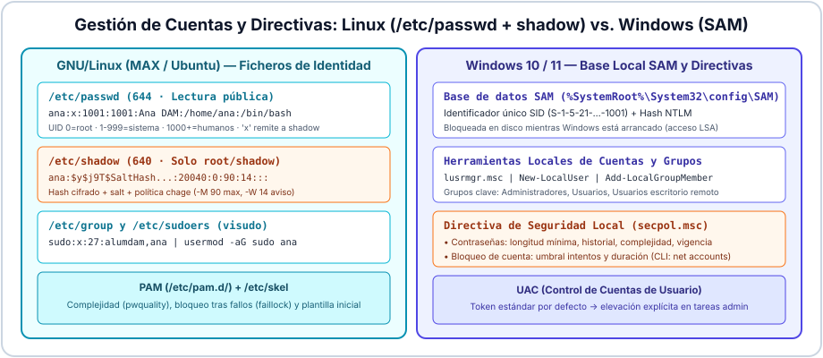

# Administración de Cuentas de Usuario Locales y Grupos

<!-- fuente: raw/procesados/ra4-usuarios-grupos-directivas-seguridad.md -->

> **Criterios de evaluación cubiertos:** `RA4.a` (configuración de cuentas locales y grupos) y `RA4.e` (uso de comandos y herramientas gráficas de administración).

El principio de **mínimo privilegio** exige que cada persona o servicio que utiliza el sistema disponga de su propia cuenta de usuario y trabaje con privilegios estándar, reservando las cuentas administrativas exclusivamente para tareas de configuración puntual.

---

## 1. Almacenamiento de Identidades: Linux (`/etc/passwd`, `shadow`, `group`) vs. Windows (`SAM`)

<!-- fuente: raw/procesados/ra4-usuarios-grupos-directivas-seguridad.md -->



### En GNU/Linux (MAX y Ubuntu)
Las cuentas locales se describen en cuatro ficheros textuales bajo `/etc/`:

1. **`/etc/passwd` (permisos `644`, lectura universal):** Contiene una línea de 7 campos separados por `:` por cada cuenta:
   `ana:x:1001:1001:Ana DAM,,,:/home/ana:/bin/bash`
   - `x` indica que el hash real está protegido en `/etc/shadow`.
   - **UID (`User ID`):** **`0`** corresponde al superusuario **`root`**; **`1–999`** se reservan para cuentas técnicas de sistema/demonios (generalmente con shell `/usr/sbin/nologin`); **`>= 1000`** corresponden a usuarios humanos estándar.
2. **`/etc/shadow` (permisos `640`, legible solo por `root`/grupo `shadow`):** Almacena la contraseña en formato hash seguro (`yescrypt` `$y$` o `SHA-512` `$6$`) con *salt* único más metadatos de caducidad y bloqueo.
3. **`/etc/group` y `/etc/gshadow`:** Definen grupos y pertenencias (`nombre:x:GID:lista_miembros`). Cada usuario tiene **un grupo primario** y cero o más **grupos secundarios** (por ejemplo `sudo` para administración o `docker`).
4. **`/etc/skel`:** Directorio plantilla cuyo contenido (`.bashrc`, `.profile`) se clona en `/home/<usuario>` al crear una cuenta nueva.

### En Windows 10 / 11
Las cuentas locales residen en la base de datos binaria **SAM (*Security Accounts Manager*)**, protegida en `%SystemRoot%\System32\config\SAM`. Internamente Windows no identifica usuarios por su nombre sino por un **SID (*Security Identifier*)** único (por ejemplo `S-1-5-21-...-1001`).

---

## 2. Operaciones Cotidianas con Cuentas y Grupos (`RA4.a`, `RA4.e`)

<!-- fuente: raw/procesados/ra4-usuarios-grupos-directivas-seguridad.md -->

=== "MAX / Ubuntu (Linux)"
    ```bash
    # 1. Crear grupo de trabajo para un proyecto y un usuario con directorio /home y bash
    sudo groupadd dam_dev
    sudo useradd -m -s /bin/bash -c "Laura Desarrolladora" laura
    sudo passwd laura

    # Alternativa interactiva amigable en Debian/Ubuntu:
    # sudo adduser laura

    # 2. Añadir a grupos secundarios SIN borrar los anteriores (¡SIEMPRE -aG!)
    sudo usermod -aG dam_dev,sudo laura

    # 3. Consultar identidades, grupos actuales y sesiones activas
    id laura
    groups laura
    who
    last -n 5

    # 4. Modificar shell o eliminar cuenta junto a su carpeta personal
    sudo usermod -s /bin/zsh laura
    sudo deluser --remove-home laura
    ```

=== "Windows 10 / 11"
    En Windows Pro/Education/Enterprise existe la consola gráfica **`lusrmgr.msc`** (*Usuarios y grupos locales*), complementada por comandos `net` o PowerShell moderno:

    ```powershell
    # 1. Crear grupo y usuario local en PowerShell (Administrador)
    New-LocalGroup -Name "DAM_Dev" -Description "Equipo desarrollo 1 DAM"
    $pass = Read-Host -AsSecureString "Introduce contraseña inicial"
    New-LocalUser -Name "laura" -Password $pass -FullName "Laura Desarrolladora"

    # 2. Añadir el usuario a los grupos Usuarios y DAM_Dev
    Add-LocalGroupMember -Group "Usuarios" -Member "laura"
    Add-LocalGroupMember -Group "DAM_Dev" -Member "laura"

    # 3. Listar cuentas locales y miembros de un grupo
    Get-LocalUser | Format-Table Name, Enabled, LastLogon
    Get-LocalGroupMember -Group "Administradores"

    # 4. Equivalente clásico en CMD:
    # net user laura /add
    # net localgroup DAM_Dev laura /add
    ```

!!! danger "El error clásico con `usermod -G`"
    Si ejecutas `sudo usermod -G dam_dev laura` **olvidando la `-a` (*append*)**, **`laura` será expulsada del grupo `sudo` y de todos sus demás grupos secundarios**, conservando únicamente `dam_dev`. Usa siempre **`usermod -aG`**.

---

## Recursos para profundizar

- **Documentación oficial:** `man 5 passwd`, `man 8 useradd`, `man 8 usermod` y [Microsoft Learn: `Microsoft.PowerShell.LocalAccounts`](https://learn.microsoft.com/en-us/powershell/module/microsoft.powershell.localaccounts/).
- **Vídeo recomendado:** [Administración completa de Usuarios, Grupos y Permisos en Linux](https://www.youtube.com/watch?v=6rrWRe_7Y-A).
- **Siguiente tema:** [Directivas de Cuenta, Seguridad de Contraseñas y Elevación de Privilegios](ra4-directivas-cuenta-politicas-contrasenas-sudo.md).
