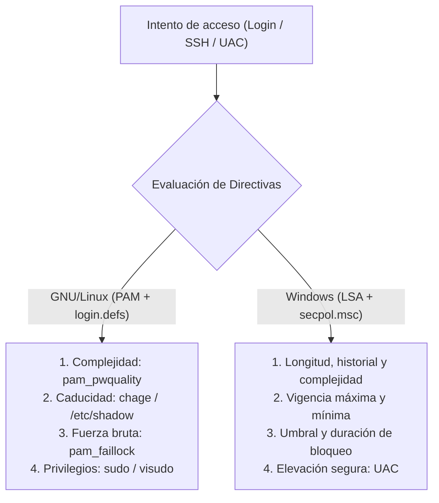

# Directivas de Cuenta, Contraseñas y Elevación de Privilegios

<!-- fuente: raw/procesados/ra4-usuarios-grupos-directivas-seguridad.md -->

> **Criterios de evaluación cubiertos:** `RA4.b` (aseguramiento mediante directivas de cuenta y de contraseñas) y `RA4.e` (administración CLI y GUI).

Crear usuarios no basta para proteger un sistema informático: es obligatorio imponer **políticas de complejidad, caducidad, bloqueo ante ataques de fuerza bruta** y mecanismos auditados para elevar privilegios administrativos temporalmente.

---

## 1. Arquitectura de Autenticación y Directivas (`RA4.b`)

<!-- fuente: raw/procesados/ra4-usuarios-grupos-directivas-seguridad.md -->



---

## 2. Directivas de Contraseña, Caducidad y Bloqueo (`RA4.b`, `RA4.e`)

<!-- fuente: raw/procesados/ra4-usuarios-grupos-directivas-seguridad.md -->

### Parámetros fundamentales en seguridad de cuentas
1. **Longitud y complejidad mínima:** Exigir al menos 10–12 caracteres combinando clases de caracteres o frases de paso largas.
2. **Historial de contraseñas:** Impedir reutilizar las últimas N claves al caducar.
3. **Vigencia mínima y máxima:** Evitar cambios continuos en el mismo día para burlar el historial y obligar a renovar periódicamente cuentas sensibles.
4. **Umbral de bloqueo (*Account Lockout*):** Deshabilitar temporalmente la cuenta (p. ej. 15 minutos) tras 5 intentos erróneos consecutivos para frenar ataques por diccionario.

=== "MAX / Ubuntu (Linux)"
    ```bash
    # 1. Consultar valores globales por defecto para nuevas cuentas
    grep -E "^PASS_" /etc/login.defs

    # 2. Inspeccionar y configurar la política de caducidad de un usuario con chage
    sudo chage -l laura
    # Máximo 90 días, mínimo 7 días antes de cambiar, aviso 14 días antes:
    sudo chage -M 90 -m 7 -W 14 laura

    # 3. Obligar al usuario a cambiar su contraseña en el próximo inicio de sesión
    sudo chage -d 0 laura

    # 4. Bloquear y desbloquear manualmente una cuenta comprometida o temporalmente inactiva
    sudo passwd -l laura   # Anteponiendo '!' al hash en /etc/shadow
    sudo passwd -u laura

    # 5. Bloqueo automático por intentos fallidos con pam_faillock (consulta / reinicio)
    sudo faillock --user laura
    sudo faillock --user laura --reset
    ```

=== "Windows 10 / 11"
    En entorno gráfico abre **`secpol.msc`** → *Directivas de seguridad locales → Directivas de cuenta* (*Directiva de contraseñas* y *Directiva de bloqueo de cuenta*). Por CLI Administrador:

    ```powershell
    # 1. Consultar las directivas actuales de contraseñas y bloqueo
    net accounts

    # 2. Configurar longitud mínima 10 caracteres, vigencia máx 90 días, mín 1 día e historial 5
    net accounts /minpwlen:10 /maxpwage:90 /minpwage:1 /uniquepw:5

    # 3. Activar bloqueo de cuenta tras 5 intentos fallidos durante 15 minutos
    net accounts /lockoutthreshold:5 /lockoutduration:15 /lockoutwindow:15

    # 4. Forzar cambio de contraseña en el próximo inicio o deshabilitar usuario
    wmic useraccount where name='laura' set PasswordExpires=true
    Disable-LocalUser -Name "laura"
    ```

---

## 3. Elevación Controlada: `sudo` / `visudo` vs. `UAC` (`RA4.b`, `RA4.e`)

<!-- fuente: raw/procesados/ra4-usuarios-grupos-directivas-seguridad.md -->

- **En GNU/Linux (`sudo`):** En lugar de habilitar sesiones directas como `root`, los miembros del grupo `sudo` ejecutan órdenes privilegiadas puntuales quedando cada comando auditado en `/var/log/auth.log`.
  - Para delegar un comando concreto a un usuario sin darle acceso total a todo el sistema, se crea un archivo en `/etc/sudoers.d/` editándolo **siempre con `visudo`** para validar la sintaxis:
  ```bash
  sudo visudo -f /etc/sudoers.d/equipo_dam
  # Ejemplo dentro del fichero (laura solo puede reiniciar nginx con sudo sin pedir root completo):
  laura ALL=(ALL) /usr/bin/systemctl restart nginx
  ```
- **En Windows (`UAC`):** Incluso cuando inicias sesión con un usuario perteneciente a *Administradores*, Windows asigna por defecto un **token filtrado estándar**; solo al autorizar el aviso de **Control de Cuentas de Usuario (UAC)** entrega el token administrativo elevado.

!!! warning "No edites `/etc/sudoers` con `nano` directamente"
    Un simple error de sintaxis al guardar `/etc/sudoers` directamente bloquea `sudo` por completo para todos los administradores. **`sudo visudo`** comprueba la gramática antes de aplicar los cambios en disco.

---

## Recursos para profundizar

- **Documentación oficial:** `man 1 chage`, `man 5 sudoers`, `man 8 pam_faillock` y [Microsoft Learn: Account Lockout Policies](https://learn.microsoft.com/en-us/windows/security/threat-protection/security-policy-settings/account-lockout-policy).
- **Vídeo recomendado:** [Administración de Usuarios, Sudo y Seguridad de Cuentas en Linux](https://www.youtube.com/watch?v=6rrWRe_7Y-A).
- **Practica lo aprendido:** [e16 · Creación de Usuarios, Grupos y Directivas (`chage` / `net accounts`)](../ejercicios/e16-ra4-creacion-usuarios-grupos-politicas-chage-net.md).
