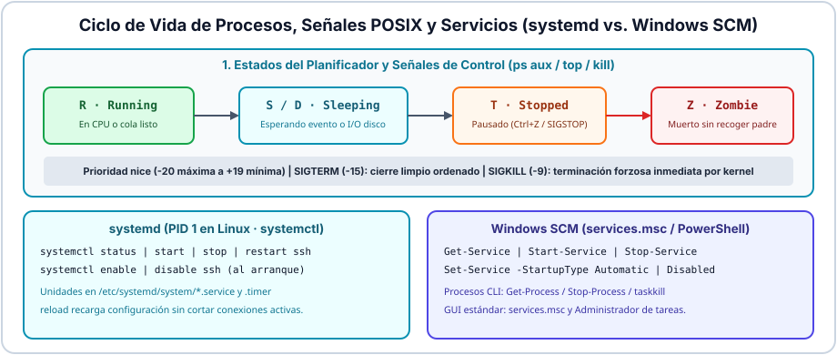

# Gestión de Procesos, Señales y Servicios (`systemd` vs. Windows)

<!-- fuente: raw/procesados/ra4-procesos-servicios-monitorizacion-desarrollo.md -->

> **Criterios de evaluación cubiertos:** `RA4.c` (identificación, arranque y detención de servicios y procesos) y `RA4.e` (comandos y herramientas gráficas de administración).

Todo programa en ejecución genera uno o varios **procesos**, supervisados por el planificador del sistema operativo, mientras que los **servicios** (o *demonios* en UNIX) se ejecutan en segundo plano desde el arranque para atender peticiones continuas sin interfaz interactiva de usuario.

---

## 1. Anatomía y Estados de un Proceso (`RA4.c`)

<!-- fuente: raw/procesados/ra4-procesos-servicios-monitorizacion-desarrollo.md -->



Cada proceso posee un identificador numérico único (**PID**), el identificador de su proceso creador (**PPID**), contexto de memoria propia y prioridad:

- **Estados en Linux:** **`R`** (*Running* / listo en cola CPU), **`S`** (*Interruptible Sleep*, esperando entrada/temporizador), **`D`** (*Uninterruptible Sleep*, esperando E/S hardware crítica), **`T`** (*Stopped*, pausado con `Ctrl+Z`) y **`Z`** (*Zombie*, terminó su ejecución pero su proceso padre aún no leyó su estado de salida).
- **Prioridades (`nice` / `renice`):** Rango numérico de **`-20`** (máxima prioridad CPU) a **`+19`** (mínima prioridad). Los usuarios estándar solo pueden bajar prioridad (aumentar `nice`); subirla (`< 0`) requiere `sudo`.
- **Señales de control (`kill`):**
  - **`SIGTERM` (`15`, por defecto):** Pide educadamente al proceso que cierre archivos y termine limpiamente.
  - **`SIGKILL` (`9`):** El kernel destruye el proceso al instante sin darle opción a guardar estado (último recurso ante procesos bloqueados).
  - **`SIGHUP` (`1`):** Indica a muchos demonios (Nginx, SSH) que recarguen su configuración.

---

## 2. Control de Procesos en Primer/Segundo Plano (`RA4.c`, `RA4.e`)

<!-- fuente: raw/procesados/ra4-procesos-servicios-monitorizacion-desarrollo.md -->

=== "MAX / Ubuntu (Linux)"
    ```bash
    # 1. Lanzar una tarea larga en segundo plano y gestionar trabajos de terminal
    sleep 300 &
    jobs                 # Lista procesos lanzados en la sesión actual
    # (Ctrl+Z detiene un proceso en primer plano -> 'bg %1' lo continúa en segundo, 'fg %1' lo recupera)

    # 2. Listar procesos completos y árbol jerárquico desde PID 1 (systemd)
    ps aux | head -n 15
    pstree -p | head -n 15
    pgrep -a sshd

    # 3. Ajustar prioridad de CPU en ejecución (menor prioridad = +10)
    nice -n 10 python3 script_pesado.py &
    renice -n 15 -p 1234

    # 4. Terminar proceso ordenadamente (SIGTERM 15) o forzosamente (SIGKILL 9)
    kill -15 1234
    kill -9 1234
    ```

=== "Windows 10 / 11"
    En entorno gráfico abre **Administrador de tareas (`Ctrl+Shift+Esc`)** o **`resmon`**. Por consola PowerShell o CMD:

    ```powershell
    # 1. Listar procesos con mayor consumo de CPU o memoria
    Get-Process | Sort-Object CPU -Descending | Select-Object Id, ProcessName, CPU, WS -First 10

    # Equivalente clásico CMD: tasklist

    # 2. Cambiar prioridad de un proceso (Normal, BelowNormal, Idle, High)
    (Get-Process notepad).PriorityClass = "BelowNormal"

    # 3. Cerrar proceso suavemente o de forma forzada (-Force)
    Stop-Process -Name "notepad" -Force
    # Equivalente CMD: taskkill /IM notepad.exe /F
    ```

---

## 3. Administración de Servicios (`systemd` vs. `services.msc`) (`RA4.c`)

<!-- fuente: raw/procesados/ra4-procesos-servicios-monitorizacion-desarrollo.md -->

=== "MAX / Ubuntu (`systemd`)"
    En las distribuciones actuales el proceso `PID 1` es **`systemd`**, administrado mediante **`systemctl`**:

    ```bash
    # Consultar estado detallado y últimas líneas de log de un servicio
    sudo systemctl status ssh

    # Control inmediato en la sesión actual (sin afectar al próximo arranque)
    sudo systemctl start ssh
    sudo systemctl stop ssh
    sudo systemctl restart ssh
    sudo systemctl reload ssh    # Recarga configuración sin cortar conexiones activas

    # Control del arranque automático (crea/borra enlaces simbólicos en targets)
    sudo systemctl enable ssh
    sudo systemctl disable ssh
    sudo systemctl is-enabled ssh
    ```

=== "Windows 10 / 11 (`services.msc` / PowerShell)"
    En GUI abre **`services.msc`** (*Servicios*). Por PowerShell como Administrador:

    ```powershell
    # Listar servicios en ejecución
    Get-Service | Where-Object Status -eq "Running" | Select-Object Name, DisplayName -First 15

    # Arrancar, detener y reiniciar un servicio (ejemplo: Cola de impresión 'Spooler')
    Stop-Service -Name "Spooler"
    Start-Service -Name "Spooler"
    Restart-Service -Name "Spooler"

    # Configurar tipo de inicio (Automatic, Manual, Disabled)
    Set-Service -Name "Spooler" -StartupType Automatic
    ```

!!! tip "¿Diferencia entre `stop` y `disable` en `systemd`?"
    `systemctl stop nginx` **detiene el servicio ahora mismo**, pero si estaba habilitado volverá a arrancar al reiniciar la VM. Para impedir también que inicie en futuros arranques debes ejecutar **`systemctl disable nginx`** (o `enable --now` para activar e iniciar a la vez).

---

## Recursos para profundizar

- **Documentación oficial:** `man 1 systemctl`, `man 1 ps`, `man 1 kill` y [Microsoft Learn: `Get-Service` / `Get-Process`](https://learn.microsoft.com/en-us/powershell/module/microsoft.powershell.management/get-service).
- **Vídeo recomendado:** [Procesos, señales y administración completa de systemd (systemctl)](https://www.youtube.com/watch?v=dx-ixZOnkpQ).
- **Practica lo aprendido:** [e18 · Control de Procesos, Señales y Servicios `systemd` / Windows](../ejercicios/e18-ra4-control-procesos-senales-servicios-systemd.md).
