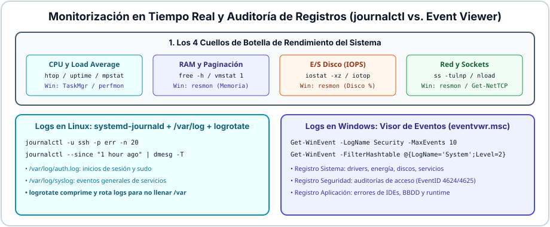
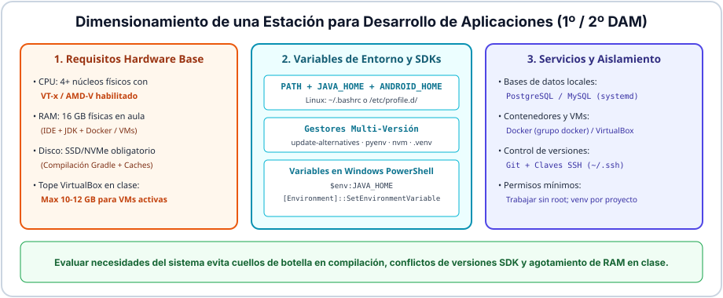

# Monitorización, Registros, Optimización y Entorno de Desarrollo

<!-- fuente: raw/procesados/ra4-procesos-servicios-monitorizacion-desarrollo.md -->

> **Criterios de evaluación cubiertos:** `RA4.f` (monitorización del sistema), `RA4.g` (utilidades de mantenimiento y optimización) y `RA4.h` (evaluación de necesidades del sistema para el desarrollo de aplicaciones).

Un administrador eficaz no espera a que el servidor se bloquee: mide la saturación de los cuatro subsistemas críticos (**CPU, RAM, E/S de disco y red**), audita los registros de eventos (*logs*) ante anomalías y dimensiona los equipos del aula o estudio para soportar entornos reales de desarrollo.

---

## 1. Monitorización de Rendimiento y Cuellos de Botella (`RA4.f`)

<!-- fuente: raw/procesados/ra4-procesos-servicios-monitorizacion-desarrollo.md -->



### Cómo interpretar el *Load Average* en Linux (`uptime` / `htop`)
El parámetro `load average: 1.20, 0.95, 0.70` indica el número medio de procesos esperando CPU o E/S durante los últimos **1, 5 y 15 minutos**. En un procesador de 4 núcleos (`nproc` = 4), una carga de `2.00` representa un ~50 % de saturación cómoda; valores sostenidos superiores a `4.00` revelan cola de espera activa.

=== "MAX / Ubuntu (Linux)"
    ```bash
    # 1. Vista interactiva en tiempo real (instalar htop si faltara)
    sudo apt install -y htop sysstat
    htop

    # 2. Instantánea de memoria libre real ('available' es la clave en Linux) y carga CPU
    free -h
    uptime
    nproc

    # 3. Estadísticas periódicas cada 1 segundo (5 muestras) de CPU/Swap y Disco E/S
    vmstat 1 5
    iostat -xz 1 3
    ```

=== "Windows 10 / 11"
    En interfaz gráfica destacan **Administrador de tareas (`Ctrl+Shift+Esc`)**, **Monitor de recursos (`resmon`)** y **Monitor de rendimiento (`perfmon`)**. En PowerShell:

    ```powershell
    # 1. Consultar uso global de CPU y memoria física disponible
    Get-Counter '\Processor(_Total)\% Processor Time', '\Memory\Available MBytes' -SampleInterval 1 -MaxSamples 3

    # 2. Identificar los 5 procesos con mayor consumo de memoria RAM privada (Working Set)
    Get-Process | Sort-Object WS -Descending |
      Select-Object ProcessName, Id, @{N="RAM_MB";E={[math]::Round($_.WS/1MB,1)}} -First 5
    ```

---

## 2. Registros de Sistema (`journald` / `/var/log` vs. Visor de Eventos) (`RA4.f`, `RA4.g`)

<!-- fuente: raw/procesados/ra4-procesos-servicios-monitorizacion-desarrollo.md -->

=== "MAX / Ubuntu (`journalctl` + `logrotate`)"
    ```bash
    # 1. Consultar errores recientes de todo el sistema o de un servicio concreto
    sudo journalctl -p err -n 20
    sudo journalctl -u ssh --since "1 hour ago"

    # 2. Seguir el registro en vivo mientras pruebas un servicio (-f = follow)
    sudo journalctl -u cron -f

    # 3. Revisar mensajes del kernel / hardware y tamaño ocupado por el diario
    dmesg -T | tail -n 20
    journalctl --disk-usage
    # /etc/logrotate.conf y /etc/logrotate.d/ rotan y comprimen los logs de /var/log automáticamente
    ```

=== "Windows 10 / 11 (`eventvwr.msc`)"
    Abre **`eventvwr.msc`** (*Visor de Eventos*) y navega a *Registros de Windows* (*Aplicación*, *Seguridad*, *Sistema*):

    ```powershell
    # Consultar los últimos 15 eventos de error o advertencia en Sistema (Level 1=Crítico, 2=Error, 3=Warning)
    Get-WinEvent -FilterHashtable @{LogName='System'; Level=1,2,3} -MaxEvents 15 |
      Format-Table TimeCreated, Id, ProviderName, Message -Wrap

    # Consultar intentos recientes de inicio de sesión o errores en Registro de Aplicación
    Get-WinEvent -LogName Application -MaxEvents 10 | Select-Object TimeCreated, Id, LevelDisplayName, ProviderName
    ```

---

## 3. Necesidades del Sistema para el Desarrollo de Aplicaciones (`RA4.h`)

<!-- fuente: raw/procesados/ra4-procesos-servicios-monitorizacion-desarrollo.md -->



Evaluar el hardware y configurar el sistema operativo antes de instalar un entorno de desarrollo evita cuellos de botella graves durante la compilación y las pruebas:

1. **Memoria RAM y Presupuesto de Virtualización:** Al ejecutar simultáneamente un IDE (*IntelliJ IDEA* / *Android Studio* ≈ 3–4 GB), un navegador con documentación, servidor de base de datos (*PostgreSQL/MySQL*) y máquinas virtuales de prueba en VirtualBox sobre nuestros PCs de aula **MAX de 16 GB**, el desarrollador debe planificar cuidadosamente el consumo (por ejemplo, **no rebasar 4–6 GB en VMs mientras el IDE está abierto**).
2. **Almacenamiento NVMe/SSD y exclusiones en tiempo real:** Los proyectos Java/Gradle, `node_modules` o compilaciones generan decenas de miles de archivos pequeños. Requieren SSD y, en Windows, es buena práctica valorar exclusiones controladas en tiempo real para carpetas de compilación verificadas (manteniendo la protección activa global).
3. **Gestión multi-versión sin contaminar el host (`RA4.h`):**
   - Utilizar **`update-alternatives`** (Java), **entornos virtuales Python (`python3 -m venv .venv`)**, **`nvm`** (Node.js) o **contenedores Docker** para aislar dependencias de cada asignatura o proyecto sin romper las herramientas del sistema base.

---

## 4. Registro de Windows (`regedit`), Consolas `mmc` y Herramientas de Mantenimiento (`RA4.f`, `RA4.g`)

En estaciones Windows, la administración profunda del sistema y el mantenimiento preventivo se apoyan en el Registro, el Monitor de Confiabilidad y utilidades modernas de optimización:

### Estructura del Registro de Windows (`regedit.exe`)

Es una base de datos jerárquica donde Windows y las aplicaciones guardan su configuración en **cinco claves raíz**:

1. **`HKEY_CLASSES_ROOT` (`HKCR`):** asociaciones de extensiones de archivos y clases COM.
2. **`HKEY_CURRENT_USER` (`HKCU`):** configuración del usuario activo (escritorio, preferencias, temas).
3. **`HKEY_LOCAL_MACHINE` (`HKLM`):** configuración global del hardware, controladores y software para todos los usuarios.
4. **`HKEY_USERS` (`HKU`):** perfiles cargados de todas las cuentas del equipo.
5. **`HKEY_CURRENT_CONFIG` (`HKCC`):** perfil de hardware activo en el arranque actual.

**Tipos de valores habituales:** `String (REG_SZ)` texto simple, `REG_BINARY` binario/hexadecimal, `REG_DWORD` entero de 32 bits (`0`/`1`), `REG_QWORD` entero de 64 bits, `REG_MULTI_SZ` listas multínea y `REG_EXPAND_SZ` cadenas con variables expandibles (`%SystemRoot%`).

!!! warning "Seguridad antes de tocar `regedit`"
    Exporta siempre una copia de seguridad de la rama antes de modificarla (`Archivo` → `Exportar`) o trabaja dentro de una máquina virtual con instantánea previa; consulta la referencia oficial de Microsoft sobre [uso avanzado del Registro de Windows](https://docs.microsoft.com/es-ES/troubleshoot/windows-server/performance/windows-registry-advanced-users).

### Consolas de diagnóstico y mantenimiento moderno

- **Consola `mmc` personalizada:** permite agrupar en una sola ventana *Administrador de dispositivos*, *Administración de discos*, *Servicios* (inicio manual/automático), *Programador de tareas* y *Visor de eventos*.
- **Monitor de Confiabilidad (`perfmon /rel`):** muestra una línea temporal diaria con fallos críticos de aplicaciones, advertencias y actualizaciones instaladas por fecha.
- **Mantenimiento y diagnóstico de hardware/SO:** [Microsoft PC Manager](https://pcmanager.microsoft.com/es-es), [Microsoft PowerToys](https://learn.microsoft.com/es-es/windows/powertoys/), scripts de ajuste transparente como [`winscript` (`winscript.cc`)](https://winscript.cc/) ([código en GitHub](https://github.com/flick9000/winscript)), y telemetría de sensores/buses con **CPU-Z**, **HWiNFO** y **GPU-Z**.

---

## Recursos para profundizar

- **Documentación oficial:** `man 1 journalctl`, `man 8 logrotate` y [Microsoft Learn: `Get-WinEvent`](https://learn.microsoft.com/en-us/powershell/module/microsoft.powershell.diagnostics/get-winevent).
- **Vídeo recomendado:** [Monitorización avanzada, logs journalctl y rendimiento en Linux](https://www.youtube.com/watch?v=dx-ixZOnkpQ).
- **Practica lo aprendido:** [e19 · Auditoría de Logs y Rendimiento](../ejercicios/e19-ra4-auditoria-logs-journalctl-eventviewer-rendimiento.md) y [e20 · Preparación de Estación de Desarrollo DAM](../ejercicios/e20-ra4-preparacion-estacion-desarrollo-dam-variables.md).
