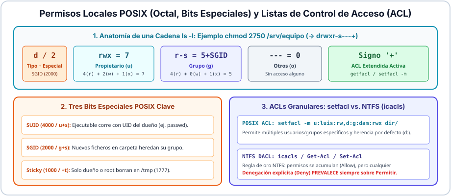

# Permisos Locales, Bits Especiales y Listas de Control de Acceso (ACL)

<!-- fuente: raw/procesados/ra4-permisos-locales-acls-herencia.md -->

> **Criterios de evaluación cubiertos:** `RA4.d` (protección del acceso mediante permisos locales y listas de control de acceso) y `RA4.e` (comandos de administración).

Un sistema multiusuario seguro requiere definir con exactitud qué usuario o grupo puede leer, modificar, ejecutar o eliminar cada recurso almacenado en disco.

---

## 1. Modelo Clásico POSIX: Propietario, Grupo, Otros y `umask` (`RA4.d`)

<!-- fuente: raw/procesados/ra4-permisos-locales-acls-herencia.md -->



En GNU/Linux existen tres categorías (**`u`** propietario, **`g`** grupo, **`o`** otros) y tres bits por categoría: **`r` (4)**, **`w` (2)** y **`x` (1)**.

| Permiso | Significado en un **Archivo regular** | Significado en un **Directorio** |
| :---: | :--- | :--- |
| **`r` (4)** | Leer contenido (`cat`, abrir en editor) | Listar nombres de archivo dentro (`ls`) |
| **`w` (2)** | Modificar o truncar el contenido | **Crear, renombrar o borrar archivos** dentro del directorio (combinado con `x`) |
| **`x` (1)** | Ejecutar como programa o script | **Entrar / atravesar (`cd`)** y acceder a los metadatos de sus inodos |

### Máscara por defecto (`umask`)
Al crear un fichero (`666`) o carpeta (`777`), el sistema resta la `umask` del usuario:
- `umask 022` (típica estándar): directorios `755` (`rwxr-xr-x`), archivos `644` (`rw-r--r--`).
- `umask 027` (endurecida): directorios `750`, archivos `640` (*otros* sin acceso).

---

## 2. Bits Especiales POSIX (`SUID`, `SGID`, `Sticky Bit`) (`RA4.d`)

<!-- fuente: raw/procesados/ra4-permisos-locales-acls-herencia.md -->

El cuarto dígito octal a la izquierda (o los modificadores simbólicos `u+s`, `g+s`, `+t`) controla comportamientos avanzados:

- **`SUID (4000)`** (`rws` en `u`): Un binario ejecutable corre temporalmente con el **UID de su propietario** (p. ej. `/usr/bin/passwd`, propiedad de `root`, permite a un alumno cambiar su hash en `/etc/shadow`).
- **`SGID (2000)`** (`rws` en `g`): Aplicado a un **directorio compartido** (`chmod 2770 /srv/equipo`), hace que todos los archivos nuevos creados dentro **hereden automáticamente el grupo propietario de la carpeta** en vez del grupo primario del autor.
- **`Sticky Bit (1000)`** (`rwt` al final): En directorios compartidos como **`/tmp` (`1777`)**, permite a todos crear archivos pero **impide borrar o renombrar ficheros ajenos** (solo el dueño del archivo, el dueño del directorio o `root` pueden borrarlo).

---

## 3. Listas de Control de Acceso (`ACL` en Linux y `NTFS` en Windows) (`RA4.d`, `RA4.e`)

<!-- fuente: raw/procesados/ra4-permisos-locales-acls-herencia.md -->

Cuando necesitas dar permisos específicos a **dos usuarios individuales** o **varios grupos** sobre una misma carpeta, los 3 tríos clásicos `u:g:o` se quedan cortos. Entra en juego la **ACL (*Access Control List*)**:

=== "MAX / Ubuntu (`chmod`, `chown`, `setfacl`)"
    ```bash
    # 1. Cambiar propietario y grupo recursivamente
    sudo chown -R root:dam_dev /srv/proyecto_dam

    # 2. Aplicar SGID (2) + rwx propietario y grupo + sin acceso otros (2770)
    sudo chmod 2770 /srv/proyecto_dam

    # 3. Consultar y aplicar ACLs granulares (paquete acl)
    sudo apt install -y acl
    getfacl /srv/proyecto_dam

    # Dar solo lectura a la usuaria 'auditor' y escritura por defecto (d:) al grupo dam_dev
    sudo setfacl -m u:auditor:rx /srv/proyecto_dam
    sudo setfacl -m d:g:dam_dev:rwx /srv/proyecto_dam

    # Comprobar la aparición del signo '+' al final de ls -ld
    ls -ld /srv/proyecto_dam   # drwxrws---+ ...
    ```

=== "Windows 10 / 11 (`NTFS DACL` y `icacls`)"
    En Windows los permisos se configuran en *Propiedades → Seguridad → Opciones avanzadas*, o de forma automatizada con **`icacls`** y PowerShell:

    ```powershell
    # 1. Consultar la ACL actual de una carpeta compartida local
    icacls "C:\ProyectosDAM"
    Get-Acl "C:\ProyectosDAM" | Format-List

    # 2. Desactivar herencia convirtiendo permisos actuales y conceder Modificar (M) a DAM_Dev
    # (OI) Object Inherit (archivos) · (CI) Container Inherit (subcarpetas)
    icacls "C:\ProyectosDAM" /inheritance:r /grant "Administradores:(OI)(CI)F" "DAM_Dev:(OI)(CI)M"

    # 3. Denegar explícitamente escritura a un usuario concreto (Deny siempre prevalece)
    icacls "C:\ProyectosDAM" /deny "invitado:(OI)(CI)W"
    ```

!!! danger "La regla de oro en Windows NTFS: `Deny` siempre gana"
    En Windows, si un usuario pertenece a `DAM_Dev` (con permiso `Modificar` concedido) y también se le aplica una regla explícita `Denegar escritura` (directamente o vía otro grupo), el permiso efectivo es **Acceso Denegado**, ya que cualquier *Deny* prevalece sobre cualquier *Allow*.

---

## Recursos para profundizar

- **Documentación oficial:** `man 1 chmod`, `man 1 setfacl`, `man 5 acl` y [Microsoft Learn: `icacls`](https://learn.microsoft.com/en-us/windows-server/administration/windows-commands/icacls).
- **Vídeo recomendado:** [Permisos especiales, chmod, chown y ACLs en Linux paso a paso](https://www.youtube.com/watch?v=zAie7f3uhp8).
- **Practica lo aprendido:** [e17 · Permisos `chmod`, `SGID`, `Sticky Bit`, `setfacl` e `icacls`](../ejercicios/e17-ra4-permisos-chmod-sgid-sticky-setfacl-icacls.md).
