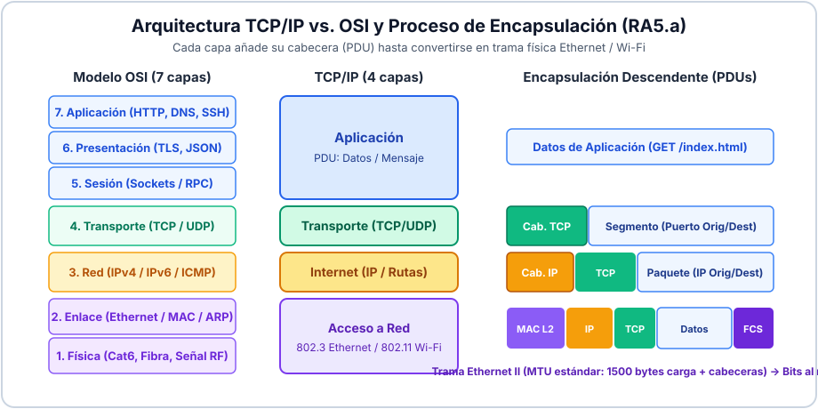
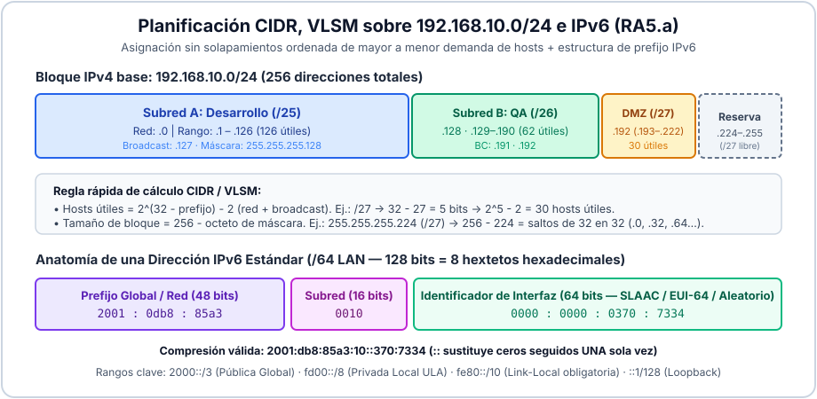

# Arquitectura TCP/IP, Direccionamiento IPv4/IPv6 y Subredes (CIDR y VLSM)

<!-- fuente: raw/procesados/ra5-tcpip-direccionamiento-ipv4-ipv6-subredes.md -->

## 1. Arquitectura en Capas: TCP/IP vs. OSI

Toda comunicación en red se divide en niveles independientes (*capas*) donde cada nivel añade su propia cabecera de control (*encapsulación*) hasta convertirse en señales eléctricas, ópticas o de radiofrecuencia:



| Capa TCP/IP | Equivalente OSI | Unidad de datos (PDU) | Protocolos y elementos clave |
| :--- | :--- | :--- | :--- |
| **Aplicación** | Aplicación, Presentación, Sesión (5–7) | Datos / Mensaje | HTTP/HTTPS, SSH, DNS, DHCP, SMB, SMTP |
| **Transporte** | Transporte (4) | Segmento (TCP) / Datagrama (UDP) | **TCP** (fiable, handshake `SYN`/`SYN-ACK`/`ACK`) y **UDP** (rápido, sin conexión) |
| **Internet** | Red (3) | Paquete | **IPv4**, **IPv6**, **ICMP** / ICMPv6 (`ping`, `traceroute`), enrutamiento IP |
| **Acceso a Red** | Enlace de Datos + Física (1–2) | Trama / Bits | Ethernet (`802.3`), Wi-Fi (`802.11`), direcciones **MAC (48 bits)**, **ARP** |

---

## 2. Direccionamiento IPv4, Rangos Privados y Cálculo CIDR / VLSM

Una dirección **IPv4** ocupa **32 bits** divididos en cuatro octetos decimales (`0–255`). La **máscara de subred** (o notación **CIDR `/prefijo`**) separa qué bits identifican a la **red** y qué bits identifican al **host**.

### Rangos Privados (RFC 1918) y Reservados

- **`10.0.0.0/8`:** Redes corporativas o de aula de gran tamaño (`10.0.0.0` – `10.255.255.255`).
- **`172.16.0.0/12`:** Segmentos medios y contenedores por defecto (`172.16.0.0` – `172.31.255.255`).
- **`192.168.0.0/16`:** Redes domésticas, PYME y laboratorios VirtualBox (`192.168.0.0` – `192.168.255.255`).
- **`127.0.0.0/8`:** Bucle local (*Loopback*, `127.0.0.1`).
- **`169.254.0.0/16`:** Autoconfiguración **APIPA / Link-Local** asignada cuando un cliente espera DHCP pero ningún servidor responde.

### Reglas de Cálculo Rápido CIDR y VLSM



1. **Hosts útiles por subred:** 2^(32 − prefijo) − 2 (la primera dirección es la **dirección de red** y la última es **broadcast**). En enlaces punto a punto entre routers suele usarse `/30` (2 útiles) o `/31` (RFC 3021).
2. **Salto de bloque (*block size*):** 256 − octeto donde corta la máscara. Por ejemplo, `/26` equivale a `255.255.255.192`, dando saltos de 256 − 192 = 64 (`.0`, `.64`, `.128`, `.192`).
3. **Estrategia VLSM (*Variable Length Subnet Mask*):** ordena siempre las subredes necesarias de **mayor a menor número de hosts** antes de repartir bloques para evitar solapamientos.

---

## 3. Direccionamiento IPv6

**IPv6** amplía el espacio a **128 bits** (8 hextetos hexadecimales separados por `:`), elimina el broadcast (sustituido por *multicast*) y simplifica el autoconfigurado mediante **SLAAC** y **NDP**.

- **Reglas de compresión:** se pueden omitir ceros iniciales dentro de cada hexteto (`0db8` → `db8`) y sustituir **una sola vez** por dirección una secuencia continua de hextetos `0000` mediante `::`.
- **Prefijos fundamentales:**
  - `2000::/3` — **Global Unicast (GUA):** equivalente a IPv4 pública enrutable.
  - `fd00::/8` (dentro de `fc00::/7`) — **Unique Local Address (ULA):** equivalente privado de red interna.
  - `fe80::/10` — **Link-Local:** generada automáticamente en cada interfaz para descubrimiento de vecinos (`NDP`) y *gateway*.
  - `::1/128` — **Loopback IPv6**.

---

## 4. Comprobación del Direccionamiento en el Sistema

=== "MAX / Ubuntu (Linux)"

    ```bash
    # Ver interfaces, estado UP/DOWN e IPs IPv4 e IPv6 de forma compacta
    ip -br addr

    # Calcular subredes y comprobar máscaras desde consola si ipcalc está instalado
    # sudo apt install -y ipcalc
    ipcalc 192.168.10.128/26

    # Verificar tabla ARP / vecinos IPv6
    ip neigh show
    ```

=== "Windows 10 / 11"

    ```powershell
    # Resumen de direcciones IPv4/IPv6 y puerta de enlace por adaptador
    Get-NetIPConfiguration

    # Listar únicamente direcciones IPv4 activas con su prefijo CIDR
    Get-NetIPAddress -AddressFamily IPv4 | Select-Object InterfaceAlias, IPAddress, PrefixLength

    # Consultar vecinos ARP locales
    Get-NetNeighbor -AddressFamily IPv4
    ```

---

## Recursos para profundizar

- Práctica relacionada: [Configuración de Red en Clientes (Netplan, NetworkManager y Windows)](ra5-configuracion-red-clientes-netplan-powershell.md).
- Referencia oficial CIDR / RFC 1918: [IETF RFC 4632 (CIDR)](https://datatracker.ietf.org/doc/html/rfc4632).
- Vídeo recomendado sobre TCP/IP y direccionamiento: [Fundamentos TCP/IP, IPv4 y CIDR (YouTube)](https://www.youtube.com/watch?v=-c_o8nOavo4).
- Vídeo recomendado sobre Subnetting y VLSM: [Subnetting IPv4 y VLSM paso a paso (YouTube)](https://www.youtube.com/watch?v=BvyLZX9tSvA).
