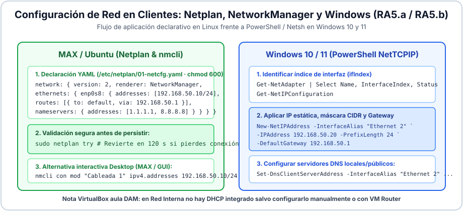

# Configuración de Red en Clientes: Netplan, NetworkManager, PowerShell y Modos VirtualBox

<!-- fuente: raw/procesados/ra5-tcpip-direccionamiento-ipv4-ipv6-subredes.md -->

## 1. Parámetros Esenciales de una Interfaz TCP/IP

Para que un equipo quede correctamente conectado a su red local y pueda alcanzar redes externas necesita cuatro parámetros coordinados:

1. **Dirección IP + Máscara CIDR:** identifica al equipo y define qué direcciones pertenecen a su subred local (comunicación directa en Capa 2 mediante ARP).
2. **Puerta de enlace predeterminada (*Default Gateway*):** IP del router dentro de esa misma subred al que se envían los paquetes con destino externo (`0.0.0.0/0`).
3. **Servidores DNS:** traducen nombres de dominio (`github.com`) a direcciones IP.
4. **Modo de asignación:** **DHCP** (dinámico mediante secuencia *Discover → Offer → Request → Acknowledge*, UDP `67/68`) o **Estático** (imprescindible en servidores, routers y servicios internos).



---

## 2. Configuración Práctica en Ubuntu / MAX vs. Windows 10/11

=== "MAX / Ubuntu (Linux)"

    Ubuntu emplea **Netplan** como capa declarativa en `/etc/netplan/*.yaml` (con permisos `0600` para evitar advertencias de seguridad), apoyándose por debajo en `NetworkManager` (en Desktop/MAX) o `systemd-networkd` (en Server).

    ```yaml
    # /etc/netplan/01-dam-estatica.yaml (permisos: sudo chmod 600)
    network:
      version: 2
      renderer: NetworkManager
      ethernets:
        enp0s8:
          dhcp4: false
          addresses:
            - 192.168.50.10/24
          routes:
            - to: default
              via: 192.168.50.1
          nameservers:
            addresses: [1.1.1.1, 8.8.8.8]
    ```

    ```bash
    # Validar sin riesgo: revierte automáticamente en 120 s si pierdes acceso remoto
    sudo netplan try

    # Aplicar definitivamente o gestionar conexiones en caliente con nmcli (MAX/Desktop)
    sudo netplan apply
    nmcli con show
    nmcli con mod "Conexión cableada 1" ipv4.method manual ipv4.addresses 192.168.50.10/24 ipv4.gateway 192.168.50.1 ipv4.dns "1.1.1.1 8.8.8.8"
    nmcli con up "Conexión cableada 1"
    ```

=== "Windows 10 / 11"

    En Windows se configura mediante **Panel de configuración → Red e Internet** o automatizado por PowerShell con el módulo `NetTCPIP` (como Administrador):

    ```powershell
    # 1. Identificar el nombre exacto de la interfaz
    Get-NetAdapter

    # 2. Desactivar DHCP si procede y fijar IP estática + Gateway
    Remove-NetIPAddress -InterfaceAlias "Ethernet 2" -AddressFamily IPv4 -Confirm:$false -ErrorAction SilentlyContinue
    New-NetIPAddress -InterfaceAlias "Ethernet 2" `
      -IPAddress 192.168.50.20 `
      -PrefixLength 24 `
      -DefaultGateway 192.168.50.1

    # 3. Asignar servidores DNS
    Set-DnsClientServerAddress -InterfaceAlias "Ethernet 2" -ServerAddresses ("1.1.1.1","8.8.8.8")

    # Alternativa clásica con netsh:
    # netsh interface ip set address name="Ethernet 2" static 192.168.50.20 255.255.255.0 192.168.50.1
    ```

---

## 3. Modos de Red en VirtualBox sobre Anfitrión MAX (Aula DAM)

Al diseñar laboratorios en PCs **MAX de 16 GB RAM**, elegir el adaptador adecuado evita conflictos con el switch del instituto:

| Modo VirtualBox | Salida a Internet | Comunicación entre VMs | Uso recomendado en aula DAM |
| :--- | :---: | :---: | :--- |
| **NAT** | Sí (vía anfitrión) | No (aisladas entre sí en `10.0.2.15`) | Descargar paquetes `apt` sin exponer la VM |
| **Red NAT** | Sí (router VirtualBox compartido) | Sí (en la misma subred DHCP VirtualBox) | Escenarios cliente-servidor con salida WAN sin complicar el switch físico |
| **Red Interna (`intnet`)** | No (salvo 2.ª NIC en VM Router) | Sí (aislado total del aula) | **Laboratorios de enrutamiento, DHCP propio, VLANs y cortafuegos** |
| **Solo-anfitrión (`vboxnet0`)** | No | Sí (y con el host MAX) | Administrar servidores vía SSH/HTTP desde MAX sin acceso externo |
| **Adaptador Puente** | Sí (IP directa del aula) | Sí | Solo si el aula permite múltiples MACs en el mismo puerto de pared |

> [!WARNING]
> **Aislamiento de servidores DHCP en el aula:** Si despliegas un servidor DHCP propio en prácticas (`RA5`/`RA6`), usa **siempre `Red Interna` (`intnet`)**; conectarlo en *Adaptador Puente* provocaría un servidor DHCP ilegal (*rogue DHCP*) afectando a los PCs reales del centro.

---

## Recursos para profundizar

- Concepto anterior: [Arquitectura TCP/IP y Direccionamiento IPv4/IPv6](ra5-arquitectura-tcpip-direccionamiento-ipv4-ipv6.md).
- Documentación oficial de Netplan: [Netplan Reference (Canonical)](https://netplan.readthedocs.io/en/stable/).
- Vídeo recomendado sobre DHCP, Gateway y Netplan: [Configuración de red, DHCP, Gateway y Netplan (YouTube)](https://www.youtube.com/watch?v=xSf9CenBR4U).
