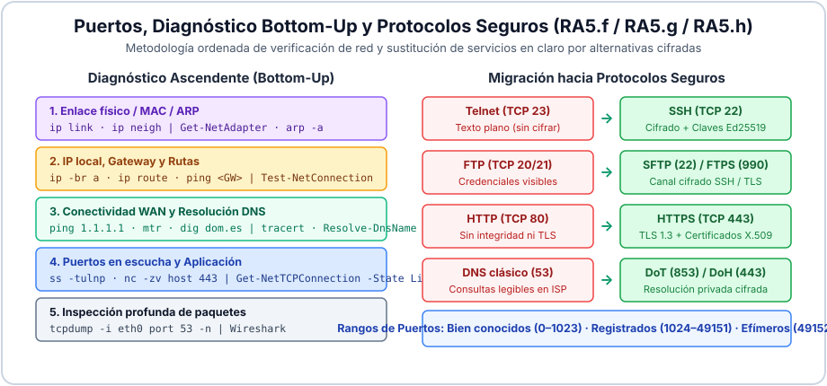

# Gestión de Puertos de Comunicaciones y Diagnóstico Sistemático de Red

<!-- fuente: raw/procesados/ra5-puertos-diagnostico-protocolos-seguros.md -->

## 1. Puertos de Comunicaciones TCP y UDP

Un **socket** combina **Dirección IP + Protocolo (TCP/UDP) + Número de Puerto (0–65535)** para dirigir el tráfico al proceso exacto que escucha en la máquina:

| Rango de puertos | Categoría | Ejemplos clave en 1.º DAM |
| :--- | :--- | :--- |
| **`0 – 1023`** | **Bien conocidos (*Well-Known*)** | `22` SSH/SFTP · `53` DNS (TCP/UDP) · `67/68` DHCP · `80` HTTP · `123` NTP · `443` HTTPS · `445` SMB |
| **`1024 – 49151`** | **Registrados** | `3306` MySQL/MariaDB · `3389` RDP · `5432` PostgreSQL · `8080` Tomcat/Spring Boot |
| **`49152 – 65535`** | **Dinámicos / Efímeros** | Puertos temporales que abre el cliente para recibir la respuesta del servidor |

> [!NOTE]
> Cuando una aplicación falla al arrancar con `Address already in use`, otro proceso ya ocupa ese mismo par `IP:puerto`. Identificar ese PID con `ss -tulnp` o `Get-NetTCPConnection` evita conflictos en despliegue.



---

## 2. Metodología *Bottom-Up* de Verificación de la Red (`RA5.g`)

Ante un problema de *"no tengo red"* o *"no conecta mi base de datos"*, nunca diagnostiques a ciegas: avanza ordenadamente capa a capa desde el hardware hasta el servicio:

1. **Capa 1–2 (Interfaz y ARP):** ¿Está el cable conectado o la interfaz `UP`? ¿Resuelve MAC locales?
2. **Capa 3 local (IP y Gateway):** ¿Tengo IP válida de mi subred (no `169.254.x.x`)? ¿Responde el `ping` a mi puerta de enlace?
3. **Capa 3 externa (Rutas WAN):** ¿Responde `ping 1.1.1.1`? (Si responde por IP pero no por nombre web, la red funciona y el fallo es únicamente **DNS**).
4. **Resolución de nombres (DNS):** ¿Responde `dig` / `Resolve-DnsName`?
5. **Capa 4 y Aplicación (Puertos y Paquetes):** ¿Escucha el servidor en `0.0.0.0` (todas las interfaces) o solo en `127.0.0.1` (local)? ¿Bloquea algún cortafuegos el puerto?

---

## 3. Comandos de Auditoría de Puertos y Diagnóstico

=== "MAX / Ubuntu (Linux)"

    ```bash
    # 1. Ver puertos TCP/UDP en escucha y proceso propietario (PID)
    sudo ss -tulnp

    # 2. Trazar el camino de saltos hasta destino (combinado ping+traceroute)
    mtr -rn -c 5 1.1.1.1

    # 3. Comprobar resolución DNS paso a paso
    dig @1.1.1.1 github.com +short

    # 4. Probar conectividad a un puerto TCP concreto sin navegador
    nc -zv 192.168.50.10 5432

    # 5. Capturar tráfico de un puerto concreto en terminal
    sudo tcpdump -i any port 53 -n -c 10
    ```

=== "Windows 10 / 11"

    ```powershell
    # 1. Ver puertos TCP en escucha y correlacionar con el nombre del proceso
    Get-NetTCPConnection -State Listen |
      Select-Object LocalAddress, LocalPort, OwningProcess,
      @{N='Proceso';E={(Get-Process -Id $_.OwningProcess).ProcessName}} |
      Sort-Object LocalPort

    # Alternativa clásica en CMD: netstat -ano

    # 2. Probar ICMP + puerto TCP concreto en un solo comando (reemplaza a telnet/nc)
    Test-NetConnection -ComputerName 192.168.50.10 -Port 5432

    # 3. Trazado de ruta y resolución DNS
    tracert -d 1.1.1.1
    Resolve-DnsName github.com
    ```

---

## Recursos para profundizar

- Concepto siguiente: [Protocolos Seguros de Comunicaciones (TLS, SSH, SFTP y VPN)](ra5-protocolos-seguros-comunicaciones-tls-ssh-vpn.md).
- Manual de `ss` e `iproute2`: [Ubuntu Manpages · ss(8)](https://manpages.ubuntu.com/).
- Vídeo recomendado sobre puertos y TCP/IP: [Puertos TCP/UDP y diagnóstico TCP/IP (YouTube)](https://www.youtube.com/watch?v=-c_o8nOavo4).
