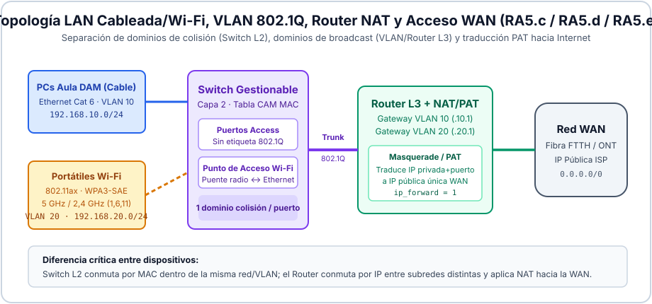

# Dispositivos de Interconexión, VLANs, Enrutamiento, NAT y Acceso WAN

<!-- fuente: raw/procesados/ra5-lan-cableada-inalambrica-enrutamiento-wan.md -->

## 1. Dispositivos de Interconexión por Capa

Comprender en qué capa trabaja cada equipo determina cómo segmenta el tráfico y qué fallos resuelve:

| Dispositivo | Capa | Criterio de reenvío | Dominios que separa | Uso real actual |
| :--- | :---: | :--- | :--- | :--- |
| **Repetidor / Hub** | 1 (Física) | Repite bits a todos los puertos | Ninguno | **Obsoleto** (genera colisiones) |
| **Switch L2** | 2 (Enlace) | Tabla CAM (**direcciones MAC**) | Colisión (uno por puerto) | Conmutación de aula, oficina y CPD |
| **Punto de Acceso (AP)** | 2 (Enlace) | Puente radio `802.11` ↔ Ethernet `802.3` | Colisión por celda/BSS | Despliegue inalámbrico multi-AP |
| **Switch L3 / Router** | 3 (Red) | Tabla de rutas (**direcciones IP**) | **Colisión + Broadcast** | Interconexión de subredes, VLANs y salida **WAN** |



---

## 2. Segmentación Lógica con VLANs (`IEEE 802.1Q`)

Una **VLAN** permite dividir un único switch físico en varias redes locales aisladas lógicamente (ej. **VLAN 10 Alumnado**, **VLAN 20 Profesorado**, **VLAN 30 Servidores**):

- **Puerto *Access*:** conectado al equipo final; las tramas entran y salen **sin etiqueta** y pertenecen a una sola VLAN.
- **Puerto *Trunk* (Troncal):** conecta switches entre sí o hacia un router (*Router-on-a-Stick*); añade una etiqueta **802.1Q (4 bytes con VID 1–4094)** para transportar múltiples VLANs por el mismo cable.
- Para que dos VLANs distintas hablen entre sí necesitan obligatoriamente pasar por un **Router o Switch L3** con su puerta de enlace respectiva (*Inter-VLAN Routing*).

---

## 3. Acceso a Redes de Área Extensa (WAN) y NAT/PAT

Las direcciones privadas **RFC 1918** (`10.x`, `172.16–31.x`, `192.168.x`) no son válidas en Internet. El **Router de borde** realiza **NAT / PAT (*Masquerade*)**:

1. **SNAT / PAT (*Masquerade*):** traduce la IP privada origen + puerto efímero hacia la **IP pública única** del router WAN en una tabla de estados, permitiendo que decenas de equipos naveguen simultáneamente por una sola línea FTTH.
2. **DNAT (*Port Forwarding*):** redirige conexiones entrantes desde un puerto de la IP pública WAN hacia un servidor interno concreto (por ejemplo, publicar el puerto `443` hacia el servidor web de DMZ).
3. **CGNAT en operadoras:** muchos ISP modernos aplican un segundo NAT en su red troncal compartiendo IP pública IPv4 entre varios abonados (impide abrir puertos entrantes IPv4 salvo IP pública dedicada o túnel VPN/IPv6).

---

## 4. Enrutamiento Estático y Función Router en Sistemas Operativos

Un servidor Linux ligero (como una VM Ubuntu Gateway de **1 GB RAM**) puede actuar como router NAT entre la red interna del laboratorio VirtualBox (`intnet`) y una interfaz puente/NAT hacia Internet:

=== "MAX / Ubuntu (Linux)"

    ```bash
    # Consultar la tabla de enrutamiento actual (ruta por defecto y subredes locales)
    ip route show

    # Añadir ruta estática temporal hacia otra subred interna a través de un router vecino
    sudo ip route add 10.20.0.0/16 via 192.168.50.254

    # Convertir una VM Ubuntu en Router + NAT temporal (entre enp0s3 WAN y enp0s8 LAN)
    sudo sysctl -w net.ipv4.ip_forward=1
    sudo iptables -t nat -A POSTROUTING -o enp0s3 -j MASQUERADE
    ```

=== "Windows 10 / 11"

    ```powershell
    # Consultar la tabla de rutas IPv4 en Windows
    Get-NetRoute -AddressFamily IPv4 | Format-Table DestinationPrefix, NextHop, InterfaceAlias, RouteMetric

    # Alternativa clásica multiversión
    route print -4

    # Añadir una ruta estática persistente (-p) hacia una subred remota
    # route add 10.20.0.0 mask 255.255.0.0 192.168.50.254 -p
    ```

---

## Recursos para profundizar

- Concepto anterior: [Redes LAN Cableadas e Inalámbricas](ra5-redes-lan-cableadas-inalambricas-wifi-seguridad.md).
- Documentación kernel Linux networking / routing: [Linux Advanced Routing](https://lartc.org/).
- Vídeo recomendado sobre Gateway, NAT y enrutamiento: [DHCP, NAT, Gateway y Enrutamiento (YouTube)](https://www.youtube.com/watch?v=xSf9CenBR4U).
