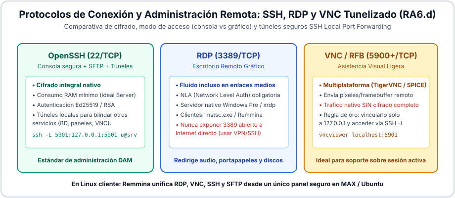

# Conexión y Administración Remota Segura (SSH, RDP, xrdp y VNC Tunelizado)

<!-- fuente: raw/procesados/ra6-acceso-remoto-cortafuegos-seguridad-red.md -->

## 1. Elección del Protocolo Remoto según el Escenario

Administrar servidores de forma remota evita desplazarse físicamente al CPD o aula y minimiza el consumo gráfico innecesario en servidores Linux de **1–2 GB RAM**.



| Protocolo | Puerto | Tipo de sesión | Cifrado nativo | Uso óptimo en 1.º DAM |
| :--- | :---: | :--- | :---: | :--- |
| **SSH** (`OpenSSH`) | `22/TCP` | Consola + SFTP + Túneles | **Sí** (Ed25519/AES-GCM) | Servidores Ubuntu, gestión diaria, túneles seguros |
| **RDP** (`mstsc` / `xrdp`) | `3389/TCP` | Escritorio gráfico virtual | **Sí** (TLS + **NLA**) | Acceso gráfico fluido a Windows 10/11 o Ubuntu Desktop |
| **VNC** (`RFB`) | `5900+N/TCP` | Control visual de sesión actual | **Limitado/No por defecto** | Soporte sobre sesión ya abierta — **solo tunelizado vía SSH** |
| **Remmina** *(cliente)* | Múltiple | Cliente unificado Linux | Según protocolo | Aplicación todo-en-uno en **MAX / Ubuntu** para RDP, VNC y SSH |

---

## 2. Seguridad Imprescindible en RDP (`NLA`) y VNC (`SSH Tunnel`)

1. **RDP con *Network Level Authentication* (`NLA`):** exige que el usuario autentique sus credenciales *antes* de crear una sesión gráfica completa en el servidor, protegiendo al equipo frente a ataques de denegación de servicio y exploits previos a la autenticación. Nunca debe exponerse el `3389/TCP` directamente a Internet abierto: accede siempre mediante **VPN** o **túnel SSH**.
2. **Blindaje de VNC y bases de datos mediante túnel SSH (`-L`):**
   El parámetro `-L puerto_local:127.0.0.1:puerto_remoto` abre un puerto privado en tu propio PC MAX/Windows que viaja encapsulado por el canal SSH cifrado (`22/TCP`) hasta el servidor remoto sin necesidad de abrir el puerto real de VNC (`5901`) o PostgreSQL (`5432`) en el cortafuegos externo.

---

## 3. Puesta en Marcha y Conexión Multiplataforma

=== "MAX / Ubuntu (Linux)"

    ```bash
    # Servidor gráfico RDP ligero en Ubuntu Desktop/XFCE: xrdp
    sudo apt-get update && sudo apt-get install -y xrdp
    sudo systemctl enable --now xrdp

    # Cliente Remmina o línea de comandos FreeRDP en MAX / Ubuntu para entrar a Windows:
    # sudo apt-get install -y remmina freerdp2-x11
    xfreerdp /v:192.168.50.20 /u:pedro /cert:ignore +clipboard

    # Túnel SSH seguro para acceder a un servicio VNC que solo escucha en localhost:5901:
    ssh -f -N -L 5901:127.0.0.1:5901 usuario@192.168.50.10
    # Ahora conecta Remmina o vncviewer hacia: localhost:5901 (tráfico 100 % cifrado)
    ```

=== "Windows 10 / 11"

    ```powershell
    # Habilitar Escritorio Remoto (RDP) con NLA obligatoria en Windows 10/11 Pro (Admin):
    Set-ItemProperty -Path 'HKLM:\System\CurrentControlSet\Control\Terminal Server' -Name "fDenyTSConnections" -Value 0
    Set-ItemProperty -Path 'HKLM:\System\CurrentControlSet\Control\Terminal Server\WinStations\RDP-Tcp' -Name "UserAuthentication" -Value 1

    # Habilitar la regla oficial del cortafuegos para Escritorio Remoto
    Enable-NetFirewallRule -DisplayGroup "Escritorio remoto" -ErrorAction SilentlyContinue
    # En inglés: Enable-NetFirewallRule -DisplayGroup "Remote Desktop"

    # Crear túnel SSH local desde PowerShell hacia servidor Ubuntu (OpenSSH nativo Windows)
    # ssh -N -L 8080:127.0.0.1:8080 usuario@192.168.50.10
    ```

---

## Recursos para profundizar

- Concepto siguiente: [Protección de Recursos y Cortafuegos (`ufw` y Windows Defender Firewall)](ra6-seguridad-recursos-cortafuegos-ufw-defender.md).
- Documentación cliente oficial Linux: [Remmina Remote Desktop Client](https://remmina.org/).
- Vídeo recomendado sobre SSH, RDP y acceso remoto seguro: [Acceso remoto SSH, RDP y seguridad de comunicaciones (YouTube)](https://www.youtube.com/watch?v=S-2TIRnsioM).
