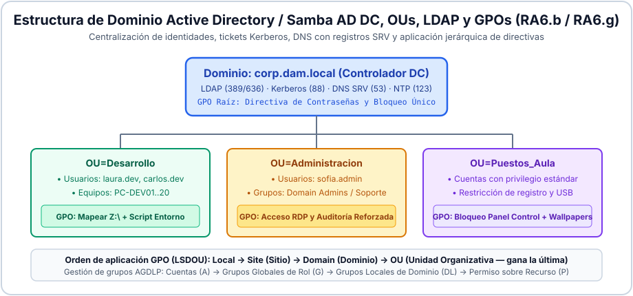

# Implantación y Explotación de Dominios (Active Directory, Samba AD DC, LDAP y GPO)

<!-- fuente: raw/procesados/ra6-dominios-active-directory-ldap-integracion.md -->

## 1. Grupo de Trabajo (*Workgroup*) frente a Dominio Centralizado

En una oficina con 5 PCs basta un **Grupo de Trabajo** donde cada máquina guarda sus propios usuarios locales. Pero en un centro educativo o empresa con decenas o cientos de puestos, crear contraseñas y carpetas equipo por equipo resulta inviable. Un **Dominio** resuelve esto mediante un **Controlador de Dominio (DC)**:

| Aspecto | Grupo de Trabajo (*Workgroup*) | Dominio (*Active Directory / Samba AD DC*) |
| :--- | :--- | :--- |
| **Autenticación** | Local en cada PC (`/etc/shadow` o SAM) | **Centralizada** mediante tickets **Kerberos** (`88/TCP+UDP`) |
| **Base de objetos** | Independiente y aislada | Directorio jerárquico **LDAP** (`389/636`) único |
| **Resolución de nombres** | Opcional o mDNS/NetBIOS | **DNS interno con registros `SRV` obligatorio** |
| **Políticas de seguridad** | Manuales máquina por máquina | Despliegue automático masivo mediante **GPOs** |



---

## 2. Pilares de un Dominio: DNS, NTP/Kerberos, OUs, AGDLP y GPOs

1. **DNS con registros SRV:** para que un PC Windows o Linux encuentre al controlador de dominio al unirse (`corp.dam.local`), su DNS primario debe apuntar obligatoriamente a la IP del **DC**, nunca directamente a `8.8.8.8` (el DC reenviará hacia Internet las consultas externas).
2. **Hora sincronizada (NTP) + Kerberos:** Kerberos rechaza automáticamente el inicio de sesión si el reloj entre cliente y servidor difiere más de **5 minutos** para evitar ataques por reenvío (*replay*).
3. **Unidades Organizativas (`OU`) y modelo `AGDLP`:** las `OU` son carpetas organizativas del directorio donde se agrupan usuarios y equipos por departamento para vincularles **Directivas de Grupo (GPO)** según precedencia **LSDOU** (*Local → Site → Domain → OU*). Los permisos de recursos siguen la cadena **Cuentas (`A`) → Grupo Global (`G`) → Grupo Local de Dominio (`DL`) → Permiso NTFS (`P`)**.

---

## 3. Despliegue Ligero de Dominio AD con Samba 4 en Aula DAM

Con una VM Ubuntu Server de **2 GB RAM**, **`samba-tool`** despliega un Controlador de Dominio totalmente compatible con clientes **Windows 10 Pro/Education** (4 GB RAM):

=== "MAX / Ubuntu (Linux)"

    ```bash
    # --- En el servidor Controlador de Dominio (Samba AD DC) ---
    # 1. Configurar hostname FQDN (ej. dc1.corp.dam.local) y desactivar systemd-resolved si ocupa puerto 53
    sudo apt-get update && sudo apt-get install -y samba krb5-user winbind

    # 2. Provisionar dominio corp.dam.local de forma no interactiva (ejemplo laboratorio Red Interna)
    # sudo samba-tool domain provision --realm=CORP.DAM.LOCAL --domain=CORP \
    #   --adminpass='AdminDam#2026!' --dns-backend=SAMBA_INTERNAL --use-rfc2307

    # 3. Operaciones habituales tras arrancar samba-ad-dc:
    sudo samba-tool ou create "OU=Desarrollo"
    sudo samba-tool user create laura.dev 'DamPass#2026!' --userou="OU=Desarrollo"
    sudo samba-tool group add g_desarrolladores
    sudo samba-tool group addmembers g_desarrolladores laura.dev

    # --- Unir un cliente Linux Desktop/Server al dominio existente ---
    # sudo apt-get install -y realmd sssd adcli packagekit
    # sudo realm join -U Administrator corp.dam.local
    ```

=== "Windows 10 / 11"

    ```powershell
    # En cliente Windows 10 Pro/Education (asegurar ANTES DNS apuntando a la IP del DC, ej. 192.168.50.10):
    Set-DnsClientServerAddress -InterfaceAlias "Ethernet" -ServerAddresses ("192.168.50.10")

    # Comprobar que resuelve los registros SRV LDAP/Kerberos del controlador
    Resolve-DnsName -Type SRV _ldap._tcp.dc._msdcs.corp.dam.local

    # Unir el equipo Windows al dominio (pedirá credenciales Administrador de dominio y reinicio)
    Add-Computer -DomainName "corp.dam.local" -Restart
    ```

---

## Recursos para profundizar

- Documentación oficial Samba AD DC: [Setting up Samba as an Active Directory Domain Controller](https://wiki.samba.org/index.php/Setting_up_Samba_as_an_Active_Directory_Domain_Controller).
- Vídeo recomendado sobre Samba y Active Directory: [Samba SMB y Controlador de Dominio Active Directory (YouTube)](https://www.youtube.com/watch?v=ayaI9WNiFXA).
