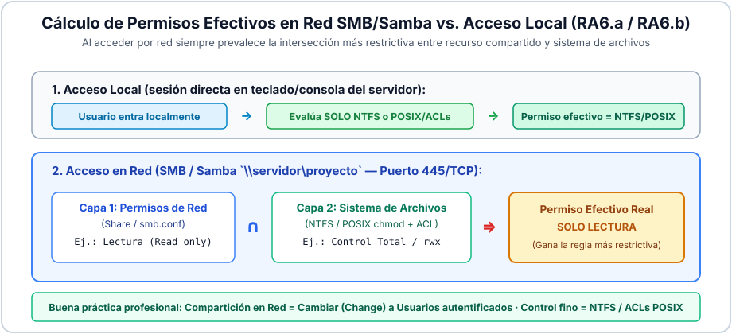

# Recursos Compartidos en Red, Permisos Efectivos y Samba/SMB

<!-- fuente: raw/procesados/ra6-recursos-compartidos-permisos-red-servidores.md -->

## 1. Permisos Locales frente a Permisos en Red (`RA6.a`)

Cuando un usuario accede a un archivo **sentado directamente** frente al equipo, únicamente se evalúan los **permisos del sistema de archivos** (NTFS o POSIX/ACLs). Sin embargo, al acceder **a través de la red** mediante SMB/CIFS o Samba (`445/TCP`), intervienen **dos puertas independientes** y siempre gana **la combinación más restrictiva**:



| Escenario | Permiso de Recurso Compartido (Red) | Permiso Local (NTFS / POSIX+ACL) | Permiso Efectivo Real |
| :--- | :--- | :--- | :--- |
| Caso A | `Lectura` (*Read*) | `Control Total` / `rwx` | **Solo Lectura** (limita la red) |
| Caso B | `Control Total` / `Cambiar` | `Lectura y ejecución` | **Solo Lectura** (limita el disco local) |
| Caso C *(recomendado)* | `Cambiar` (*Usuarios autentificados*) | ACL fina por grupos (`kora_devs`, `kora_qa`) | **El exacto definido en el sistema de archivos** |

> [!TIP]
> **Regla de administración profesional:** Concede permisos amplios en la capa de compartición (*Share*: `Cambiar` a usuarios autenticados o restringido por `valid users`), y aplica todo el detalle granular por subcarpetas y usuarios directamente en **NTFS** o **POSIX + `setfacl`**.

---

## 2. Compartición Multiplataforma con Samba (`SMB/CIFS`) (`RA6.a`, `RA6.b`)

**Samba** implementa en Linux el protocolo **SMB3** para servir carpetas compartidas e impresoras a clientes **Windows 10/11**, macOS y otros Linux.

- El fichero principal es `/etc/samba/smb.conf` y debe validarse **siempre** tras editarlo mediante **`testparm -s`**.
- Samba mantiene su **propia base de contraseñas SMB** paralela a `/etc/shadow`: todo usuario Linux local que deba entrar por red tiene que habilitarse con `sudo smbpasswd -a <usuario>`.

```ini
# Fragmento ejemplo en /etc/samba/smb.conf
[ProyectosDAM]
   comment = Repositorio compartido 1 DAM
   path = /srv/proyectos_dam
   browseable = yes
   read only = no
   valid users = @aurora_dev, @auditores
   write list = @aurora_dev
   create mask = 0660
   directory mask = 0770
   force group = aurora_dev
```

---

## 3. Configuración Práctica y Montaje en Clientes

=== "MAX / Ubuntu (Linux)"

    ```bash
    # Servidor: instalar Samba, añadir usuario SMB y validar sintaxis
    sudo apt-get update && sudo apt-get install -y samba smbclient cifs-utils
    sudo smbpasswd -a dev_elena
    testparm -s
    sudo systemctl restart smbd

    # Cliente Linux: listar recursos y montar recurso remoto con fichero de credenciales
    smbclient -L //192.168.50.10 -U dev_elena
    sudo mkdir -p /mnt/proyectos_red
    sudo mount -t cifs //192.168.50.10/ProyectosDAM /mnt/proyectos_red \
      -o username=dev_elena,uid=$(id -u),gid=$(id -g),file_mode=0660,dir_mode=0770
    ```

=== "Windows 10 / 11"

    ```powershell
    # En un Windows 10/11 que comparte recursos hacia la red (PowerShell Admin):
    New-Item -Path "C:\CompartidoDAM" -ItemType Directory -Force
    New-SmbShare -Name "ProyectosWin" -Path "C:\CompartidoDAM" `
      -FullAccess "Administradores" -ChangeAccess "aurora_dev" -ReadAccess "auditor_externo"

    # Consultar recursos compartidos y sesiones activas entrantes
    Get-SmbShare
    Get-SmbSession

    # Montar unidad Z: persistente desde Windows hacia el servidor Linux Samba:
    # net use Z: \\192.168.50.10\ProyectosDAM /user:dev_elena /persistent:yes
    ```

---

## Directivas Locales (`secpol.msc` / `gpedit.msc`), Cambio de Propietario y Cifrado EFS en Red

En redes Windows en grupo de trabajo (*Workgroup*, sin Active Directory), la gestión de recursos compartidos combina dos capas e introduce matices importantes de seguridad:

1. **Derechos de usuario frente a permisos sobre recursos:**
   - Un **derecho de usuario** (administrado en **`secpol.msc`** $\rightarrow$ *Directivas locales* $\rightarrow$ *Asignación de derechos de usuario*, p. ej. *Iniciar sesión localmente* o *Acceso desde la red*) determina qué acciones puede realizar una cuenta sobre el equipo.
   - Un **permiso** (ACL NTFS y permisos SMB) determina qué usuario puede leer/escribir un archivo o recurso concreto.
   - Las plantillas y configuraciones avanzadas de directivas se gestionan con **`secpol.msc`** (seguridad, contraseñas y bloqueo de cuenta) y **`gpedit.msc`** (directivas de grupo local y plantillas administrativas).
2. **Acceso anónimo en Windows (`Centro de redes`):** por defecto Windows exige autenticación (*Uso compartido con protección por contraseña*). Desactivar la protección por contraseña permite que cuentas remotas sin coincidencia de credenciales accedan si el recurso incluye `Todos` (*Everyone*) o `Invitado` habilitado, reduciendo el aislamiento del equipo.
3. **Cambio de propietario (*Take Ownership*):** si un administrador cambia el propietario NTFS de una carpeta, el antiguo propietario pierde la capacidad de reescribir sus propios permisos (`Full Control` implícito del *Creator Owner*), quedando sujeto estrictamente a las entradas ACL explícitas que conserve.
4. **Cifrado EFS en carpetas compartidas entre varios usuarios:** en NTFS, **EFS (*Encrypting File System*)** cifra cada archivo con la clave pública del certificado del usuario que cifra (por ejemplo **Pedro**). Aunque **Luis** tenga permiso de escritura en la misma carpeta, **no podrá leer los ficheros cifrados por Pedro** salvo que Pedro añada expresamente el certificado EFS de Luis al archivo. Asimismo, al crear nuevos archivos en una carpeta con el atributo de cifrado activado, Windows los cifra con el certificado del creador (**Luis**), de modo que el otro usuario tampoco los leerá si no se intercambian certificados o trabajan bajo un Dominio con agente de recuperación.

---

## Recursos para profundizar

- Concepto siguiente: [Servidores de Ficheros (NFS), Impresión (CUPS) y Aplicaciones](ra6-servidores-ficheros-impresion-aplicaciones.md).
- Documentación oficial Samba: [Samba Wiki](https://wiki.samba.org/).
- Vídeo recomendado sobre Samba SMB/CIFS: [Compartición de recursos con Samba SMB en red (YouTube)](https://www.youtube.com/watch?v=ayaI9WNiFXA).
