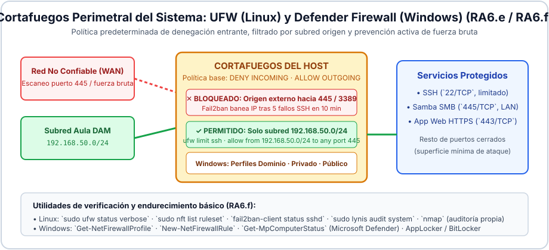

# Seguridad de Recursos y Cortafuegos de Host (`ufw`, `nftables` y Windows Defender Firewall)

<!-- fuente: raw/procesados/ra6-acceso-remoto-cortafuegos-seguridad-red.md -->

## 1. Necesidad de Proteger los Recursos y Minimizar la Superficie de Exposición

Cada puerto dejado en escucha hacia `0.0.0.0` sin filtrado supone un vector potencial de ataque o abuso (escaneos automatizados, fuerza bruta por diccionario en `22/3389`, propagación de *ransomware* por `SMB 445`). La protección perimetral en el propio sistema operativo sigue cuatro principios:

1. **Política base restrictiva (*Default Deny Incoming*):** bloquear por defecto **todo** tráfico entrante no solicitado, permitiendo las respuestas a conexiones iniciadas desde el propio equipo (*stateful inspection*).
2. **Mínimo privilegio por origen:** en lugar de abrir el puerto SMB `445` o RDP `3389` a `any` (`0.0.0.0/0`), permitirlo únicamente desde la subred interna de confianza (`192.168.50.0/24`).
3. **Diferenciación por perfil de red:** en portátiles Windows/Linux, no aplicar las mismas reglas conectado en la red privada de empresa/casa que en una Wi-Fi pública.
4. **Regla de oro antes de activar el cortafuegos:** permitir primero **SSH (`22`) o RDP** antes de ejecutar `ufw enable` para no bloquearse uno mismo fuera del servidor remoto.



---

## 2. Configuración Práctica con `ufw` (Linux) y `Defender Firewall` (Windows)

=== "MAX / Ubuntu (Linux)"

    Ubuntu integra **`ufw`** (*Uncomplicated Firewall*) como interfaz clara sobre **`nftables`**:

    ```bash
    # 1. Definir política base: denegar entradas, permitir salidas
    sudo ufw default deny incoming
    sudo ufw default allow outgoing

    # 2. Permitir SSH limitado contra fuerza bruta (6+ intentos en 30 s)
    sudo ufw limit 22/tcp comment 'SSH con limite de tasa'

    # 3. Permitir Samba SMB (445/TCP) EXCLUSIVAMENTE desde nuestra LAN de aula
    sudo ufw allow from 192.168.50.0/24 to any port 445 proto tcp comment 'Samba solo LAN'

    # 4. Activar cortafuegos y auditar reglas numeradas
    sudo ufw enable
    sudo ufw status numbered

    # Cómo borrar la regla nº 3 si fuese necesario más adelante:
    # sudo ufw delete 3
    ```

=== "Windows 10 / 11"

    Windows Defender Firewall distingue automáticamente entre tres perfiles (**`Domain`**, **`Private`** y **`Public`**):

    ```powershell
    # 1. Consultar estado de los tres perfiles y cambiar un adaptador interno a Perfil Privado
    Get-NetFirewallProfile | Select-Object Name, Enabled, DefaultInboundAction, DefaultOutboundAction
    Set-NetConnectionProfile -InterfaceAlias "Ethernet" -NetworkCategory Private

    # 2. Permitir conexiones entrantes al puerto 8080 solo desde la LAN de laboratorio y perfil Privado
    New-NetFirewallRule -DisplayName "App DAM 8080 Solo LAN" `
      -Direction Inbound -Protocol TCP -LocalPort 8080 `
      -RemoteAddress 192.168.50.0/24 -Profile Private -Action Allow

    # 3. Desactivar temporalmente o eliminar una regla creada
    Disable-NetFirewallRule -DisplayName "App DAM 8080 Solo LAN"
    ```

---

## 3. Verificación desde el Exterior (`nmap` vs `ss`)

Es habitual que `ss -tulnp` muestre un puerto abierto localmente en `0.0.0.0:445`, pero que desde otro ordenador aparezca como **`filtered`** (descartado silenciosamente por `ufw` o Defender Firewall). Contrastar la vista **interna** (`ss`) frente a la vista **externa** (`nc`/`Test-NetConnection`/`nmap` sobre tu propia red de pruebas) garantiza que el cortafuegos está protegiendo realmente el recurso.

---

## Recursos para profundizar

- Concepto siguiente: [Utilidades Básicas de Seguridad, `fail2ban` y Auditoría](ra6-utilidades-seguridad-auditoria-endurecimiento.md).
- Manual oficial `ufw`: [Ubuntu Server Documentation · Firewall (UFW)](https://ubuntu.com/server/docs/security-firewall).
- Vídeo recomendado sobre cortafuegos y comunicaciones seguras: [Cortafuegos UFW y comunicaciones seguras (YouTube)](https://www.youtube.com/watch?v=S-2TIRnsioM).
