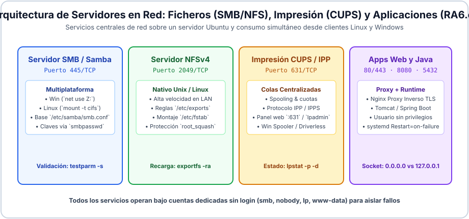

# Servidores de Ficheros (SMB/NFS), Impresión (CUPS) y Aplicaciones

<!-- fuente: raw/procesados/ra6-recursos-compartidos-permisos-red-servidores.md -->

## 1. Ecosistema de Servidores Departamentales en Red

En cualquier red corporativa o aula de desarrollo conviven cuatro grandes familias de servicios compartidos orientados a usuarios y aplicaciones:



| Tipo de Servidor | Protocolo y Puerto | Sistema Típico | Función principal en entorno DAM |
| :--- | :--- | :--- | :--- |
| **Ficheros multiplataforma** | SMB3 / CIFS (`445/TCP`) | Samba / Windows Server | Carpetas departamentales compartidas con Windows, MAX y macOS |
| **Ficheros Unix/Linux** | NFSv4 (`2049/TCP`) | `nfs-kernel-server` | Almacenamiento rápido entre servidores Linux y nodos de contenedores |
| **Impresión** | IPP / IPPS (`631/TCP`) | **CUPS** (Linux) / Print Spooler (Win) | Cola única, control de trabajos, drivers centralizados y cuotas |
| **Aplicaciones / Web** | HTTP/HTTPS (`80/443`, `8080`) | Nginx + Tomcat / Spring Boot / Node | Ejecución de lógica de negocio, APIs REST y proxy inverso TLS |

---

## 2. Servidor de Ficheros Nativo Linux: **NFSv4** (`2049/TCP`)

Cuando todos los servidores que intercambian datos ejecutan Linux (por ejemplo compartiendo despliegues o respaldos entre VMs de aula), **NFSv4** ofrece menor sobrecarga que SMB y preserva directamente propietarios y permisos POSIX.

- **Regla crítica de seguridad (`root_squash`):** Viene activada por defecto y traduce cualquier petición del usuario `root` (UID `0`) de un cliente remoto al usuario sin privilegios `nobody`, impidiendo que el administrador de una estación cliente modifique ficheros críticos del servidor como `root`. Jamás debe usarse `no_root_squash` salvo necesidad extrema muy acotada.

---

## 3. Servidores de Impresión (**CUPS**) y Aplicaciones

### Impresión Centralizada (`CUPS` y `Spooler`)
- En **MAX / Ubuntu**, el sistema estándar de impresión es **CUPS** (*Common Unix Printing System*, puerto `631/TCP`), basado en el protocolo abierto **IPP** (*Internet Printing Protocol*), que incluso permite impresión *driverless* (**IPP Everywhere / AirPrint**). Su panel web local `https://localhost:631` y las utilidades CLI (`lpstat`, `lpadmin`, `lpq`, `cancel`) permiten pausar colas, cancelar trabajos bloqueados y compartir impresoras en la LAN.
- En **Windows**, la impresión depende del servicio `Spooler` y puede publicarse mediante impresoras compartidas en red o mediante servidor de impresión IPP.

### Servidores de Aplicaciones (Nginx + Runtime Java/Python)
Un servidor de aplicaciones nunca expone directamente procesos ejecutándose como `root`: corre bajo una cuenta sin login interactivo (`www-data`, `tomcat`) tras un **proxy inverso (Nginx)** que termina TLS en `443/TCP` y reenvía al puerto interno del backend (`127.0.0.1:8080`).

---

## 4. Despliegue Rápido en Consola

=== "MAX / Ubuntu (Linux)"

    ```bash
    # --- Servidor NFSv4 ---
    sudo apt-get update && sudo apt-get install -y nfs-kernel-server
    sudo mkdir -p /srv/nfs_compartido
    echo "/srv/nfs_compartido 192.168.50.0/24(rw,sync,no_subtree_check,root_squash)" |
      sudo tee -a /etc/exports
    sudo exportfs -ra
    sudo exportfs -v

    # En cliente Ubuntu (paquete nfs-common):
    # sudo mount -t nfs4 192.168.50.10:/srv/nfs_compartido /mnt/nfs_dam

    # --- Impresión CUPS ---
    sudo apt-get install -y cups
    lpstat -p -d

    # --- Servidor Web / Proxy de Aplicaciones ---
    sudo systemctl status nginx --no-pager
    ```

=== "Windows 10 / 11"

    ```powershell
    # Gestión de colas e impresoras compartidas en Windows PowerShell
    Get-Printer | Select-Object Name, DriverName, PortName, Shared, PrinterStatus
    Get-PrintJob -PrinterName "Microsoft Print to PDF" -ErrorAction SilentlyContinue

    # Consultar servicio Spooler e IIS / cliente NFS si estuviesen habilitados
    Get-Service Spooler
    ```

---

## Recursos para profundizar

- Concepto anterior: [Recursos Compartidos en Red y Samba/SMB](ra6-recursos-compartidos-permisos-red-samba-smb.md).
- Documentación oficial OpenPrinting CUPS: [OpenPrinting CUPS](https://openprinting.github.io/cups/).
- Vídeo recomendado sobre compartición de servidores en red: [Samba, servidores de red y administración compartida (YouTube)](https://www.youtube.com/watch?v=ayaI9WNiFXA).
