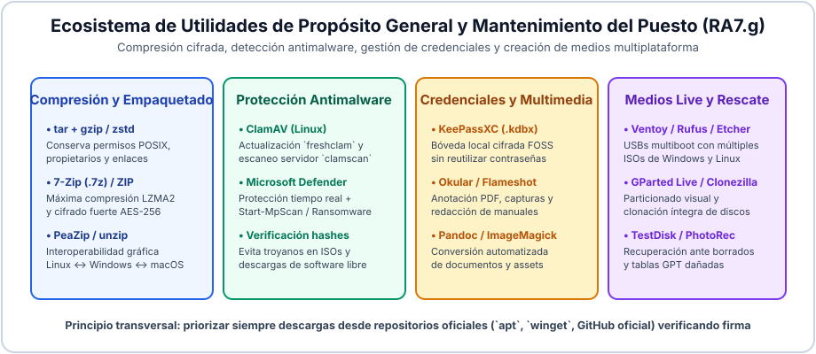

# Búsqueda de Documentación Técnica y Utilidades de Propósito General

<!-- fuente: raw/procesados/ra7-correo-transferencia-utilidades-proposito-general.md -->

## 1. Estrategia Profesional de Búsqueda de Documentación (`RA7.f`)

Saber encontrar información técnica fiable ahorra horas de depuración y evita introducir fallos de seguridad sacados de blogs obsoletos:

1. **Primera línea sin salir de consola:** páginas **`man`** (`man 5 fstab`, buscar palabras con `/`), ayuda breve **`--help`** y resúmenes prácticos comunitarios **`tldr`** (`tldr rsync`, `tldr ss`).
2. **Fuentes primarias oficiales:** [Ubuntu Docs](https://ubuntu.com/server/docs), [ArchWiki](https://wiki.archlinux.org/), [Microsoft Learn](https://learn.microsoft.com/es-es/), [MDN Web Docs](https://developer.mozilla.org/) y documentación oficial del lenguaje/proyecto.
3. **Búsqueda web con operadores precisos:** acota por dominio (`site:learn.microsoft.com "icacls"`), busca códigos exactos de error entre comillas (`"externally-managed-environment"`), verifica la fecha o versión del sistema operativo, y **prueba siempre en VirtualBox** antes de lanzar comandos desconocidos en producción.

---

## 2. Ecosistema de Utilidades de Propósito General (`RA7.g`)



| Categoría | Linux (`MAX` / `Ubuntu`) | Windows `10` / `11` | Caso de uso práctico |
| :--- | :--- | :--- | :--- |
| **Empaquetado y compresión cifrada** | `tar` + `gzip`/`zstd`, `p7zip-full` (`7z`), `PeaZip` | `7-Zip`, `PeaZip`, compresor nativo | Archivar proyectos (`tar`) conservando permisos o proteger envíos `.7z` con AES-256 |
| **Antimalware bajo demanda** | **ClamAV** (`freshclam`, `clamscan`) | **Microsoft Defender** (`Start-MpScan`) | Analizar descargas, memorias USB y carpetas compartidas Samba |
| **Gestión segura de contraseñas** | **KeePassXC** (`.kdbx` cifrada) | **KeePassXC** / Bitwarden | Evitar contraseñas repetidas o anotadas en texto plano |
| **USBs multiboot y rescate** | **Ventoy**, `BalenaEtcher`, `GParted`, `TestDisk` | **Rufus**, **Ventoy**, `TestDisk` | Crear pendrives de instalación y diagnosticar particiones dañadas |
| **Captura y conversión técnica** | `Flameshot`, `Pandoc`, `Okular` | Herramienta Recortes, `Pandoc`, `SumatraPDF` | Generar evidencias gráficas anotadas y manuales PDF/ODT |

---

## 3. Operaciones Prácticas con Utilidades de Sistema

=== "MAX / Ubuntu (Linux)"

    ```bash
    # Instalar compresores, antivirus ClamAV y herramienta de consulta rápida
    sudo apt-get update && sudo apt-get install -y p7zip-full clamav

    # Actualizar firmas antivirus y escanear recursivamente una carpeta descargada
    # sudo systemctl stop clamav-freshclam 2>/dev/null || true
    # sudo freshclam
    clamscan -r --infected ~/Descargas/

    # Crear archivo 7z cifrado con contraseña AES-256 (-mhe=on cifra también nombres de ficheros)
    7z a -p -mhe=on copia_segura.7z ./documentos/

    # Consultar manual oficial por secciones (ej. sección 5 = formatos de fichero)
    man 5 crontab | head -n 25
    ```

=== "Windows 10 / 11"

    ```powershell
    # Comprimir o extraer archivos ZIP de forma nativa desde PowerShell
    Compress-Archive -Path "C:\Proyectos\Docs\*" -DestinationPath "C:\Backups\Docs.zip" -Force

    # Consultar ayuda completa oficial del propio comando sin abrir navegador
    Get-Help Compress-Archive -Examples

    # Escanear una carpeta específica descargada con Microsoft Defender
    Start-MpScan -ScanType CustomScan -ScanPath "$env:USERPROFILE\Downloads"
    ```

---

## Recursos para profundizar

- Portal técnico oficial Linux: [ArchWiki · General Recommendations](https://wiki.archlinux.org/).
- Portal técnico oficial Windows: [Microsoft Learn · Windows Commands](https://learn.microsoft.com/es-es/windows-server/administration/windows-commands/windows-commands).
- Vídeo recomendado sobre productividad, documentos y utilidades FOSS: [Utilidades libres, ofimática y gestión documental (YouTube)](https://www.youtube.com/watch?v=GArVeJj8MHo).
