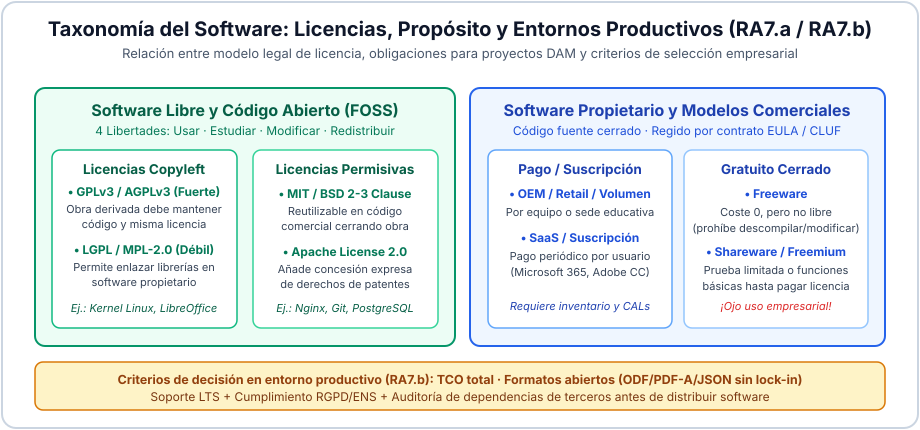

# Clasificación del Software por Propósito, Licencias y Modelos de Distribución

<!-- fuente: raw/procesados/ra7-clasificacion-software-licencias-entornos-productivos.md -->

## 1. Taxonomía del Software según su Propósito Técnico

Todo sistema productivo organiza las aplicaciones instaladas en tres grandes categorías funcionales:

1. **Software de sistema / base:** sistemas operativos (MAX, Ubuntu, Windows), controladores (*drivers*), firmware UEFI, máquinas virtuales (**VirtualBox**) y demonios esenciales.
2. **Software de programación y desarrollo:** compiladores (**OpenJDK**), intérpretes (**Python**), entornos integrados (**IntelliJ IDEA**, **VS Code**), control de versiones (**Git**) y herramientas de automatización (**Gradle**, **Docker**).
3. **Software de aplicación / propósito general:** suites ofimáticas (**LibreOffice**, **Microsoft 365**), correo (**Thunderbird**), navegadores web, gestores documentales y software vertical empresarial (ERP/CRM).



---

## 2. Clasificación Jurídica por Licencias (`FOSS` vs. Propietario)

Como futuro desarrollador de aplicaciones multiplataforma (**1.º DAM**), elegir una librería o aplicación exige respetar sus condiciones legales de uso, modificación y redistribución:

| Categoría | Tipo de Licencia | Características y Obligaciones Clave | Ejemplos Reales |
| :--- | :--- | :--- | :--- |
| **Copyleft Fuerte (FOSS)** | **GPLv3** / **AGPLv3** | Permite usar, estudiar y modificar; si distribuyes (o sirves en red bajo **AGPL**) una obra derivada, **debes liberar su código bajo la misma licencia**. | Kernel Linux, Bash, Nextcloud (AGPLv3), LibreOffice (MPLv2) |
| **Copyleft Débil (FOSS)** | **LGPL** / **MPL-2.0** | Permite enlazar dinámicamente la librería desde un programa propietario sin obligar a abrir todo tu proyecto. | Bibliotecas C/C++, Firefox |
| **Permisivas (FOSS)** | **MIT**, **BSD**, **Apache 2.0** | Permiten integrar el código en software comercial cerrado conservando avisos de copyright (**Apache 2.0** además concede patentes). | Nginx, PostgreSQL, Git, VS Code (MIT fuente) |
| **Propietario / EULA** | **OEM**, **Retail**, **Volumen**, **CAL** | Código fuente cerrado; prohíbe copia no autorizada y descompilación. | Windows 10/11 Pro, Oracle Database Comercial |
| **Pago por uso** | **SaaS** / Suscripción | Alojamiento y mantenimiento continuo en nube por cuota mensual/anual. | Microsoft 365, Google Workspace, JetBrains All Products |
| **Gratuito Cerrado** | **Freeware** / **Shareware** | Freeware cuesta `0 €` pero **no es software libre** ni suele cubrir uso corporativo ilimitado; Shareware limita funciones o tiempo. | Adobe Reader (Freeware), WinRAR (Shareware) |

---

## 3. Auditoría Práctica de Licencias en Proyectos y Sistemas

Antes de empaquetar un producto en empresa, debemos inspeccionar qué licencias arrastran las dependencias instaladas para detectar incompatibilidades jurídicas:

=== "MAX / Ubuntu (Linux)"

    ```bash
    # Consultar la licencia oficial empaquetada de una aplicación APT
    head -n 25 /usr/share/doc/nginx/copyright

    # Auditar licencias declaradas en dependencias Python dentro de un entorno virtual
    # pip install pip-licenses && pip-licenses
    dpkg -l | awk 'NR>5 {print $2, $3}' | head -n 15
    ```

=== "Windows 10 / 11"

    ```powershell
    # Inventariar programas instalados mediante winget indicando identificador oficial y origen
    winget list | Select-Object -First 20

    # Consultar tipo de licencia del sistema operativo Windows (Retail, OEM o KMS/Volumen)
    Get-CimInstance SoftwareLicensingProduct -Filter "Name like 'Windows%' and LicenseStatus = 1" |
      Select-Object Name, Description, PartialProductKey
    ```

---

## Recursos para profundizar

- Concepto siguiente: [Análisis de Necesidades de Software en Entornos Productivos](ra7-analisis-necesidades-software-entornos-productivos.md).
- Guía oficial de licencias aprobadas: [Open Source Initiative (OSI) · Licenses](https://opensource.org/licenses).
- Vídeo recomendado sobre licencias de software: [Licencias de software libre, copyleft, permisivas y propietario (YouTube)](https://www.youtube.com/watch?v=p4pSjP0FqQQ).
