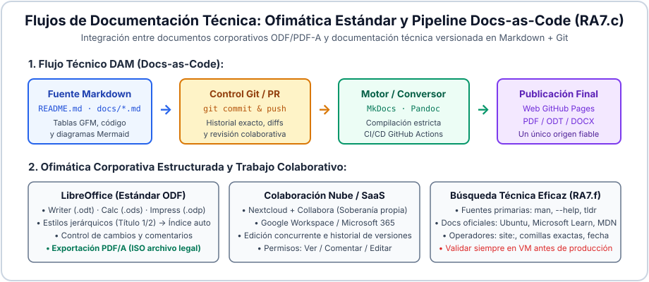

# Documentación con Ofimática, Markdown (*Docs-as-Code*) y Trabajo Colaborativo

<!-- fuente: raw/procesados/ra7-ofimatica-colaboracion-documentacion-markdown.md -->

## 1. Dos Mundos Complementarios: Ofimática Estructurada y *Docs-as-Code*

En un departamento informático coexisten documentos administrativos y manuales técnicos con requisitos distintos:



1. **Suites Ofimáticas Corporativas (`LibreOffice Writer/Calc` · `Google Workspace` · `Microsoft 365`):**
   - Ideales para informes ejecutivos, actas, presupuestos en hoja de cálculo y entregas formales con identidad visual de empresa.
   - **Regla fundamental de calidad:** nunca aplicar formato manual bloque a bloque ("negrita + tamaño 16"); usar siempre **Estilos jerárquicos (`Título 1`, `Título 2`, `Cuerpo de texto`, `Código`)**, lo que permite generar automáticamente **tablas de contenido (índices)**, marcadores PDF navegables y saltos consistentes.
   - Exportar documentación final archivada en **PDF/A** (estándar ISO con fuentes incrustadas sin dependencias externas).

2. **Documentación Técnica como Código (*Docs-as-Code*: Markdown + Git + Pandoc/MkDocs):**
   - La documentación técnica (`README.md`, guías de API, manuales como esta misma `wikiSI`) vive en texto plano **Markdown** dentro del propio repositorio **Git**, sometiéndose a revisiones (*Pull Requests*), historial de cambios línea por línea (*diffs*) y despliegue automático en GitHub Pages o PDF mediante **`pandoc`**.

---

## 2. Trabajo Colaborativo Seguro y Control de Versiones Documental

| Mecanismo colaborativo | Ventajas principales | Precaución clave |
| :--- | :--- | :--- |
| **Nube colaborativa** (`Nextcloud Collabora`, `Drive`, `SharePoint`) | Edición concurrente en tiempo real, comentarios con `@mención`, historial automático | Ajustar permisos exactos (**Ver / Comentar / Editar**) y evitar enlaces públicos abiertos sin fecha de caducidad |
| **Control de cambios offline** (`LibreOffice Writer`) | Permite aprobar o rechazar cada edición con firma de autor antes de publicar versión final | Consolidar y aceptar cambios antes de exportar el PDF definitivo para cliente externo |
| **Repositorio Git (`Markdown`)** | Trazabilidad exacta por autor/commit, cero conflictos binarios, publicación automatizada CI/CD | Separar archivos fuente grandes (ISOs/vídeos) de la documentación |

---

## 3. Automatización Documental en Consola con Markdown y Pandoc

=== "MAX / Ubuntu (Linux)"

    ```bash
    # Instalar pandoc para transformar documentación técnica Markdown a ODT, DOCX o HTML
    sudo apt-get update && sudo apt-get install -y pandoc

    # Convertir un informe técnico en Markdown con tabla de contenidos automática (--toc)
    pandoc README.md -o manual_proyecto.odt --toc --metadata title="Manual Técnico DAM"
    pandoc README.md -o manual_proyecto.html --standalone --toc

    # Conversión masiva sin entorno gráfico con LibreOffice CLI (soffice --headless)
    soffice --headless --convert-to pdf manual_proyecto.odt
    ```

=== "Windows 10 / 11"

    ```powershell
    # Instalar Pandoc de forma reproducible en Windows con winget
    winget install --id JohnMacFarlane.Pandoc -e --accept-package-agreements --accept-source-agreements

    # Convertir un README.md técnico a Word (.docx) o OpenDocument (.odt) con índice automático
    pandoc README.md -o manual_proyecto.docx --toc
    ```

---

## Ecosistema de Aplicaciones Comunes de Productividad y Colaboración (`RA7.b`, `RA7.c`, `RA7.g`)

Un técnico o desarrollador DAM combina en su flujo diario suites ofimáticas tradicionales con herramientas colaborativas, wikis personales y sistemas de notas enlazadas:

- **Ofimática local y en la nube:** **Microsoft Office** (Word/Excel), **LibreOffice** (Writer/Calc bajo ODF) y **Google Workspace** (edición colaborativa en tiempo real con historial de revisiones).
- **Documentación viva y wikis (`TiddlyWiki`, `Obsidian`, `Notion` + `GitHub`):**
  - [**TiddlyWiki (`tiddlywiki.com`)**](https://tiddlywiki.com/languages/es-ES/index.html) permite crear una wiki personal no lineal contenida en un **único archivo HTML** portátil (versionable o publicable junto a GitHub Pages).
  - **Obsidian** y **Notion** facilitan grafos de conocimiento en Markdown, mientras que **GitHub** aloja repositorios técnicos y manuales (`README.md`).
- **Diseño multimedia, comunicación y organización:** **Canva** (maquetación e infografías), **Audacity** (edición de audio), **Microsoft Teams** / **Discord** / **Telegram** (comunicación asíncrona/síncrona) y tableros **Kanban** como **Trello**.
- **Navegación enfocada a privacidad y correo cifrado:** navegadores como **Brave** o **Zen Browser**, correo corporativo en **Mozilla Thunderbird** (configurando firma y cifrado **GPG**) y transferencia puntual de archivos grandes mediante **WeTransfer**, **Dropbox**, **pCloud** o **Mega**.

---

## Recursos para profundizar

- Guía oficial sintaxis GitHub Flavored Markdown: [GitHub Docs · Basic writing and formatting](https://docs.github.com/es/get-started/writing-on-github).
- Conversor universal de documentos: [Pandoc Documentation](https://pandoc.org/).
- Vídeo recomendado sobre Markdown y documentación técnica: [Documentación técnica en Markdown (YouTube)](https://www.youtube.com/watch?v=eaKFOC8lfjU).
- Vídeo recomendado sobre suites ofimáticas y productividad: [LibreOffice y herramientas colaborativas (YouTube)](https://www.youtube.com/watch?v=GArVeJj8MHo).
