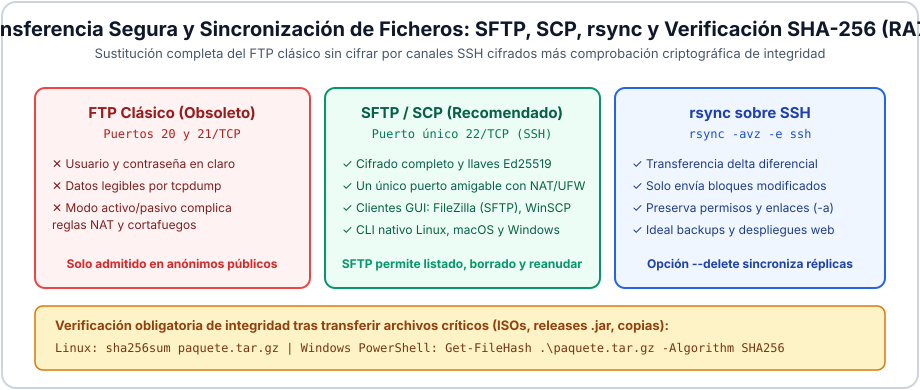

# Transferencia Segura de Ficheros (`SFTP`, `SCP`, `rsync`) y Verificación de Integridad

<!-- fuente: raw/procesados/ra7-correo-transferencia-utilidades-proposito-general.md -->

## 1. De FTP en Claro a SFTP / SCP y Sincronización Diferencial `rsync`

El antiguo **FTP (`20/21/TCP`)** envía usuarios, contraseñas y archivos sin cifrado y abre conexiones de datos secundarias problemáticas con NAT y cortafuegos. En entornos actuales solo se sustituye por alternativas cifradas en un único puerto:



| Herramienta | Protocolo / Puerto | Cuándo elegirla |
| :--- | :--- | :--- |
| **`sftp`** / **FileZilla (`SFTP`)** / **WinSCP** | SSH (`22/TCP`) | Sesiones interactivas gráficas o por consola para navegar carpetas remotas, subir/bajar lotes y reanudar envíos cortados |
| **`scp`** | SSH (`22/TCP`) | Copia puntual no interactiva en scripts o línea de comandos entre dos rutas concretas |
| **`rsync -avz -e ssh`** | SSH (`22/TCP`) | **Sincronización diferencial** de copias de seguridad, despliegues web y árboles completos (solo transmite bloques modificados) |
| **FTPS** | FTP sobre TLS (`990/TCP`) | Únicamente por compatibilidad con sistemas externos heredados que exijan FTP cifrado con TLS |

---

## 2. Verificación Criptográfica de Integridad (`SHA-256`)

Tras transferir un instalador, imagen ISO o empaquetado `.tar.gz`/`.jar` grande por red, comprobar su **suma SHA-256** garantiza al 100 % que ningún bit se corrompió ni fue manipulado durante el envío.

=== "MAX / Ubuntu (Linux)"

    ```bash
    # 1. Calcular huella SHA-256 antes de enviar
    sha256sum entrega_v1.tar.gz > entrega_v1.tar.gz.sha256

    # 2. Transferir ambos ficheros mediante SCP sobre puerto 22
    scp entrega_v1.tar.gz entrega_v1.tar.gz.sha256 usuario@192.168.50.10:/tmp/

    # 3. Sincronización diferencial segura de carpeta completa con barra de progreso
    rsync -avz --progress -e ssh ./dist/ usuario@192.168.50.10:/var/www/app/

    # 4. En destino remoto, verificar automáticamente la firma SHA-256
    ssh usuario@192.168.50.10 "cd /tmp && sha256sum -c entrega_v1.tar.gz.sha256"
    ```

=== "Windows 10 / 11"

    ```powershell
    # 1. Calcular hash SHA-256 nativo con PowerShell
    Get-FileHash .\entrega_v1.tar.gz -Algorithm SHA256

    # 2. Enviar por SCP nativo de Windows 10/11 o sesión interactiva SFTP
    scp .\entrega_v1.tar.gz usuario@192.168.50.10:/tmp/

    # 3. En GUI Windows (WinSCP / FileZilla): seleccionar SIEMPRE protocolo "SFTP" (puerto 22), nunca FTP plano
    ```

---

## Recursos para profundizar

- Concepto siguiente: [Búsqueda de Documentación Técnica y Utilidades de Propósito General](ra7-busqueda-documentacion-tecnica-utilidades-sistema.md).
- Manual oficial de OpenSSH (`sftp` / `scp`): [OpenBSD / OpenSSH Manuals](https://www.openssh.com/manual.html).
- Vídeo recomendado sobre SFTP y comunicaciones seguras: [SSH, SFTP y transferencia cifrada (YouTube)](https://www.youtube.com/watch?v=S-2TIRnsioM).
- Vídeo recomendado sobre sincronización `rsync`: [Copias incrementales y sincronización con rsync (YouTube)](https://www.youtube.com/watch?v=MPqCAhVKlBs).
