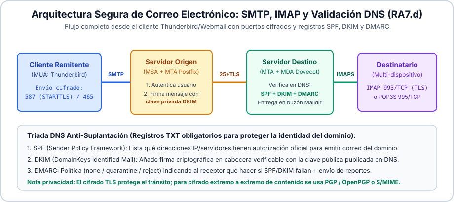

# Sistemas de Correo Electrónico y Mensajería Corporativa Segura

<!-- fuente: raw/procesados/ra7-correo-transferencia-utilidades-proposito-general.md -->

## 1. Protocolos del Correo Electrónico: SMTP, IMAP y POP3

El correo electrónico separa el envío desde el cliente, el transporte entre servidores y la consulta del buzón en puertos y protocolos diferenciados:



| Protocolo | Rol | Puerto Clásico (Obsoleto sin cifrar) | Puerto Seguro Obligatorio | Comportamiento |
| :--- | :--- | :---: | :---: | :--- |
| **SMTP** | Envío de cliente a servidor (MSA) y tránsito (MTA) | `25` (entre servidores) | **`587/TCP` (STARTTLS)** · **`465/TCP` (SMTPS)** | Autentica al usuario y entrega el mensaje saliente |
| **IMAP** | Lectura y sincronización de buzón | `143` | **`993/TCP` (IMAPS TLS)** | Mantiene correos y carpetas **en el servidor**; ideal para PC + móvil |
| **POP3** | Descarga simple de bandeja de entrada | `110` | **`995/TCP` (POP3S TLS)** | Pensado para descargar mensajes a un único equipo |

---

## 2. Seguridad Antisuplantación y Antiphishing: **SPF, DKIM y DMARC**

Un servidor de correo moderno rechaza correos procedentes de dominios mal protegidos verificando tres registros **`TXT`** en el **DNS** del remitente:

1. **SPF (*Sender Policy Framework*):** publica la lista exacta de direcciones IP autorizadas a enviar correo con el dominio `@tuempresa.es` (p. ej. `v=spf1 mx ip4:198.51.100.10 -all`).
2. **DKIM (*DomainKeys Identified Mail*):** firma criptográficamente las cabeceras y cuerpo del correo desde el servidor emisor; el destinatario valida la firma consultando la clave pública publicada en DNS.
3. **DMARC:** ordena al servidor receptor qué hacer si fallan SPF y DKIM (**`p=none`** observar, **`p=quarantine`** a spam, **`p=reject`** rechazar por completo) y envía reportes de intentos de suplantación.

> [!NOTE]
> El cifrado TLS de transporte protege el mensaje viajando entre cliente y servidor o entre servidores, pero cada servidor puede leerlo mientras está en su buzón. Si necesitas confidencialidad **extremo a extremo (*E2EE*)**, el cliente (**Mozilla Thunderbird**, multiplataforma FOSS) soporta nativamente firma y cifrado **OpenPGP** y **S/MIME**.

---

## 3. Comprobación Técnica de Registros DNS de Correo desde Consola

=== "MAX / Ubuntu (Linux)"

    ```bash
    # Consultar servidores de correo (MX) y políticas SPF / DMARC de un dominio real
    dig MX debian.org +short
    dig TXT debian.org +short | grep "v=spf1"
    dig TXT _dmarc.debian.org +short

    # Instalar cliente de correo FOSS estándar en entorno gráfico MAX / Ubuntu
    # sudo apt-get install -y thunderbird
    ```

=== "Windows 10 / 11"

    ```powershell
    # Inspeccionar registros MX, SPF y DMARC desde PowerShell nativo
    Resolve-DnsName -Name debian.org -Type MX
    Resolve-DnsName -Name debian.org -Type TXT | Where-Object Strings -like "*spf1*"
    Resolve-DnsName -Name _dmarc.debian.org -Type TXT
    ```

---

## Recursos para profundizar

- Concepto siguiente: [Transferencia Segura de Ficheros (`SFTP`, `SCP`, `rsync`) y Verificación de Integridad](ra7-servicios-transferencia-ficheros-sftp-scp-sincronizacion.md).
- Estándar OpenPGP en Thunderbird: [Mozilla Support · OpenPGP in Thunderbird](https://support.mozilla.org/es/kb/openpgp-en-thunderbird).
- Vídeo recomendado sobre correo seguro y protocolos de red: [Comunicaciones seguras, correo y protocolos en red (YouTube)](https://www.youtube.com/watch?v=S-2TIRnsioM).
