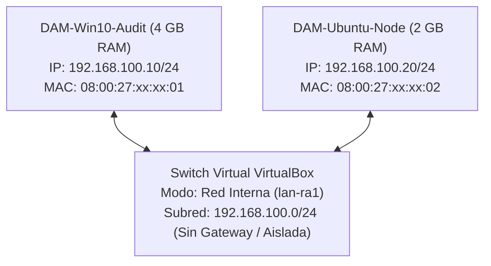

# Guía de Resolución · Práctica 01 (RA1)

> **Estado:** Privada para docente (`publicar: false`). Cambiar a `publicar: true` tras finalizar la entrega en clase para liberarla en la web.

---

## Solución Tarea 1 · Hardware Central y Arquitectura (`RA1.a`)

### Comandos en Host MAX
```bash
lscpu | grep -E "Architecture|Model name|Thread|Core|CPU\(s\)|Virtualization"
sudo dmidecode -t baseboard | grep -E "Manufacturer|Product Name|Version"
```

### Comandos en `DAM-Win10-Audit` (PowerShell)
```powershell
Get-CimInstance Win32_Processor | Select-Object Name, NumberOfCores, NumberOfLogicalProcessors, MaxClockSpeed
Get-CimInstance Win32_BaseBoard | Select-Object Manufacturer, Product, Version
```

### Respuesta modelo esperada
VirtualBox utiliza las extensiones hardware `VT-x`/`AMD-V` del procesador real para ejecutar el código invitado directamente sobre la CPU física (por lo que Windows 10 muestra el mismo modelo de CPU real limitado a **2 vCPUs**), mientras que virtualiza la placa base (`Oracle Corporation VirtualBox`) y el chipset para aislar y hacer portable la máquina virtual.

---

## Solución Tarea 2 · Jerarquía de Memorias y Presupuesto (`RA1.b`)

### Comandos en MAX y Windows 10
```bash
# Host MAX
lscpu | grep -i cache
sudo dmidecode -t memory | grep -E "Locator:|Size:|Type:|Form Factor:|Configured Memory Speed:"
free -h
swapon --show
```

```powershell
# VM DAM-Win10-Audit
Get-CimInstance Win32_PageFileUsage | Select-Object Name, AllocatedBaseSize, CurrentUsage
```

### Justificación numérica esperada
En un equipo del aula con **16 GB de RAM física**, asignar **6 GB** en total a `DAM-Win10-Audit` (4 GB) + `DAM-Ubuntu-Node` (2 GB) deja **10 GB libres** para el sistema operativo anfitrión MAX, el entorno gráfico, navegador y sobrecarga del propio hipervisor VirtualBox. Si se asignaran **14 GB** a las VMs, solo quedarían 2 GB para MAX + VirtualBox, provocando *thrashing* (paginación constante contra disco/`swap`), lentitud extrema y riesgo de cierre de procesos por el *OOM Killer*.

---

## Solución Tarea 3 · Verificación del Arranque UEFI (`RA1.c`)

### Comandos de validación en MAX y en `DAM-Ubuntu-Node` (con EFI activado)
```bash
[ -d /sys/firmware/efi ] && echo "UEFI activo" || echo "BIOS Legacy"
lsblk -o NAME,SIZE,FSTYPE,PARTTYPENAME,MOUNTPOINT
sudo efibootmgr -v
systemd-analyze
systemd-analyze blame | head -n 5
```

**Evidencia esperada en `DAM-Ubuntu-Node`:**
- Directorio `/sys/firmware/efi` presente.
- Partición de ~512 MB en `vfat` (`FAT32`), tipo `EFI System`, montada en `/boot/efi`.
- Entrada activa en `efibootmgr -v` apuntando a `\EFI\ubuntu\shimx64.efi`.

---

## Solución Tarea 4 · Periféricos, Buses e Interconexión (`RA1.a`, `RA1.d`)

### Comandos en MAX
```bash
lspci -nnk | grep -A 3 -E "NVMe|SATA|USB|Ethernet|VGA"
lsusb -tv
lsblk -o NAME,SIZE,TYPE,TRAN,MODEL
```

### Carpeta compartida / Passthrough en `DAM-Ubuntu-Node`
1. Instalar *Guest Additions* en `DAM-Ubuntu-Node` (`Dispositivos → Insertar imagen de CD de las Guest Additions`).
2. Configurar carpeta compartida `~/Auditoria_RA1` con automontaje (`/media/sf_Auditoria_RA1`) y ejecutar dentro de la VM:
   ```bash
   sudo usermod -aG vboxsf $USER
   # Tras reiniciar sesión:
   ls -la /media/sf_Auditoria_RA1
   echo "Prueba verificada desde DAM-Ubuntu-Node" > /media/sf_Auditoria_RA1/ok.txt
   ```

---

## Solución Tarea 5 · Red Interna `lan-ra1` y Mapas (`RA1.e`, `RA1.f`, `RA1.g`)

### Configuración IP estática temporal en ambos nodos
=== "DAM-Win10-Audit (PowerShell Admin)"
    ```powershell
    # Consultar nombre del adaptador (habitualmente "Ethernet")
    Get-NetAdapter
    New-NetIPAddress -InterfaceAlias "Ethernet" -IPAddress 192.168.100.10 -PrefixLength 24
    ping 192.168.100.20
    arp -a
    ```

=== "DAM-Ubuntu-Node (Terminal)"
    ```bash
    ip -br link
    sudo ip addr add 192.168.100.20/24 dev enp0s3
    sudo ip link set enp0s3 up
    ping -c 4 192.168.100.10
    ip neigh show
    ```

*(Nota: si `ping` desde Ubuntu hacia Windows 10 no recibe respuesta, recordar habilitar temporalmente la regla de Firewall de Windows `Compartir archivos e impresoras (petición eco: ICMPv4 de entrada)` o comprobar el perfil de red en Windows).*

### Diagramas modelo resueltos

**Mapa Físico (Ejemplo de puesto de aula):**


**Mapa Lógico (`lan-ra1` en VirtualBox):**


---

## Solución Tarea 6 · Protocolo ESD/Eléctrico y PVD (`RA1.h`)

### Protocolo de 5 pasos antes de ampliar RAM
1. Apagar completamente el equipo desde MAX y desconectar el cable de alimentación AC de la torre (nunca manipular con corriente conectada).
2. Pulsar el botón de encendido durante 5 segundos para descargar los condensadores de la placa y fuente ATX.
3. Colocar alfombrilla y pulsera antiestática ESD (con resistencia de seguridad de 1 MΩ) conectada al chasis metálico sin pintar.
4. Extraer el módulo RAM nuevo de su bolsa antiestática sujetándolo exclusivamente por los bordes laterales, sin tocar los contactos dorados ni chips.
5. Insertar el módulo alineando la muesca física (DDR4/DDR5) hasta oír el clic de las pestañas de retención, cerrar la carcasa antes de reconectar el cable AC y comprobar en BIOS/MAX (`dmidecode -t memory` / `free -h`) que se reconoce la capacidad total.

### Tabla PVD modelo (RD 488/1997)
- **Distancia ojo-pantalla:** 50–70 cm.
- **Altura del monitor:** Borde superior a la altura de los ojos o ligeramente por debajo.
- **Iluminación y ventanas:** Pantalla perpendicular a las ventanas, sin reflejos directos.
- **Postura:** Espalda apoyada en zona lumbar, codos y rodillas a ~90°, pies apoyados firmemente en el suelo.
- **Descanso visual:** Aplicar regla **20-20-20** cada 20 minutos (mirar a 6 metros durante 20 segundos).
