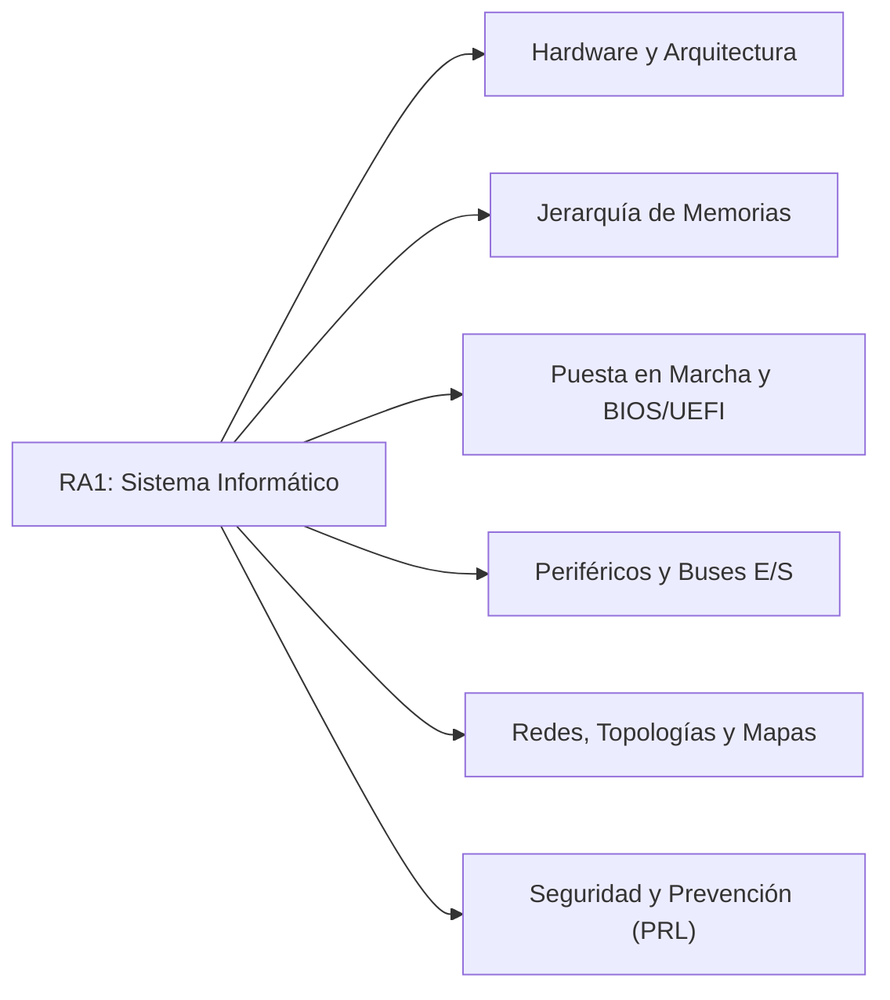

# RA1 · Evalúa sistemas informáticos, identificando sus componentes y características

> **Estado del bloque:** En preparación activa (primer bloque en orden de desarrollo secuencial).

---

## Mapa Conceptual del Bloque

---

## Criterios de Evaluación Oficiales

| Código | Criterio de Evaluación | Cobertura |
| :---: | :--- | :---: |
| **RA1.a** | Se han reconocido los componentes físicos de un sistema informático y sus mecanismos de interconexión. | Pendiente |
| **RA1.b** | Se han clasificado los tipos de memorias, señalando sus características e identificando sus prestaciones y la función que desarrollan en el conjunto del sistema. | Pendiente |
| **RA1.c** | Se ha verificado el proceso de puesta en marcha de un equipo. | Pendiente |
| **RA1.d** | Se han clasificado, instalado y configurado diferentes tipos de dispositivos periféricos. | Pendiente |
| **RA1.e** | Se han identificado los tipos de redes y sistemas de comunicación. | Pendiente |
| **RA1.f** | Se han identificado los componentes de una red informática. | Pendiente |
| **RA1.g** | Se han interpretado mapas físicos y lógicos de una red informática. | Pendiente |
| **RA1.h** | Se han reconocido las normas de seguridad y prevención de riesgos laborales en el uso de los sistemas informáticos. | Pendiente |

---

## Contenidos Básicos Asociados (*Explotación de sistemas microinformáticos*)

- Placas base. Formatos.
- Estructura y componentes: procesador (Set de Instrucciones, Registros, Contador, Unidad Aritmético-Lógica, Interrupciones); memoria interna, tipos y características (RAM, xPROM y otras); interfaces de entrada/salida; discos y periféricos; adaptadores para la conexión de dispositivos; componentes de un sistema informático.
- Periféricos. Adaptadores para la conexión de dispositivos.
- Normas de seguridad y prevención de riesgos laborales.
- Características de las redes. Ventajas e inconvenientes.
- Tipos de redes.
- Componentes de una red informática.
- Topologías de red.
- Tipos de cableado. Conectores.
- Mapa físico y lógico de una red local.

---

## Conceptos Teóricos

*Pendiente de compilación inicial. Consulta el [índice general de conceptos](../conceptos/index.md).*

## Ejercicios Prácticos Resueltos

*Pendiente de compilación inicial. Consulta el [índice de ejercicios](../ejercicios/index.md).*

## Prácticas Integradoras de Aula

*Pendiente de compilación inicial. Consulta el [índice de prácticas](../practicas/index.md).*
