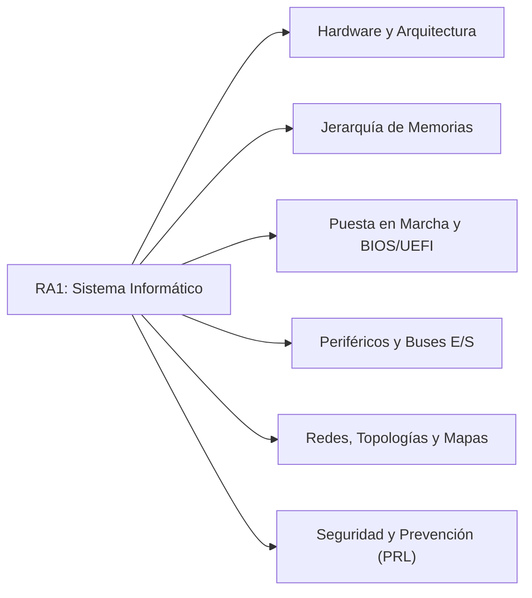

# RA1 · Evalúa sistemas informáticos, identificando sus componentes y características

> **Estado del bloque:** Completado ✅ (6 conceptos teóricos, 6 ilustraciones SVG, 5 ejercicios resueltos y práctica integradora `p01`).

---

## Mapa Conceptual del Bloque

---

## Criterios de Evaluación Oficiales

| Código | Criterio de Evaluación | Cobertura | Recursos en `wikiSI` |
| :---: | :--- | :---: | :--- |
| **RA1.a** | Se han reconocido los componentes físicos de un sistema informático y sus mecanismos de interconexión. | Completado ✅ | [Concepto CPU/Placa](../conceptos/ra1-arquitectura-placa-base-cpu.md) · [Concepto Buses](../conceptos/ra1-perifericos-interfaces-buses.md) · [e01](../ejercicios/e01-ra1-auditoria-hardware-cpu-placas.md) · [p01](../practicas/p01-ra1-auditoria-integral-sistema-red-enunciado.md) |
| **RA1.b** | Se han clasificado los tipos de memorias, señalando sus características e identificando sus prestaciones y la función que desarrollan en el conjunto del sistema. | Completado ✅ | [Concepto Memorias](../conceptos/ra1-jerarquia-tipos-memoria.md) · [e02](../ejercicios/e02-ra1-analisis-jerarquia-memorias.md) · [p01](../practicas/p01-ra1-auditoria-integral-sistema-red-enunciado.md) |
| **RA1.c** | Se ha verificado el proceso de puesta en marcha de un equipo. | Completado ✅ | [Concepto BIOS/UEFI](../conceptos/ra1-puesta-en-marcha-bios-uefi.md) · [e03](../ejercicios/e03-ra1-verificacion-arranque-uefi-bios.md) · [p01](../practicas/p01-ra1-auditoria-integral-sistema-red-enunciado.md) |
| **RA1.d** | Se han clasificado, instalado y configurado diferentes tipos de dispositivos periféricos. | Completado ✅ | [Concepto Periféricos](../conceptos/ra1-perifericos-interfaces-buses.md) · [e04](../ejercicios/e04-ra1-inventario-perifericos-buses-usb.md) · [p01](../practicas/p01-ra1-auditoria-integral-sistema-red-enunciado.md) |
| **RA1.e** | Se han identificado los tipos de redes y sistemas de comunicación. | Completado ✅ | [Concepto Redes](../conceptos/ra1-redes-componentes-topologias-mapas.md) · [e05](../ejercicios/e05-ra1-interpretacion-mapa-red-prl.md) · [p01](../practicas/p01-ra1-auditoria-integral-sistema-red-enunciado.md) |
| **RA1.f** | Se han identificado los componentes de una red informática. | Completado ✅ | [Concepto Redes](../conceptos/ra1-redes-componentes-topologias-mapas.md) · [e05](../ejercicios/e05-ra1-interpretacion-mapa-red-prl.md) · [p01](../practicas/p01-ra1-auditoria-integral-sistema-red-enunciado.md) |
| **RA1.g** | Se han interpretado mapas físicos y lógicos de una red informática. | Completado ✅ | [Concepto Redes](../conceptos/ra1-redes-componentes-topologias-mapas.md) · [e05](../ejercicios/e05-ra1-interpretacion-mapa-red-prl.md) · [p01](../practicas/p01-ra1-auditoria-integral-sistema-red-enunciado.md) |
| **RA1.h** | Se han reconocido las normas de seguridad y prevención de riesgos laborales en el uso de los sistemas informáticos. | Completado ✅ | [Concepto PRL/PVD](../conceptos/ra1-seguridad-prevencion-riesgos-prl.md) · [e05](../ejercicios/e05-ra1-interpretacion-mapa-red-prl.md) · [p01](../practicas/p01-ra1-auditoria-integral-sistema-red-enunciado.md) |

---

## Contenidos Básicos Asociados (*Explotación de sistemas microinformáticos*)

- Placas base. Formatos.
- Estructura y componentes: procesador (Set de Instrucciones, Registros, Contador, Unidad Aritmético-Lógica, Interrupciones); memoria interna, tipos y características (RAM, xPROM y otras); interfaces de entrada/salida; discos y periféricos; adaptadores para la conexión de dispositivos; componentes de un sistema informático.
- Periféricos. Adaptadores para la conexión de dispositivos.
- Normas de seguridad y prevención de riesgos laborales.
- Características de las redes. Ventajas e inconvenientes.
- Tipos de redes.
- Componentes de una red informática.
- Topologías de red.
- Tipos de cableado. Conectores.
- Mapa físico y lógico de una red local.

---

## Conceptos Teóricos

1. [Arquitectura de Von Neumann, Placa Base y CPU](../conceptos/ra1-arquitectura-placa-base-cpu.md) (`RA1.a`)
2. [Jerarquía de Memorias y Tipos de Memoria](../conceptos/ra1-jerarquia-tipos-memoria.md) (`RA1.b`)
3. [Puesta en Marcha del Equipo: POST, BIOS Legacy y UEFI](../conceptos/ra1-puesta-en-marcha-bios-uefi.md) (`RA1.c`)
4. [Periféricos, Interfaces de Entrada/Salida y Buses](../conceptos/ra1-perifericos-interfaces-buses.md) (`RA1.a`, `RA1.d`)
5. [Redes, Componentes, Cableado y Mapas Físico y Lógico](../conceptos/ra1-redes-componentes-topologias-mapas.md) (`RA1.e`, `RA1.f`, `RA1.g`)
6. [Normas de Seguridad y Prevención de Riesgos Laborales (PRL)](../conceptos/ra1-seguridad-prevencion-riesgos-prl.md) (`RA1.h`)

## Ejercicios Prácticos Resueltos

1. [e01 · Auditoría de Hardware: CPU y Placa Base en MAX y VirtualBox](../ejercicios/e01-ra1-auditoria-hardware-cpu-placas.md) (`RA1.a`)
2. [e02 · Análisis de la Jerarquía de Memorias y Presupuesto de RAM](../ejercicios/e02-ra1-analisis-jerarquia-memorias.md) (`RA1.b`)
3. [e03 · Verificación del Arranque UEFI vs. BIOS y Análisis de Tiempos](../ejercicios/e03-ra1-verificacion-arranque-uefi-bios.md) (`RA1.c`)
4. [e04 · Inventario de Buses PCIe/USB y Periféricos en VirtualBox](../ejercicios/e04-ra1-inventario-perifericos-buses-usb.md) (`RA1.a`, `RA1.d`)
5. [e05 · Mapa Físico/Lógico de Red en VirtualBox y Checklist PRL](../ejercicios/e05-ra1-interpretacion-mapa-red-prl.md) (`RA1.e`–`RA1.h`)

## Prácticas Integradoras de Aula

- **[Práctica p01 · Auditoría Integral de Hardware, Arranque, Red y PRL (Enunciado)](../practicas/p01-ra1-auditoria-integral-sistema-red-enunciado.md)** (`RA1.a`–`RA1.h` · 2 VMs, 6 GB RAM totales en VirtualBox sobre MAX)
