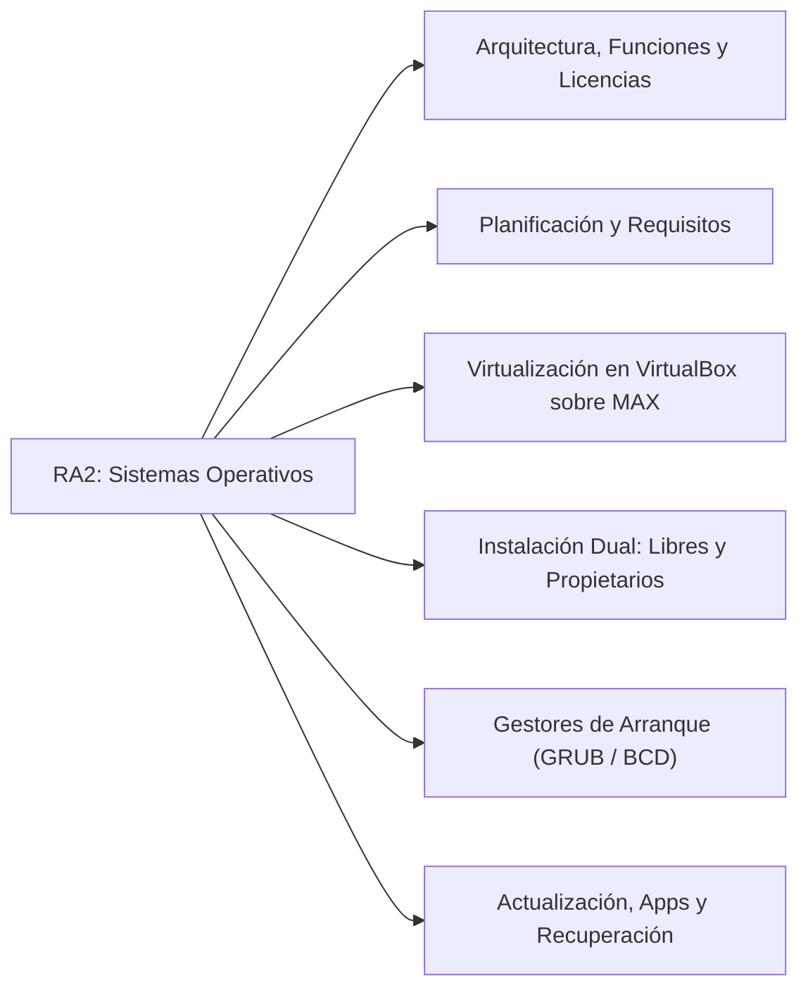

# RA2 · Instala sistemas operativos planificando el proceso e interpretando documentación técnica

> **Estado del bloque:** Planificado (comienza tras completar y validar RA1).

---

## Mapa Conceptual del Bloque

---

## Criterios de Evaluación Oficiales

| Código | Criterio de Evaluación | Cobertura |
| :---: | :--- | :---: |
| **RA2.a** | Se han identificado los elementos funcionales de un sistema informático. | Pendiente |
| **RA2.b** | Se han analizado las características, funciones y arquitectura de un sistema operativo. | Pendiente |
| **RA2.c** | Se han comparado sistemas operativos en base a sus requisitos, características, campos de aplicación y licencias de uso. | Pendiente |
| **RA2.d** | Se ha planificado el proceso de la instalación de sistemas operativos. | Pendiente |
| **RA2.e** | Se han instalado y actualizado sistemas operativos libres y propietarios. | Pendiente |
| **RA2.f** | Se han aplicado técnicas de actualización y recuperación del sistema. | Pendiente |
| **RA2.g** | Se han utilizado tecnologías de virtualización para instalar y probar sistemas operativos. | Pendiente |
| **RA2.h** | Se han instalado, desinstalado y actualizado aplicaciones. | Pendiente |
| **RA2.i** | Se han documentado los procesos realizados. | Pendiente |

---

## Contenidos Básicos Asociados (*Instalación de sistemas operativos*)

- Evolución histórica y clasificación.
- Funciones de un sistema operativo.
- Tipos de sistemas operativos.
- Tipos de aplicaciones.
- Licencias y tipos de licencias.
- Procedimiento de instalación.
- Gestores de arranque. Configuración y reparación.
- Tecnologías de virtualización. Tipos.
- Consideraciones previas a la instalación de sistemas operativos libres y propietarios.
- Instalación de sistemas operativos libres y propietarios. Requisitos, versiones y licencias.
- Instalación/desinstalación de aplicaciones. Requisitos, versiones y licencias.
- Actualización y recuperación de sistemas operativos y aplicaciones.
- Documentación de la instalación y de las incidencias detectadas.

---

## Conceptos Teóricos

*Bloque planificado tras RA1. Consulta el [índice general de conceptos](../conceptos/index.md).*

## Ejercicios Prácticos Resueltos

*Bloque planificado tras RA1. Consulta el [índice de ejercicios](../ejercicios/index.md).*

## Prácticas Integradoras de Aula

*Bloque planificado tras RA1. Consulta el [índice de prácticas](../practicas/index.md).*
