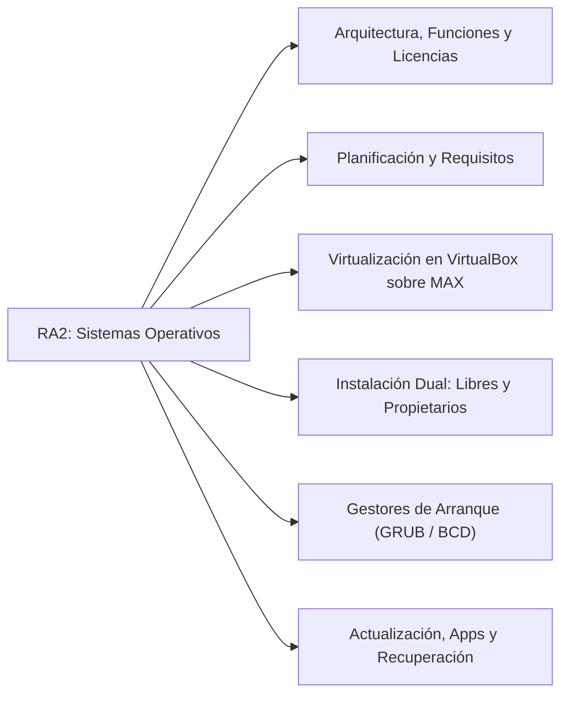

# RA2 · Instala sistemas operativos planificando el proceso e interpretando documentación técnica

> **Estado del bloque:** Completado ✅ (6 páginas de conceptos, 6 diagramas SVG, 5 ejercicios resueltos `e06`–`e10`, práctica integradora `p02` y banco de evaluación privado).

---

## Mapa Conceptual del Bloque

---

## Criterios de Evaluación Oficiales

| Código | Criterio de Evaluación | Cobertura | Recursos |
| :---: | :--- | :---: | :--- |
| **RA2.a** | Se han identificado los elementos funcionales de un sistema informático. | Completado ✅ | [Arquitectura y Funciones SO](../conceptos/ra2-arquitectura-funciones-sistema-operativo.md) · [e06](../ejercicios/e06-ra2-verificacion-isos-creacion-vm-virtualbox.md) · [p02](../practicas/p02-ra2-despliegue-dualboot-recuperacion-enunciado.md) |
| **RA2.b** | Se han analizado las características, funciones y arquitectura de un sistema operativo. | Completado ✅ | [Arquitectura y Funciones SO](../conceptos/ra2-arquitectura-funciones-sistema-operativo.md) · [p02](../practicas/p02-ra2-despliegue-dualboot-recuperacion-enunciado.md) |
| **RA2.c** | Se han comparado sistemas operativos en base a sus requisitos, características, campos de aplicación y licencias de uso. | Completado ✅ | [Comparativa SO y Licencias](../conceptos/ra2-comparativa-so-licencias.md) · [e06](../ejercicios/e06-ra2-verificacion-isos-creacion-vm-virtualbox.md) · [p02](../practicas/p02-ra2-despliegue-dualboot-recuperacion-enunciado.md) |
| **RA2.d** | Se ha planificado el proceso de la instalación de sistemas operativos. | Completado ✅ | [Planificación y Dual-Boot](../conceptos/ra2-planificacion-instalacion-dual-boot.md) · [VirtualBox](../conceptos/ra2-virtualizacion-virtualbox-max.md) · [e06](../ejercicios/e06-ra2-verificacion-isos-creacion-vm-virtualbox.md) · [e07](../ejercicios/e07-ra2-instalacion-dual-boot-windows-ubuntu.md) · [p02](../practicas/p02-ra2-despliegue-dualboot-recuperacion-enunciado.md) |
| **RA2.e** | Se han instalado y actualizado sistemas operativos libres y propietarios. | Completado ✅ | [Planificación y Dual-Boot](../conceptos/ra2-planificacion-instalacion-dual-boot.md) · [GRUB2 y BCD](../conceptos/ra2-gestores-arranque-grub-bcd.md) · [e07](../ejercicios/e07-ra2-instalacion-dual-boot-windows-ubuntu.md) · [e08](../ejercicios/e08-ra2-configuracion-reparacion-grub-bcd.md) · [p02](../practicas/p02-ra2-despliegue-dualboot-recuperacion-enunciado.md) |
| **RA2.f** | Se han aplicado técnicas de actualización y recuperación del sistema. | Completado ✅ | [GRUB2 y BCD](../conceptos/ra2-gestores-arranque-grub-bcd.md) · [Paquetes y Recuperación](../conceptos/ra2-gestion-aplicaciones-actualizacion-recuperacion.md) · [e08](../ejercicios/e08-ra2-configuracion-reparacion-grub-bcd.md) · [e10](../ejercicios/e10-ra2-recuperacion-snapshots-timeshift-dism.md) · [p02](../practicas/p02-ra2-despliegue-dualboot-recuperacion-enunciado.md) |
| **RA2.g** | Se han utilizado tecnologías de virtualización para instalar y probar sistemas operativos. | Completado ✅ | [VirtualBox en MAX](../conceptos/ra2-virtualizacion-virtualbox-max.md) · [e06](../ejercicios/e06-ra2-verificacion-isos-creacion-vm-virtualbox.md) · [e07](../ejercicios/e07-ra2-instalacion-dual-boot-windows-ubuntu.md) · [e10](../ejercicios/e10-ra2-recuperacion-snapshots-timeshift-dism.md) · [p02](../practicas/p02-ra2-despliegue-dualboot-recuperacion-enunciado.md) |
| **RA2.h** | Se han instalado, desinstalado y actualizado aplicaciones. | Completado ✅ | [Paquetes y Recuperación](../conceptos/ra2-gestion-aplicaciones-actualizacion-recuperacion.md) · [e09](../ejercicios/e09-ra2-gestion-paquetes-apt-dpkg-winget.md) · [p02](../practicas/p02-ra2-despliegue-dualboot-recuperacion-enunciado.md) |
| **RA2.i** | Se han documentado los procesos realizados. | Completado ✅ | [Planificación y Dual-Boot](../conceptos/ra2-planificacion-instalacion-dual-boot.md) · [Paquetes y Recuperación](../conceptos/ra2-gestion-aplicaciones-actualizacion-recuperacion.md) · [e10](../ejercicios/e10-ra2-recuperacion-snapshots-timeshift-dism.md) · [p02](../practicas/p02-ra2-despliegue-dualboot-recuperacion-enunciado.md) |

---

## Contenidos Básicos Asociados (*Instalación de sistemas operativos*)

- Evolución histórica y clasificación.
- Funciones de un sistema operativo.
- Tipos de sistemas operativos.
- Tipos de aplicaciones.
- Licencias y tipos de licencias.
- Procedimiento de instalación.
- Gestores de arranque. Configuración y reparación.
- Tecnologías de virtualización. Tipos.
- Consideraciones previas a la instalación de sistemas operativos libres y propietarios.
- Instalación de sistemas operativos libres y propietarios. Requisitos, versiones y licencias.
- Instalación/desinstalación de aplicaciones. Requisitos, versiones y licencias.
- Actualización y recuperación de sistemas operativos y aplicaciones.
- Documentación de la instalación y de las incidencias detectadas.

---

## Conceptos Teóricos

1. [Arquitectura, Elementos Funcionales y Clasificación de Sistemas Operativos](../conceptos/ra2-arquitectura-funciones-sistema-operativo.md) (`RA2.a`, `RA2.b`)
2. [Comparativa de Sistemas Operativos, Requisitos y Licencias](../conceptos/ra2-comparativa-so-licencias.md) (`RA2.c`)
3. [Tecnologías de Virtualización y Laboratorio VirtualBox en MAX](../conceptos/ra2-virtualizacion-virtualbox-max.md) (`RA2.d`, `RA2.g`)
4. [Planificación, Particionado GPT/UEFI e Instalación Dual-Boot](../conceptos/ra2-planificacion-instalacion-dual-boot.md) (`RA2.d`, `RA2.e`, `RA2.i`)
5. [Gestores de Arranque: GRUB2, Windows BCD y Reparación](../conceptos/ra2-gestores-arranque-grub-bcd.md) (`RA2.e`, `RA2.f`)
6. [Gestión de Aplicaciones, Actualización y Recuperación del Sistema](../conceptos/ra2-gestion-aplicaciones-actualizacion-recuperacion.md) (`RA2.f`, `RA2.h`, `RA2.i`)

## Ejercicios Prácticos Resueltos

1. [e06 · Verificación de ISOs, Licencias y Provisionamiento VM UEFI en VirtualBox](../ejercicios/e06-ra2-verificacion-isos-creacion-vm-virtualbox.md) (`RA2.a`, `RA2.c`, `RA2.d`, `RA2.g` · 6 GB RAM)
2. [e07 · Planificación e Instalación Dual-Boot Windows + Ubuntu en UEFI/GPT](../ejercicios/e07-ra2-instalacion-dual-boot-windows-ubuntu.md) (`RA2.d`, `RA2.e`, `RA2.g` · 4 GB RAM)
3. [e08 · Configuración y Reparación de Arranque Dual-Boot (GRUB2 y BCD)](../ejercicios/e08-ra2-configuracion-reparacion-grub-bcd.md) (`RA2.e`, `RA2.f` · 4 GB RAM)
4. [e09 · Gestión Profesional de Aplicaciones: `apt`, `dpkg`, Snap y `winget`](../ejercicios/e09-ra2-gestion-paquetes-apt-dpkg-winget.md) (`RA2.h` · 6 GB RAM)
5. [e10 · Recuperación ante Desastres: Snapshots, Timeshift, DISM/SFC y Acta Técnica](../ejercicios/e10-ra2-recuperacion-snapshots-timeshift-dism.md) (`RA2.f`, `RA2.g`, `RA2.i` · 6 GB RAM)

## Prácticas Integradoras de Aula

- **[Práctica p02 · Despliegue Dual-Boot, Gestión de Paquetes, Arranque y Recuperación (Enunciado)](../practicas/p02-ra2-despliegue-dualboot-recuperacion-enunciado.md)** (`RA2.a`–`RA2.i` · `DAM-Estacion-Dual` 4 GB + `DAM-Rescate-Puppy` 1 GB = 5 GB en VirtualBox sobre MAX)
