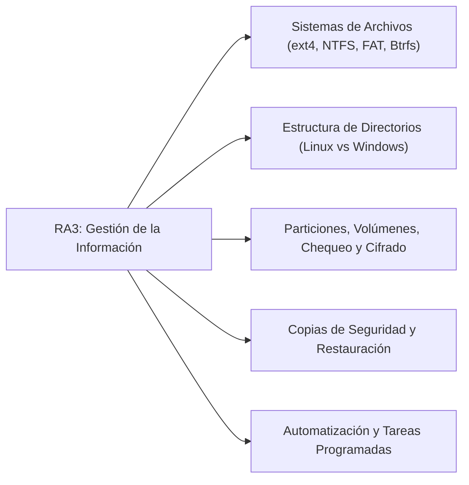

# RA3 · Gestiona la información del sistema identificando las estructuras de almacenamiento y aplicando medidas para asegurar la integridad de los datos

> **Estado del bloque:** Planificado (comienza tras completar y validar RA2).

---

## Mapa Conceptual del Bloque

---

## Criterios de Evaluación Oficiales

| Código | Criterio de Evaluación | Cobertura |
| :---: | :--- | :---: |
| **RA3.a** | Se han comparado sistemas de archivos. | Pendiente |
| **RA3.b** | Se ha identificado la estructura y función de los directorios del sistema | Pendiente |
| **RA3.c** | operativo. *(Nota: en la tabla curricular oficial el enunciado de `b)` aparece dividido entre `b)` y `c)`)* | Pendiente |
| **RA3.d** | Se han utilizado herramientas en entorno gráfico y comandos para localizar información en el sistema de archivos. | Pendiente |
| **RA3.e** | Se han creado diferentes tipos de particiones y unidades lógicas. | Pendiente |
| **RA3.f** | Se han realizado y restaurado copias de seguridad. | Pendiente |
| **RA3.g** | Se han planificado y automatizado tareas. | Pendiente |
| **RA3.h** | Se han instalado y evaluado utilidades relacionadas con la gestión de información. | Pendiente |

---

## Contenidos Básicos Asociados (*Gestión de la información*)

- Gestión de sistemas de archivos mediante comandos y entornos gráficos.
- Estructura de directorios de sistemas operativos libres y propietarios.
- Búsqueda de información del sistema mediante comandos y herramientas gráficas.
- Identificación del software instalado mediante comandos y herramientas gráficas.
- Realización y restauración de copias de seguridad.
- Herramientas de administración de discos. Particiones y volúmenes. Desfragmentación y chequeo. Cifrado.
- Tareas automáticas. Planificación.

---

## Conceptos Teóricos

*Bloque planificado tras RA2. Consulta el [índice general de conceptos](../conceptos/index.md).*

## Ejercicios Prácticos Resueltos

*Bloque planificado tras RA2. Consulta el [índice de ejercicios](../ejercicios/index.md).*

## Prácticas Integradoras de Aula

*Bloque planificado tras RA2. Consulta el [índice de prácticas](../practicas/index.md).*
