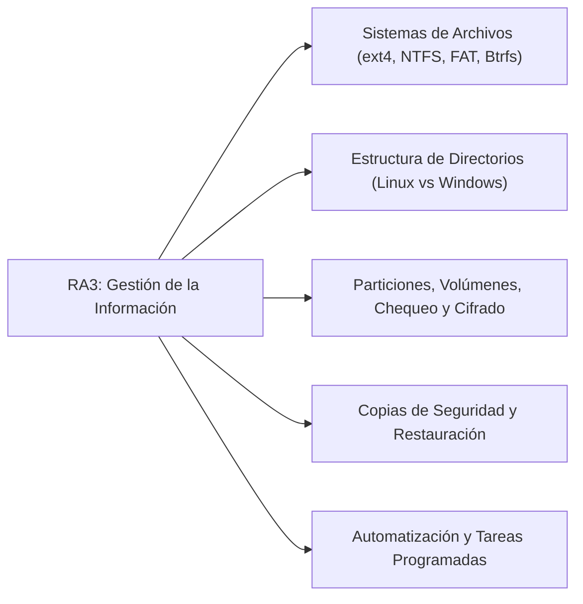

# RA3 · Gestiona la información del sistema identificando las estructuras de almacenamiento y aplicando medidas para asegurar la integridad de los datos

> **Estado del bloque:** Completado ✅ (6 páginas de conceptos, 5 diagramas SVG, 5 ejercicios resueltos `e11`–`e15`, práctica integradora `p03` y banco de evaluación privado).

---

## Mapa Conceptual del Bloque

---

## Criterios de Evaluación Oficiales

| Código | Criterio de Evaluación | Cobertura | Recursos |
| :---: | :--- | :---: | :--- |
| **RA3.a** | Se han comparado sistemas de archivos. | Completado ✅ | [Sistemas de Archivos](../conceptos/ra3-sistemas-archivos-anatomia-comparativa.md) · [e11](../ejercicios/e11-ra3-exploracion-fhs-inodos-enlaces-busqueda.md) · [e12](../ejercicios/e12-ra3-particionado-montaje-fstab-diskpart.md) · [p03](../practicas/p03-ra3-almacenamiento-lvm-cifrado-backups-enunciado.md) |
| **RA3.b** | Se ha identificado la estructura y función de los directorios del sistema | Completado ✅ | [Directorios FHS/Win](../conceptos/ra3-estructura-directorios-fhs-windows.md) · [e11](../ejercicios/e11-ra3-exploracion-fhs-inodos-enlaces-busqueda.md) · [p03](../practicas/p03-ra3-almacenamiento-lvm-cifrado-backups-enunciado.md) |
| **RA3.c** | operativo. *(Nota: en la tabla curricular oficial el enunciado de `b)` aparece dividido entre `b)` y `c)`)* | Completado ✅ | [Directorios FHS/Win](../conceptos/ra3-estructura-directorios-fhs-windows.md) · [e11](../ejercicios/e11-ra3-exploracion-fhs-inodos-enlaces-busqueda.md) · [p03](../practicas/p03-ra3-almacenamiento-lvm-cifrado-backups-enunciado.md) |
| **RA3.d** | Se han utilizado herramientas en entorno gráfico y comandos para localizar información en el sistema de archivos. | Completado ✅ | [Búsqueda e Inventario](../conceptos/ra3-busqueda-localizacion-informacion.md) · [e11](../ejercicios/e11-ra3-exploracion-fhs-inodos-enlaces-busqueda.md) · [p03](../practicas/p03-ra3-almacenamiento-lvm-cifrado-backups-enunciado.md) |
| **RA3.e** | Se han creado diferentes tipos de particiones y unidades lógicas. | Completado ✅ | [Discos, LVM y RAID](../conceptos/ra3-particiones-lvm-raid-administracion-discos.md) · [Chequeo y Cifrado](../conceptos/ra3-chequeo-desfragmentacion-cifrado-discos.md) · [e12](../ejercicios/e12-ra3-particionado-montaje-fstab-diskpart.md) · [e13](../ejercicios/e13-ra3-volumenes-logicos-lvm-raid-mdadm.md) · [e14](../ejercicios/e14-ra3-chequeo-smart-cifrado-luks-bitlocker.md) · [p03](../practicas/p03-ra3-almacenamiento-lvm-cifrado-backups-enunciado.md) |
| **RA3.f** | Se han realizado y restaurado copias de seguridad. | Completado ✅ | [Backups y Tareas](../conceptos/ra3-copias-seguridad-clonacion-tareas-programadas.md) · [e15](../ejercicios/e15-ra3-backups-rsync-tar-cron-schtasks.md) · [p03](../practicas/p03-ra3-almacenamiento-lvm-cifrado-backups-enunciado.md) |
| **RA3.g** | Se han planificado y automatizado tareas. | Completado ✅ | [Backups y Tareas](../conceptos/ra3-copias-seguridad-clonacion-tareas-programadas.md) · [e15](../ejercicios/e15-ra3-backups-rsync-tar-cron-schtasks.md) · [p03](../practicas/p03-ra3-almacenamiento-lvm-cifrado-backups-enunciado.md) |
| **RA3.h** | Se han instalado y evaluado utilidades relacionadas con la gestión de información. | Completado ✅ | [Búsqueda](../conceptos/ra3-busqueda-localizacion-informacion.md) · [LVM/RAID](../conceptos/ra3-particiones-lvm-raid-administracion-discos.md) · [SMART/LUKS](../conceptos/ra3-chequeo-desfragmentacion-cifrado-discos.md) · [e13](../ejercicios/e13-ra3-volumenes-logicos-lvm-raid-mdadm.md) · [e14](../ejercicios/e14-ra3-chequeo-smart-cifrado-luks-bitlocker.md) · [e15](../ejercicios/e15-ra3-backups-rsync-tar-cron-schtasks.md) · [p03](../practicas/p03-ra3-almacenamiento-lvm-cifrado-backups-enunciado.md) |

---

## Contenidos Básicos Asociados (*Gestión de la información*)

- Gestión de sistemas de archivos mediante comandos y entornos gráficos.
- Estructura de directorios de sistemas operativos libres y propietarios.
- Búsqueda de información del sistema mediante comandos y herramientas gráficas.
- Identificación del software instalado mediante comandos y herramientas gráficas.
- Realización y restauración de copias de seguridad.
- Herramientas de administración de discos. Particiones y volúmenes. Desfragmentación y chequeo. Cifrado.
- Tareas automáticas. Planificación.

---

## Conceptos Teóricos

1. [Sistemas de Archivos: Anatomía y Comparativa Técnica](../conceptos/ra3-sistemas-archivos-anatomia-comparativa.md) (`RA3.a`)
2. [Estructura y Función de los Directorios: FHS Linux vs. Windows](../conceptos/ra3-estructura-directorios-fhs-windows.md) (`RA3.b`, `RA3.c`)
3. [Búsqueda, Localización de Información e Inventario de Software](../conceptos/ra3-busqueda-localizacion-informacion.md) (`RA3.d`, `RA3.h`)
4. [Administración de Discos, Particiones, LVM y Matrices RAID](../conceptos/ra3-particiones-lvm-raid-administracion-discos.md) (`RA3.e`, `RA3.h`)
5. [Diagnóstico, Chequeo, TRIM vs. Desfragmentación y Cifrado de Discos](../conceptos/ra3-chequeo-desfragmentacion-cifrado-discos.md) (`RA3.e`, `RA3.h`)
6. [Copias de Seguridad, Clonación y Automatización de Tareas](../conceptos/ra3-copias-seguridad-clonacion-tareas-programadas.md) (`RA3.f`, `RA3.g`, `RA3.h`)

## Ejercicios Prácticos Resueltos

1. [e11 · Exploración FHS, Inodos, Enlaces y Búsqueda Avanzada](../ejercicios/e11-ra3-exploracion-fhs-inodos-enlaces-busqueda.md) (`RA3.a`–`RA3.d` · 6 GB RAM)
2. [e12 · Particionado GPT, Formateo y Montaje Persistente (`fstab` vs. `DiskPart`)](../ejercicios/e12-ra3-particionado-montaje-fstab-diskpart.md) (`RA3.a`, `RA3.e` · 6 GB RAM)
3. [e13 · Volúmenes Lógicos `LVM` y Matrices `RAID 1` por Software (`mdadm`)](../ejercicios/e13-ra3-volumenes-logicos-lvm-raid-mdadm.md) (`RA3.e`, `RA3.h` · 2 GB RAM)
4. [e14 · Chequeo SMART, Reparación Lógica (`fsck`/`chkdsk`), TRIM y Cifrado `LUKS` / `BitLocker`](../ejercicios/e14-ra3-chequeo-smart-cifrado-luks-bitlocker.md) (`RA3.e`, `RA3.h` · 6 GB RAM)
5. [e15 · Copias de Seguridad con `rsync`, `tar` y `Robocopy` más Automatización (`cron` y `schtasks`)](../ejercicios/e15-ra3-backups-rsync-tar-cron-schtasks.md) (`RA3.f`, `RA3.g`, `RA3.h` · 6 GB RAM)

## Prácticas Integradoras de Aula

- **[Práctica p03 · Almacenamiento Elástico (LVM/RAID), Cifrado y Copias Automatizadas (Enunciado)](../practicas/p03-ra3-almacenamiento-lvm-cifrado-backups-enunciado.md)** (`RA3.a`–`RA3.h` · `DAM-Storage-Ubuntu` 2 GB + `DAM-Client-Win10` 4 GB = 6 GB en VirtualBox sobre MAX)
