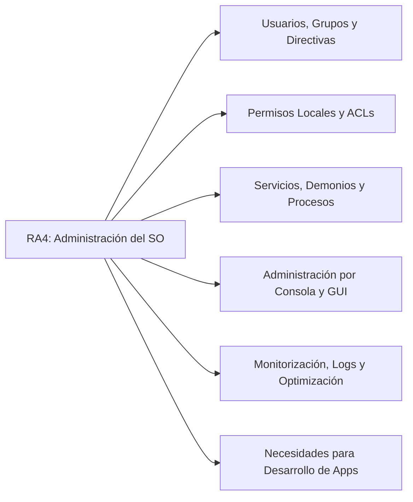

# RA4 · Gestiona sistemas operativos utilizando comandos y herramientas gráficas y evaluando las necesidades del sistema

> **Estado del bloque:** **Completado ✅** · Incluye 6 conceptos desarrollados, 5 diagramas SVG propios, 5 ejercicios resueltos (`e16`–`e20`) y la práctica integradora [`p04`](../practicas/p04-ra4-administracion-multi-usuario-acls-monitorizacion-enunciado.md).

---

## Mapa Conceptual del Bloque

---

## Criterios de Evaluación Oficiales

| Código | Criterio de Evaluación | Cobertura |
| :---: | :--- | :--- |
| **RA4.a** | Se han configurado cuentas de usuario locales y grupos. | [Concepto 1](../conceptos/ra4-administracion-usuarios-grupos-locales.md) · [`e16`](../ejercicios/e16-ra4-creacion-usuarios-grupos-politicas-chage-net.md) · [`p04`](../practicas/p04-ra4-administracion-multi-usuario-acls-monitorizacion-enunciado.md) |
| **RA4.b** | Se ha asegurado el acceso al sistema mediante el uso de directivas de cuenta y directivas de contraseñas. | [Concepto 2](../conceptos/ra4-directivas-cuenta-politicas-contrasenas-sudo.md) · [`e16`](../ejercicios/e16-ra4-creacion-usuarios-grupos-politicas-chage-net.md) · [`p04`](../practicas/p04-ra4-administracion-multi-usuario-acls-monitorizacion-enunciado.md) |
| **RA4.c** | Se han identificado, arrancado y detenido servicios y procesos. | [Concepto 4](../conceptos/ra4-gestion-procesos-servicios-systemd-windows.md) · [`e18`](../ejercicios/e18-ra4-control-procesos-senales-servicios-systemd.md) · [`p04`](../practicas/p04-ra4-administracion-multi-usuario-acls-monitorizacion-enunciado.md) |
| **RA4.d** | Se ha protegido el acceso a la información mediante el uso de permisos locales y listas de control de acceso. | [Concepto 3](../conceptos/ra4-permisos-locales-bits-especiales-acls.md) · [`e17`](../ejercicios/e17-ra4-permisos-chmod-sgid-sticky-setfacl-icacls.md) · [`p04`](../practicas/p04-ra4-administracion-multi-usuario-acls-monitorizacion-enunciado.md) |
| **RA4.e** | Se han utilizado comandos para realizar las tareas básicas de configuración y administración del sistema. | [Conceptos 1–5](../conceptos/ra4-comandos-administracion-variables-scripting.md) · [`e16`](../ejercicios/e16-ra4-creacion-usuarios-grupos-politicas-chage-net.md)–[`e20`](../ejercicios/e20-ra4-preparacion-estacion-desarrollo-dam-variables.md) · [`p04`](../practicas/p04-ra4-administracion-multi-usuario-acls-monitorizacion-enunciado.md) |
| **RA4.f** | Se ha monitorizado el sistema. | [Concepto 6](../conceptos/ra4-monitorizacion-logs-optimizacion-entorno-dam.md) · [`e19`](../ejercicios/e19-ra4-auditoria-logs-journalctl-eventviewer-rendimiento.md) · [`p04`](../practicas/p04-ra4-administracion-multi-usuario-acls-monitorizacion-enunciado.md) |
| **RA4.g** | Se han instalado y evaluado utilidades para el mantenimiento y optimización del sistema. | [Concepto 6](../conceptos/ra4-monitorizacion-logs-optimizacion-entorno-dam.md) · [`e19`](../ejercicios/e19-ra4-auditoria-logs-journalctl-eventviewer-rendimiento.md)–[`e20`](../ejercicios/e20-ra4-preparacion-estacion-desarrollo-dam-variables.md) · [`p04`](../practicas/p04-ra4-administracion-multi-usuario-acls-monitorizacion-enunciado.md) |
| **RA4.h** | Se han evaluado las necesidades del sistema informático en relación con el desarrollo de aplicaciones. | [Conceptos 5–6](../conceptos/ra4-monitorizacion-logs-optimizacion-entorno-dam.md) · [`e20`](../ejercicios/e20-ra4-preparacion-estacion-desarrollo-dam-variables.md) · [`p04`](../practicas/p04-ra4-administracion-multi-usuario-acls-monitorizacion-enunciado.md) |

---

## Contenidos Básicos Asociados (*Configuración de sistemas operativos*)

- Configuración de usuarios y grupos.
- Seguridad de cuentas de usuario.
- Seguridad de contraseñas.
- Acceso a recursos. Permisos locales. Listas de control de acceso.
- Servicios y procesos.
- Comandos de sistemas operativos libres y propietarios.
- Herramientas de monitorización del sistema. Registros y logs.

---

## Conceptos Teóricos

1. [Administración de Usuarios y Grupos Locales](../conceptos/ra4-administracion-usuarios-grupos-locales.md) (`RA4.a`, `RA4.e`)
2. [Directivas de Cuenta, Contraseñas y Delegación `sudo`](../conceptos/ra4-directivas-cuenta-politicas-contrasenas-sudo.md) (`RA4.b`, `RA4.e`)
3. [Permisos Locales, Bits Especiales (`SUID`/`SGID`/`Sticky`) y ACLs (`setfacl`/`icacls`)](../conceptos/ra4-permisos-locales-bits-especiales-acls.md) (`RA4.d`, `RA4.e`)
4. [Gestión de Procesos, Señales y Servicios (`systemd` y Windows)](../conceptos/ra4-gestion-procesos-servicios-systemd-windows.md) (`RA4.c`, `RA4.e`)
5. [Comandos de Administración, Variables de Entorno y Scripting](../conceptos/ra4-comandos-administracion-variables-scripting.md) (`RA4.e`, `RA4.h`)
6. [Monitorización, Registros (`journalctl`/Eventos) y Dimensionamiento para Desarrollo DAM](../conceptos/ra4-monitorizacion-logs-optimizacion-entorno-dam.md) (`RA4.f`, `RA4.g`, `RA4.h`)

## Ejercicios Prácticos Resueltos

1. [e16 · Creación de Usuarios, Grupos y Directivas (`chage` y `net accounts`)](../ejercicios/e16-ra4-creacion-usuarios-grupos-politicas-chage-net.md) (`RA4.a`, `RA4.b`, `RA4.e` · 6 GB RAM)
2. [e17 · Permisos Locales (`chmod`, SGID, Sticky) y ACLs (`setfacl` e `icacls`)](../ejercicios/e17-ra4-permisos-chmod-sgid-sticky-setfacl-icacls.md) (`RA4.d`, `RA4.e` · 6 GB RAM)
3. [e18 · Control de Procesos, Señales (`kill`/`nice`) y Servicios (`systemd`/PowerShell)](../ejercicios/e18-ra4-control-procesos-senales-servicios-systemd.md) (`RA4.c`, `RA4.e` · 6 GB RAM)
4. [e19 · Auditoría de Logs (`journalctl`/Eventos) y Monitorización de Rendimiento](../ejercicios/e19-ra4-auditoria-logs-journalctl-eventviewer-rendimiento.md) (`RA4.f`, `RA4.g` · 6 GB RAM)
5. [e20 · Preparación de Estación de Desarrollo DAM: Variables, `PATH` y Scripting](../ejercicios/e20-ra4-preparacion-estacion-desarrollo-dam-variables.md) (`RA4.e`, `RA4.g`, `RA4.h` · 6 GB RAM)

## Prácticas Integradoras de Aula

- **[p04 · Administración Multiusuario, ACLs, Servicios, Monitorización y Entorno DAM](../practicas/p04-ra4-administracion-multi-usuario-acls-monitorizacion-enunciado.md)** (`DAM-Srv-Ubuntu` 2 GB + `DAM-Workstation-Win10` 4 GB = **6 GB** sobre MAX 16 GB)
