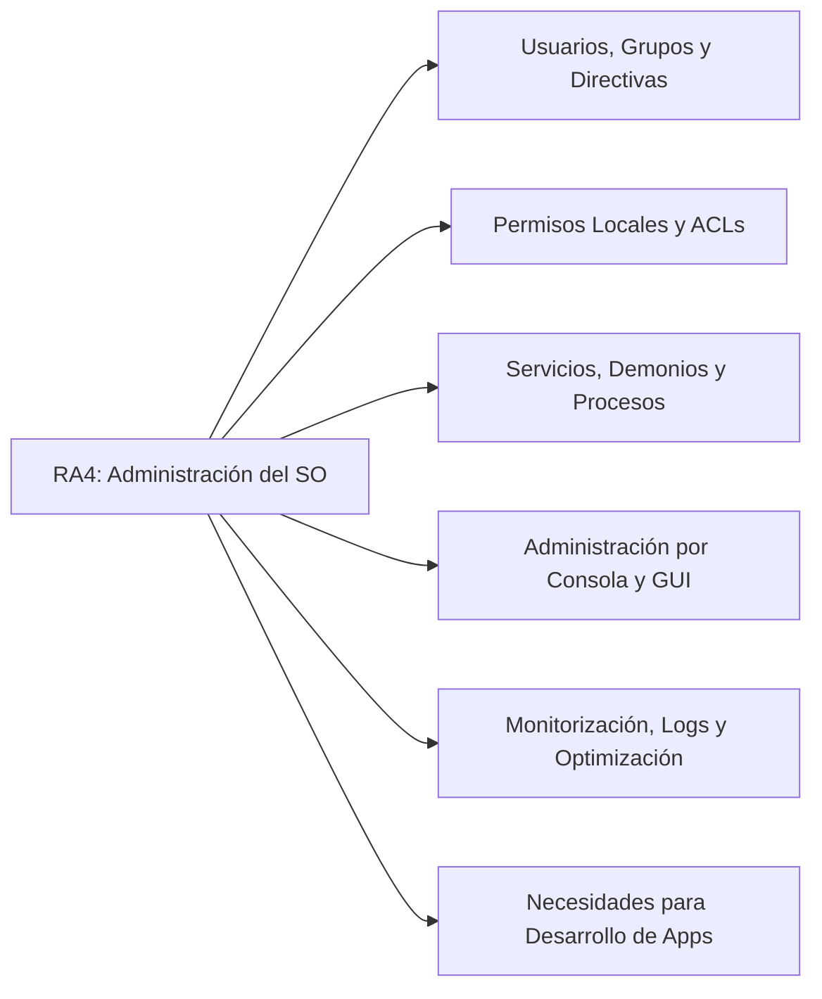

# RA4 · Gestiona sistemas operativos utilizando comandos y herramientas gráficas y evaluando las necesidades del sistema

> **Estado del bloque:** Planificado (comienza tras completar y validar RA3).

---

## Mapa Conceptual del Bloque

---

## Criterios de Evaluación Oficiales

| Código | Criterio de Evaluación | Cobertura |
| :---: | :--- | :---: |
| **RA4.a** | Se han configurado cuentas de usuario locales y grupos. | Pendiente |
| **RA4.b** | Se ha asegurado el acceso al sistema mediante el uso de directivas de cuenta y directivas de contraseñas. | Pendiente |
| **RA4.c** | Se han identificado, arrancado y detenido servicios y procesos. | Pendiente |
| **RA4.d** | Se ha protegido el acceso a la información mediante el uso de permisos locales y listas de control de acceso. | Pendiente |
| **RA4.e** | Se han utilizado comandos para realizar las tareas básicas de configuración y administración del sistema. | Pendiente |
| **RA4.f** | Se ha monitorizado el sistema. | Pendiente |
| **RA4.g** | Se han instalado y evaluado utilidades para el mantenimiento y optimización del sistema. | Pendiente |
| **RA4.h** | Se han evaluado las necesidades del sistema informático en relación con el desarrollo de aplicaciones. | Pendiente |

---

## Contenidos Básicos Asociados (*Configuración de sistemas operativos*)

- Configuración de usuarios y grupos.
- Seguridad de cuentas de usuario.
- Seguridad de contraseñas.
- Acceso a recursos. Permisos locales. Listas de control de acceso.
- Servicios y procesos.
- Comandos de sistemas operativos libres y propietarios.
- Herramientas de monitorización del sistema. Registros y logs.

---

## Conceptos Teóricos

*Bloque planificado tras RA3. Consulta el [índice general de conceptos](../conceptos/index.md).*

## Ejercicios Prácticos Resueltos

*Bloque planificado tras RA3. Consulta el [índice de ejercicios](../ejercicios/index.md).*

## Prácticas Integradoras de Aula

*Bloque planificado tras RA3. Consulta el [índice de prácticas](../practicas/index.md).*
