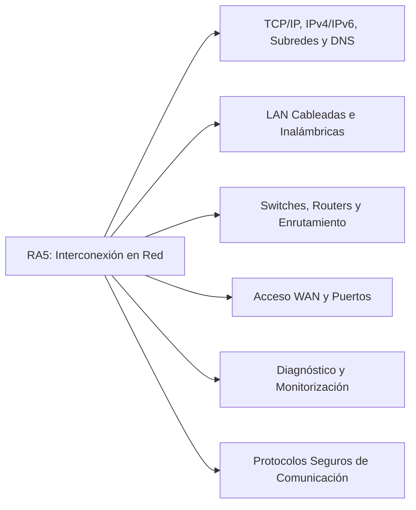

# RA5 · Interconecta sistemas en red configurando dispositivos y protocolos

> **Estado del bloque:** **Completado ✅** · Incluye 6 conceptos desarrollados, 5 diagramas SVG propios, 5 ejercicios resueltos (`e21`–`e25`) y la práctica integradora [`p05`](../practicas/p05-ra5-redes-vlsm-enrutamiento-nat-ssh-enunciado.md).

---

## Mapa Conceptual del Bloque

---

## Criterios de Evaluación Oficiales

| Código | Criterio de Evaluación | Cobertura |
| :---: | :--- | :--- |
| **RA5.a** | Se ha configurado el protocolo TCP/IP. | [Concepto 1](../conceptos/ra5-arquitectura-tcpip-direccionamiento-ipv4-ipv6.md) · [`e21`](../ejercicios/e21-ra5-calculo-subredes-cidr-vlsm-ipv6.md)–[`e22`](../ejercicios/e22-ra5-configuracion-red-netplan-nmcli-powershell.md) · [`p05`](../practicas/p05-ra5-redes-vlsm-enrutamiento-nat-ssh-enunciado.md) |
| **RA5.b** | Se han configurado redes de área local cableadas. | [Conceptos 2–3](../conceptos/ra5-configuracion-red-clientes-netplan-powershell.md) · [`e22`](../ejercicios/e22-ra5-configuracion-red-netplan-nmcli-powershell.md) · [`p05`](../practicas/p05-ra5-redes-vlsm-enrutamiento-nat-ssh-enunciado.md) |
| **RA5.c** | Se han configurado redes de área local inalámbricas. | [Concepto 3](../conceptos/ra5-redes-lan-cableadas-inalambricas-wifi-seguridad.md) · [`e24`](../ejercicios/e24-ra5-auditoria-puertos-diagnostico-red-ss-wireshark.md) · [`p05`](../practicas/p05-ra5-redes-vlsm-enrutamiento-nat-ssh-enunciado.md) |
| **RA5.d** | Se han utilizado dispositivos de interconexión de redes. | [Concepto 4](../conceptos/ra5-interconexion-enrutamiento-nat-acceso-wan.md) · [`e23`](../ejercicios/e23-ra5-router-nat-masquerade-enlaces-wan.md) · [`p05`](../practicas/p05-ra5-redes-vlsm-enrutamiento-nat-ssh-enunciado.md) |
| **RA5.e** | Se ha configurado el acceso a redes de área extensa. | [Concepto 4](../conceptos/ra5-interconexion-enrutamiento-nat-acceso-wan.md) · [`e23`](../ejercicios/e23-ra5-router-nat-masquerade-enlaces-wan.md) · [`p05`](../practicas/p05-ra5-redes-vlsm-enrutamiento-nat-ssh-enunciado.md) |
| **RA5.f** | Se han gestionado puertos de comunicaciones. | [Concepto 5](../conceptos/ra5-gestion-puertos-herramientas-diagnostico-red.md) · [`e24`](../ejercicios/e24-ra5-auditoria-puertos-diagnostico-red-ss-wireshark.md)–[`e25`](../ejercicios/e25-ra5-comunicaciones-seguras-ssh-claves-sftp-tls.md) · [`p05`](../practicas/p05-ra5-redes-vlsm-enrutamiento-nat-ssh-enunciado.md) |
| **RA5.g** | Se ha verificado el funcionamiento de la red mediante el uso de comandos y herramientas básicas. | [Concepto 5](../conceptos/ra5-gestion-puertos-herramientas-diagnostico-red.md) · [`e24`](../ejercicios/e24-ra5-auditoria-puertos-diagnostico-red-ss-wireshark.md) · [`p05`](../practicas/p05-ra5-redes-vlsm-enrutamiento-nat-ssh-enunciado.md) |
| **RA5.h** | Se han aplicado protocolos seguros de comunicaciones. | [Concepto 6](../conceptos/ra5-protocolos-seguros-comunicaciones-tls-ssh-vpn.md) · [`e25`](../ejercicios/e25-ra5-comunicaciones-seguras-ssh-claves-sftp-tls.md) · [`p05`](../practicas/p05-ra5-redes-vlsm-enrutamiento-nat-ssh-enunciado.md) |

---

## Contenidos Básicos Asociados (*Conexión de sistemas en red*)

- Configuración del protocolo TCP/IP en un cliente de red. Direcciones IP. Máscaras de subred. Puertas de enlace. Servidores de nombres de dominio. IPv4. IPv6. Configuración estática. Configuración dinámica automática.
- Ficheros de configuración de red.
- Gestión de puertos.
- Resolución de problemas de conectividad en sistemas operativos en red. Herramientas de diagnóstico.
- Herramientas gráficas y comandos utilizados en sistemas operativos libres y propietarios.
- Monitorización de redes.
- Protocolos TCP/IP.
- Configuración de los adaptadores de red en sistemas operativos libres y propietarios.
- Interconexión de redes: adaptadores de red y dispositivos de interconexión. Enrutamiento.
- Redes cableadas. Tipos y características. Adaptadores de red. Conmutadores, enrutadores, entre otros. Seguridad.
- Redes inalámbricas. Tipos y características. Adaptadores. Dispositivos de interconexión. Seguridad.
- Seguridad de comunicaciones.
- Tecnologías de acceso a redes de área extensa.

---

## Conceptos Teóricos

1. [Arquitectura TCP/IP, Direccionamiento IPv4/IPv6 y Subredes (CIDR/VLSM)](../conceptos/ra5-arquitectura-tcpip-direccionamiento-ipv4-ipv6.md) (`RA5.a`)
2. [Configuración de Red en Clientes: Netplan, NetworkManager, PowerShell y VirtualBox](../conceptos/ra5-configuracion-red-clientes-netplan-powershell.md) (`RA5.a`, `RA5.b`)
3. [Redes LAN Cableadas (`802.3`) e Inalámbricas (`802.11` / Wi-Fi Segura)](../conceptos/ra5-redes-lan-cableadas-inalambricas-wifi-seguridad.md) (`RA5.b`, `RA5.c`)
4. [Dispositivos de Interconexión, VLANs (`802.1Q`), NAT y Acceso WAN](../conceptos/ra5-interconexion-enrutamiento-nat-acceso-wan.md) (`RA5.d`, `RA5.e`)
5. [Gestión de Puertos y Diagnóstico Sistemático de Red (*Bottom-Up*)](../conceptos/ra5-gestion-puertos-herramientas-diagnostico-red.md) (`RA5.f`, `RA5.g`)
6. [Protocolos Seguros de Comunicaciones: TLS, SSH, SFTP y VPN](../conceptos/ra5-protocolos-seguros-comunicaciones-tls-ssh-vpn.md) (`RA5.h`, `RA5.f`)

## Ejercicios Prácticos Resueltos

1. [e21 · Cálculo de Subredes IPv4, Planificación VLSM y Compresión IPv6](../ejercicios/e21-ra5-calculo-subredes-cidr-vlsm-ipv6.md) (`RA5.a` · 2 GB RAM)
2. [e22 · Configuración de Red con Netplan, `nmcli` y PowerShell en Red Interna](../ejercicios/e22-ra5-configuracion-red-netplan-nmcli-powershell.md) (`RA5.a`, `RA5.b` · 6 GB RAM)
3. [e23 · VM Router Linux (`ip_forward`, NAT `MASQUERADE`) y Enrutamiento WAN](../ejercicios/e23-ra5-router-nat-masquerade-enlaces-wan.md) (`RA5.d`, `RA5.e` · 4 GB RAM)
4. [e24 · Auditoría de Puertos (`ss`/`Get-NetTCPConnection`) y Diagnóstico *Bottom-Up*](../ejercicios/e24-ra5-auditoria-puertos-diagnostico-red-ss-wireshark.md) (`RA5.c`, `RA5.f`, `RA5.g` · 6 GB RAM)
5. [e25 · Comunicaciones Seguras: SSH por Claves Ed25519, SFTP y Verificación TLS](../ejercicios/e25-ra5-comunicaciones-seguras-ssh-claves-sftp-tls.md) (`RA5.f`, `RA5.h` · 6 GB RAM)

## Prácticas Integradoras de Aula

- **[p05 · Diseño de Subredes VLSM, Router NAT, Diagnóstico de Puertos y Comunicaciones Seguras](../practicas/p05-ra5-redes-vlsm-enrutamiento-nat-ssh-enunciado.md)** (`DAM-Router-Gate` 1 GB + `DAM-Net-Ubuntu` 2 GB + `DAM-Net-Win10` 4 GB = **7 GB** sobre MAX 16 GB)
