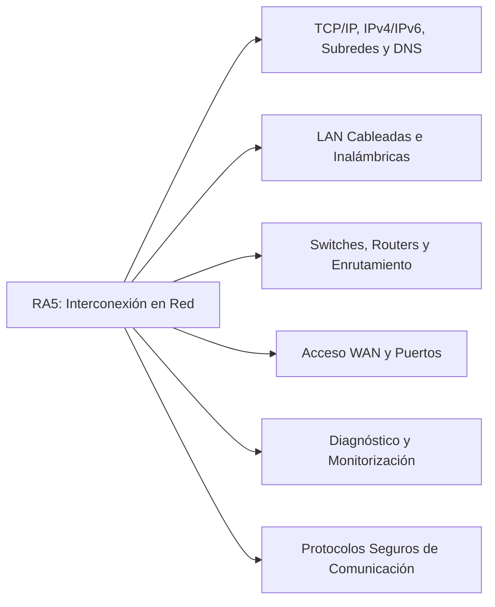

# RA5 · Interconecta sistemas en red configurando dispositivos y protocolos

> **Estado del bloque:** Planificado (comienza tras completar y validar RA4).

---

## Mapa Conceptual del Bloque

---

## Criterios de Evaluación Oficiales

| Código | Criterio de Evaluación | Cobertura |
| :---: | :--- | :---: |
| **RA5.a** | Se ha configurado el protocolo TCP/IP. | Pendiente |
| **RA5.b** | Se han configurado redes de área local cableadas. | Pendiente |
| **RA5.c** | Se han configurado redes de área local inalámbricas. | Pendiente |
| **RA5.d** | Se han utilizado dispositivos de interconexión de redes. | Pendiente |
| **RA5.e** | Se ha configurado el acceso a redes de área extensa. | Pendiente |
| **RA5.f** | Se han gestionado puertos de comunicaciones. | Pendiente |
| **RA5.g** | Se ha verificado el funcionamiento de la red mediante el uso de comandos y herramientas básicas. | Pendiente |
| **RA5.h** | Se han aplicado protocolos seguros de comunicaciones. | Pendiente |

---

## Contenidos Básicos Asociados (*Conexión de sistemas en red*)

- Configuración del protocolo TCP/IP en un cliente de red. Direcciones IP. Máscaras de subred. Puertas de enlace. Servidores de nombres de dominio. IPv4. IPv6. Configuración estática. Configuración dinámica automática.
- Ficheros de configuración de red.
- Gestión de puertos.
- Resolución de problemas de conectividad en sistemas operativos en red. Herramientas de diagnóstico.
- Herramientas gráficas y comandos utilizados en sistemas operativos libres y propietarios.
- Monitorización de redes.
- Protocolos TCP/IP.
- Configuración de los adaptadores de red en sistemas operativos libres y propietarios.
- Interconexión de redes: adaptadores de red y dispositivos de interconexión. Enrutamiento.
- Redes cableadas. Tipos y características. Adaptadores de red. Conmutadores, enrutadores, entre otros. Seguridad.
- Redes inalámbricas. Tipos y características. Adaptadores. Dispositivos de interconexión. Seguridad.
- Seguridad de comunicaciones.
- Tecnologías de acceso a redes de área extensa.

---

## Conceptos Teóricos

*Bloque planificado tras RA4. Consulta el [índice general de conceptos](../conceptos/index.md).*

## Ejercicios Prácticos Resueltos

*Bloque planificado tras RA4. Consulta el [índice de ejercicios](../ejercicios/index.md).*

## Prácticas Integradoras de Aula

*Bloque planificado tras RA4. Consulta el [índice de prácticas](../practicas/index.md).*
