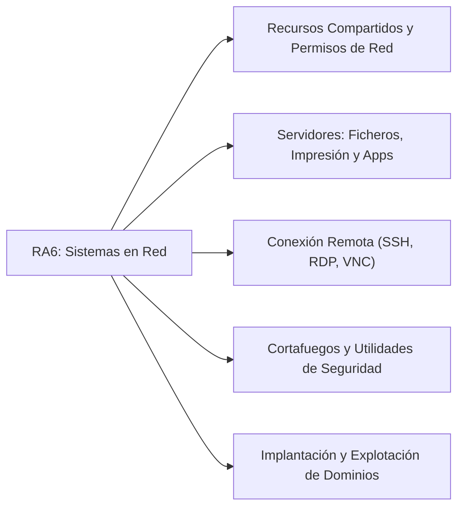

# RA6 · Opera sistemas en red gestionando sus recursos e identificando las restricciones de seguridad existentes

> **Estado del bloque:** Planificado (comienza tras completar y validar RA5).

---

## Mapa Conceptual del Bloque

---

## Criterios de Evaluación Oficiales

| Código | Criterio de Evaluación | Cobertura |
| :---: | :--- | :---: |
| **RA6.a** | Se ha configurado el acceso a recursos locales y recursos de red. | Pendiente |
| **RA6.b** | Se han identificado y configurado los derechos de usuario y directivas de seguridad. | Pendiente |
| **RA6.c** | Se han explotado servidores de ficheros, servidores de impresión y servidores de aplicaciones. | Pendiente |
| **RA6.d** | Se ha accedido a los servidores utilizando técnicas de conexión remota. | Pendiente |
| **RA6.e** | Se ha evaluado la necesidad de proteger los recursos y el sistema. | Pendiente |
| **RA6.f** | Se han instalado y evaluado utilidades de seguridad básica. | Pendiente |
| **RA6.g** | Se han configurado y explotado dominios. | Pendiente |

---

## Contenidos Básicos Asociados (*Gestión de recursos en una red*)

- Permisos y derechos. Permisos de red. Permisos locales. Herencia. Listas de control de acceso.
- Configuración de recursos compartidos. Permisos de acceso y directivas de seguridad.
- Requisitos de seguridad del sistema y de los datos.
- Servidores de ficheros.
- Servidores de impresión.
- Servidores de aplicaciones.
- Técnicas de conexión remota.
- Cortafuegos.
- Implantación y explotación de dominios.

---

## Conceptos Teóricos

*Bloque planificado tras RA5. Consulta el [índice general de conceptos](../conceptos/index.md).*

## Ejercicios Prácticos Resueltos

*Bloque planificado tras RA5. Consulta el [índice de ejercicios](../ejercicios/index.md).*

## Prácticas Integradoras de Aula

*Bloque planificado tras RA5. Consulta el [índice de prácticas](../practicas/index.md).*
