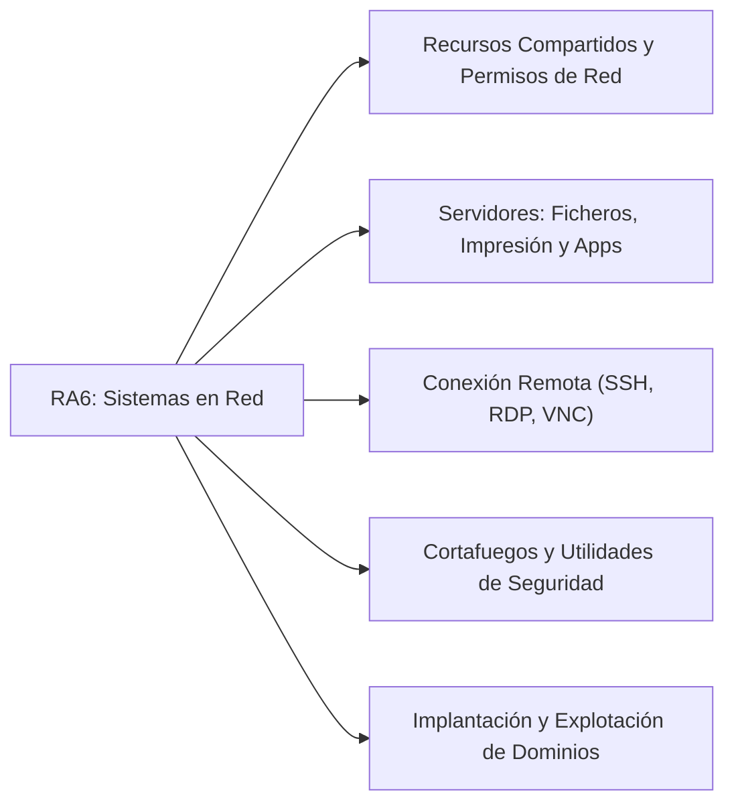

# RA6 · Opera sistemas en red gestionando sus recursos e identificando las restricciones de seguridad existentes

> **Estado del bloque:** **Completado ✅** · Incluye 6 conceptos desarrollados, 5 diagramas SVG propios, 5 ejercicios resueltos (`e26`–`e30`) y la práctica integradora [`p06`](../practicas/p06-ra6-recursos-samba-acceso-remoto-cortafuegos-dominio-enunciado.md).

---

## Mapa Conceptual del Bloque

---

## Criterios de Evaluación Oficiales

| Código | Criterio de Evaluación | Cobertura |
| :---: | :--- | :--- |
| **RA6.a** | Se ha configurado el acceso a recursos locales y recursos de red. | [Concepto 1](../conceptos/ra6-recursos-compartidos-permisos-red-samba-smb.md) · [`e26`](../ejercicios/e26-ra6-comparticion-samba-smb-permisos-efectivos.md) · [`p06`](../practicas/p06-ra6-recursos-samba-acceso-remoto-cortafuegos-dominio-enunciado.md) |
| **RA6.b** | Se han identificado y configurado los derechos de usuario y directivas de seguridad. | [Conceptos 1, 5, 6](../conceptos/ra6-recursos-compartidos-permisos-red-samba-smb.md) · [`e26`](../ejercicios/e26-ra6-comparticion-samba-smb-permisos-efectivos.md) · [`e30`](../ejercicios/e30-ra6-dominio-samba-ad-dc-unidades-organizativas.md) · [`p06`](../practicas/p06-ra6-recursos-samba-acceso-remoto-cortafuegos-dominio-enunciado.md) |
| **RA6.c** | Se han explotado servidores de ficheros, servidores de impresión y servidores de aplicaciones. | [Concepto 2](../conceptos/ra6-servidores-ficheros-impresion-aplicaciones.md) · [`e26`](../ejercicios/e26-ra6-comparticion-samba-smb-permisos-efectivos.md)–[`e27`](../ejercicios/e27-ra6-servidor-nfs-impresion-cups-tomcat.md) · [`p06`](../practicas/p06-ra6-recursos-samba-acceso-remoto-cortafuegos-dominio-enunciado.md) |
| **RA6.d** | Se ha accedido a los servidores utilizando técnicas de conexión remota. | [Concepto 3](../conceptos/ra6-conexion-administracion-remota-ssh-rdp-vnc.md) · [`e28`](../ejercicios/e28-ra6-escritorio-remoto-rdp-remmina-ssh-tunnel.md) · [`p06`](../practicas/p06-ra6-recursos-samba-acceso-remoto-cortafuegos-dominio-enunciado.md) |
| **RA6.e** | Se ha evaluado la necesidad de proteger los recursos y el sistema. | [Conceptos 4–5](../conceptos/ra6-seguridad-recursos-cortafuegos-ufw-defender.md) · [`e29`](../ejercicios/e29-ra6-cortafuegos-ufw-windows-defender-fail2ban.md) · [`p06`](../practicas/p06-ra6-recursos-samba-acceso-remoto-cortafuegos-dominio-enunciado.md) |
| **RA6.f** | Se han instalado y evaluado utilidades de seguridad básica. | [Conceptos 4–5](../conceptos/ra6-utilidades-seguridad-auditoria-endurecimiento.md) · [`e29`](../ejercicios/e29-ra6-cortafuegos-ufw-windows-defender-fail2ban.md) · [`p06`](../practicas/p06-ra6-recursos-samba-acceso-remoto-cortafuegos-dominio-enunciado.md) |
| **RA6.g** | Se han configurado y explotado dominios. | [Concepto 6](../conceptos/ra6-implantacion-explotacion-dominios-ad-samba-dc.md) · [`e30`](../ejercicios/e30-ra6-dominio-samba-ad-dc-unidades-organizativas.md) · [`p06`](../practicas/p06-ra6-recursos-samba-acceso-remoto-cortafuegos-dominio-enunciado.md) |

---

## Contenidos Básicos Asociados (*Gestión de recursos en una red*)

- Permisos y derechos. Permisos de red. Permisos locales. Herencia. Listas de control de acceso.
- Configuración de recursos compartidos. Permisos de acceso y directivas de seguridad.
- Requisitos de seguridad del sistema y de los datos.
- Servidores de ficheros.
- Servidores de impresión.
- Servidores de aplicaciones.
- Técnicas de conexión remota.
- Cortafuegos.
- Implantación y explotación de dominios.

---

## Conceptos Teóricos

1. [Recursos Compartidos en Red, Permisos Efectivos y Samba/SMB](../conceptos/ra6-recursos-compartidos-permisos-red-samba-smb.md) (`RA6.a`, `RA6.b`)
2. [Servidores de Ficheros (SMB/NFS), Impresión (CUPS) y Aplicaciones](../conceptos/ra6-servidores-ficheros-impresion-aplicaciones.md) (`RA6.c`)
3. [Conexión y Administración Remota Segura (SSH, RDP, xrdp y VNC)](../conceptos/ra6-conexion-administracion-remota-ssh-rdp-vnc.md) (`RA6.d`)
4. [Seguridad de Recursos y Cortafuegos (`ufw`, `nftables` y Defender Firewall)](../conceptos/ra6-seguridad-recursos-cortafuegos-ufw-defender.md) (`RA6.e`, `RA6.f`)
5. [Utilidades de Seguridad Básica, Defensa Activa (`fail2ban`) y Auditoría](../conceptos/ra6-utilidades-seguridad-auditoria-endurecimiento.md) (`RA6.b`, `RA6.e`, `RA6.f`)
6. [Implantación y Explotación de Dominios (Active Directory, Samba AD DC, LDAP y GPO)](../conceptos/ra6-implantacion-explotacion-dominios-ad-samba-dc.md) (`RA6.g`, `RA6.b`)

## Ejercicios Prácticos Resueltos

1. [e26 · Compartición de Recursos con Samba (`SMB3`) y Permisos Efectivos](../ejercicios/e26-ra6-comparticion-samba-smb-permisos-efectivos.md) (`RA6.a`, `RA6.b`, `RA6.c` · 6 GB RAM)
2. [e27 · Despliegue NFSv4 (`root_squash`), Impresión CUPS y Proxy Nginx](../ejercicios/e27-ra6-servidor-nfs-impresion-cups-tomcat.md) (`RA6.c` · 4 GB RAM)
3. [e28 · Conexión Remota Segura: RDP (NLA), Remmina y Túnel Local SSH](../ejercicios/e28-ra6-escritorio-remoto-rdp-remmina-ssh-tunnel.md) (`RA6.d` · 6 GB RAM)
4. [e29 · Cortafuegos (`ufw`/Defender), `fail2ban` y Auditoría de Seguridad](../ejercicios/e29-ra6-cortafuegos-ufw-windows-defender-fail2ban.md) (`RA6.e`, `RA6.f` · 6 GB RAM)
5. [e30 · Dominio Samba AD DC, Unidades Organizativas (`OU`) y Unión Windows 10](../ejercicios/e30-ra6-dominio-samba-ad-dc-unidades-organizativas.md) (`RA6.b`, `RA6.g` · 6 GB RAM)

## Prácticas Integradoras de Aula

- **[p06 · Servidores Compartidos, Acceso Remoto, Cortafuegos y Dominio Samba AD](../practicas/p06-ra6-recursos-samba-acceso-remoto-cortafuegos-dominio-enunciado.md)** (`DAM-Corp-Srv` 2 GB + `DAM-Corp-Win10` 4 GB = **6 GB** sobre MAX 16 GB)
